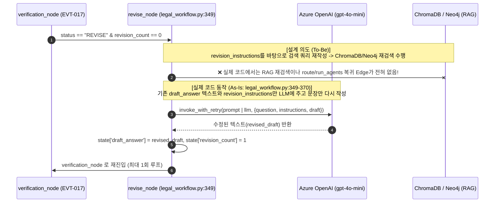

# EVT-018: 검색 전략 변경 및 재검색 (Adaptive Re-Retrieval — 미구현)

## 1. 이벤트 메타데이터

| 항목 | 내용 |
|---|---|
| **이벤트 ID** | `EVT-018` |
| **이벤트 명칭** | 검증 실패(`REVISE`) 시 검색 전략 변경 및 RAG 재검색 루프 |
| **구현 상태** | **MISSING (미구현 — 단순 텍스트 재작성만 존재)** |
| **발생 트리거** | `EVT-017` `verification_condition`이 `"REVISE"`를 반환하고 `revision_count < 1`일 때 |
| **백엔드 진입점** | [`workflows/legal_workflow.py:349-370, 444-456`](file:///c:/myprjs/ai-legal-helper/backend/src/ai_legal_helper/workflows/legal_workflow.py#L349-L370) (`revise_node`) |
| **연관 저장소** | 없음 (ChromaDB 및 Neo4j 재검색 호출 없음) |

---

## 2. 설계 목표 vs 실제 구현(As-Is) 비교 시퀀스 다이어그램



---

## 3. 코드 수준 감사 확인 내역

1. **LangGraph Edge 구조 확인 ([`legal_workflow.py:444-456`](file:///c:/myprjs/ai-legal-helper/backend/src/ai_legal_helper/workflows/legal_workflow.py#L444-L456))**:
   ```python
   workflow.add_conditional_edges(
       "verification",
       verification_condition,
       {
           "finalize": "finalize",
           "revise": "revise",
           "insufficient": "insufficient",
       }
   )
   workflow.add_edge("revise", "verification")
   ```
   - `verification`에서 `route`, `plan`, 또는 `run_agents`로 되돌아가는 Edge가 존재하지 않는다.
2. **`revise_node` 내부 구현 확인 ([`legal_workflow.py:349-370`](file:///c:/myprjs/ai-legal-helper/backend/src/ai_legal_helper/workflows/legal_workflow.py#L349-L370))**:
   - `revise_node`는 `RetrievalService`, `rewrite_query`, `GraphRAGRetriever`를 일절 호출하지 않는다.
   - 단지 `"다음 검증 지침에 따라 법률 답변 초안을 수정하세요. 사실관계를 날조하지 말고, 지적된 문제점을 보완하세요."`라는 프롬프트로 기존 `draft_answer`를 재작성할 뿐이다.
3. **결론**:
   - 검색 결과가 불충분할 때 검색어 전략을 바꾸어 다시 검색하는 **Adaptive Retrieval(`EVT-018`)은 구현되어 있지 않으며**, 단순 1회 텍스트 교정(`revise_node`)만 구현되어 있다.

