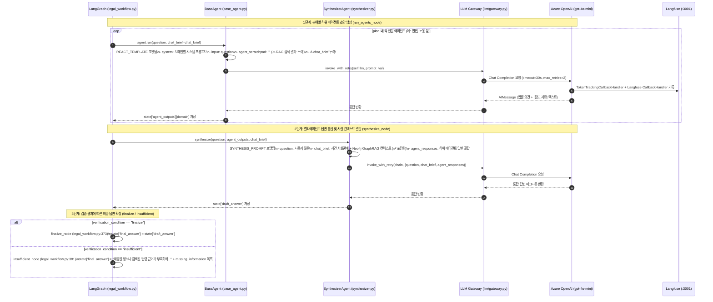

# EVT-019: LLM 답변 생성 (LLM Answer Generation & Synthesis)

## 1. 이벤트 메타데이터

| 항목 | 내용 |
|---|---|
| **이벤트 ID** | `EVT-019` |
| **이벤트 명칭** | 전문 에이전트 답변 생성, 멀티에이전트 답변 통합(`Synthesizer`) 및 최종 답변 확정 |
| **구현 상태** | **PARTIAL** (하위 에이전트 → 통합 에이전트 → 최종 확정/보류 파이프라인 동작, 단 `BaseAgent`에 법률 RAG 본문과 `chat_brief`가 누락되어 사전학습 지식 의존) |
| **발생 트리거** | `legal_workflow.py`의 `run_agents` → `synthesize` → (`finalize` \| `revise` \| `insufficient`) 노드 실행 |
| **백엔드 진입점** | [`agents/legal/base_agent.py:143-189`](file:///c:/myprjs/ai-legal-helper/backend/src/ai_legal_helper/agents/legal/base_agent.py#L143-L189), [`agents/synthesizer.py:38-95`](file:///c:/myprjs/ai-legal-helper/backend/src/ai_legal_helper/agents/synthesizer.py#L38-L95), [`workflows/legal_workflow.py:306-394`](file:///c:/myprjs/ai-legal-helper/backend/src/ai_legal_helper/workflows/legal_workflow.py#L306-L394) |
| **연관 외부 시스템** | Azure OpenAI (`gpt-4o-mini`) via [`llm/gateway.py`](file:///c:/myprjs/ai-legal-helper/backend/src/ai_legal_helper/llm/gateway.py) |

---

## 2. End-to-End Sequence Diagram

---

## 3. 13단계 실행 경로 상세 추적

1. **이벤트 발생 화면 및 컴포넌트**: 백그라운드 법률 상담 실행 중 내부 답변 생성 단계.
2. **이벤트 핸들러**: `run_agents_node`(`legal_workflow.py:272`), `synthesize_node`(`306행`), `finalize_node`(`373행`), `insufficient_node`(`381행`).
3. **호출되는 API와 HTTP Method**: 백그라운드 내부 실행.
4. **FastAPI Router**: `api/routes/consultation.py`.
5. **Service / Repository 함수**: `BaseAgent.run()`, `SynthesizerAgent.synthesize()`, `invoke_with_retry()`.
6. **DB 읽기·쓰기**: 메모리 상태(`agent_outputs`, `draft_answer`, `final_answer`) 갱신.
7. **AI Agent 또는 RAG 호출**:
   - `BaseAgent`는 도메인별 시스템 프롬프트(`civil_agent.py` 등)와 `REACT_TEMPLATE`을 결합하여 호출한다.
   - `SynthesizerAgent`는 `agent_outputs`가 1개일 때에도 일관된 톤앤매너와 `chat_brief` 반영을 위해 항상 LLM 통합 프롬프트를 실행한다(`synthesizer.py:55`).
8. **외부 LLM·도구 호출**: `llm/gateway.py:get_llm()`을 통해 Azure OpenAI(`gpt-4o-mini`, `temperature=0.0` 또는 `0.1`) 호출.
9. **응답 JSON 구조**: `state["final_answer"]` (Markdown 형식 문자열).
10. **프런트엔드 상태 변경**: 폴링 완료 후 `result.answer`에 반영.
11. **화면 출력**: `ChatSection.tsx`에서 `whitespace-pre-wrap` 스타일로 답변 본문 출력.
12. **Langfuse 기록**: `legal_specialist_agent`, `synthesizer_agent`, `finalize` / `insufficient` Span 및 각 LLM 호출의 Generation(토큰 사용량 및 추정 비용 USD 포함) 기록.
13. **실패·예외 처리 경로**:
    - `SynthesizerAgent`에서 LLM 호출이 재시도 후에도 실패하면 `synthesizer.py:72`에서 하위 에이전트들의 원본 출력(`formatted_inputs`)을 그대로 이어 붙여 반환함으로써 전체 상담이 빈 답변으로 무너지는 것을 방지한다.

