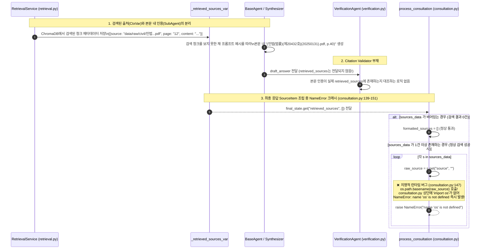

# EVT-020: 법률 근거 및 인용 검증 (Legal Grounding & Citation Validation)

## 1. 이벤트 메타데이터

| 항목 | 내용 |
|---|---|
| **이벤트 ID** | `EVT-020` |
| **이벤트 명칭** | 법률 근거 출처 수집, 인용 포맷팅 및 검증 |
| **구현 상태** | **PARTIAL (치명적 런타임 `NameError` 및 Citation Validator 미구현)** |
| **발생 트리거** | `run_agents_node` 출처 수집(`get_retrieved_sources`) → `verification_node` → `process_consultation`의 `SourceItem` 변환(`consultation.py:139-151`) |
| **백엔드 진입점** | [`rag/retrieval.py:16-30, 173-180`](file:///c:/myprjs/ai-legal-helper/backend/src/ai_legal_helper/rag/retrieval.py#L16-L30), [`workflows/legal_workflow.py:296`](file:///c:/myprjs/ai-legal-helper/backend/src/ai_legal_helper/workflows/legal_workflow.py#L296), [`api/routes/consultation.py:139-151, 214-224`](file:///c:/myprjs/ai-legal-helper/backend/src/ai_legal_helper/api/routes/consultation.py#L139-L151) |
| **연관 저장소** | ContextVar (`_retrieved_sources_var`), PostgreSQL (`consultations.sources`) |

---

## 2. End-to-End Sequence Diagram (출처 분리 현상 및 `NameError` 발생 경로)



---

## 3. 13단계 실행 경로 상세 추적

1. **이벤트 발생 화면 및 컴포넌트**: 법률 상담 백그라운드 파이프라인 내부 출처 처리 단계.
2. **이벤트 핸들러**: `RetrievalService.retrieve`(`retrieval.py:173`), `run_agents_node`(`legal_workflow.py:296`), `process_consultation`(`consultation.py:139`).
3. **호출되는 API와 HTTP Method**: 백그라운드 내부 실행 및 `GET /api/v1/consultations/{request_id}` 조회 시 실행.
4. **FastAPI Router**: `api/routes/consultation.py`.
5. **Service / Repository 함수**: `clear_retrieved_sources()`, `get_retrieved_sources()`.
6. **DB 읽기·쓰기**: `ConsultationRecord.sources` JSON 컬럼에 `[{"title": ..., "source": ..., "page": ..., "content_snippet": ...}]` 저장 시도.
7. **AI Agent 또는 RAG 호출**: `RetrievalService` 및 `VerificationAgent`.
8. **외부 LLM·도구 호출**: 없음.
9. **응답 JSON 구조** (`SourceItem` — [`api/schemas/consultation.py:12-19`](file:///c:/myprjs/ai-legal-helper/backend/src/ai_legal_helper/api/schemas/consultation.py#L12-L19)):
   ```json
   {
     "title": "민법(법률)(제20432호)(20250131).pdf (p.40)",
     "source": "민법(법률)(제20432호)(20250131).pdf",
     "page": "40",
     "content_snippet": "제618조(임대차의 의의)...",
     "url": null
   }
   ```
10. **프런트엔드 상태 변경**: `result.sources` 배열 저장.
11. **화면 출력**: `ChatSection.tsx` 하단 `📚 참고 법령 및 판례 출처` 섹션에 파란색 배지(`src.title`) 렌더링.
12. **Langfuse 기록**: 별도 Citation Validation Span 없음.
13. **실패·예외 처리 및 2대 결함 요약**:
    - **결함 1 (`import os` 누락으로 인한 `NameError`)**: [`consultation.py:147`](file:///c:/myprjs/ai-legal-helper/backend/src/ai_legal_helper/api/routes/consultation.py#L147)과 [`consultation.py:217, 221`](file:///c:/myprjs/ai-legal-helper/backend/src/ai_legal_helper/api/routes/consultation.py#L217)에서 `os.path.basename`을 호출하지만 파일 전체에 `import os`가 없다.
    - **결함 2 (허위 인용 필터링 부재)**: LLM이 본문 내에 작성한 `(파일명.pdf, p.XX)` 인용이 실제 `_retrieved_sources_var`에 있는 파일명·페이지인지 대조하는 Citation Validator가 구현되어 있지 않다.

