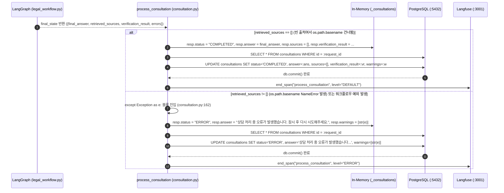

# EVT-021: 분석 결과 저장 (Consultation Result Persistence)

## 1. 이벤트 메타데이터

| 항목 | 내용 |
|---|---|
| **이벤트 ID** | `EVT-021` |
| **이벤트 명칭** | 법률 상담 분석 결과의 인메모리 및 PostgreSQL 영속화 |
| **구현 상태** | **PARTIAL** (영속화 로직은 구현되어 있으나, `EVT-020`의 `os.path.basename` `NameError` 발생 시 예외 블록으로 빠져 `status="ERROR"`가 저장됨) |
| **발생 트리거** | `process_consultation` 백그라운드 태스크에서 `graph.invoke()` 완료 직후 또는 예외 발생 시 |
| **백엔드 진입점** | [`api/routes/consultation.py:137-196`](file:///c:/myprjs/ai-legal-helper/backend/src/ai_legal_helper/api/routes/consultation.py#L137-L196) (`process_consultation` 후반부) |
| **연관 저장소** | Process Memory (`_consultations`), PostgreSQL (`consultations`) |

---

## 2. End-to-End Sequence Diagram

---

## 3. 13단계 실행 경로 상세 추적

1. **이벤트 발생 화면 및 컴포넌트**: 백그라운드 태스크 종료 단계.
2. **이벤트 핸들러**: [`api/routes/consultation.py:137-196`](file:///c:/myprjs/ai-legal-helper/backend/src/ai_legal_helper/api/routes/consultation.py#L137-L196).
3. **호출되는 API와 HTTP Method**: 백그라운드 내부 실행.
4. **FastAPI Router**: `api/routes/consultation.py`.
5. **Service / Repository 함수**: `process_consultation` 내부 SQLAlchemy 세션(`SessionLocal()`) 처리.
6. **DB 읽기·쓰기**:
   - 인메모리 `_consultations[request_id]` 객체의 `status`, `answer`, `sources`, `verification_result`, `warnings` 속성 갱신.
   - PostgreSQL `consultations` 테이블에서 `id == request_id` 레코드를 조회하여 동일 필드들을 `UPDATE` 후 `db.commit()`.
7. **AI Agent 또는 RAG 호출**: 없음 (이미 완료된 `final_state` 저장).
8. **외부 LLM·도구 호출**: 없음.
9. **응답 JSON 구조**: 저장되는 `ConsultationRecord` 스키마 ([`models.py:456-484`](file:///c:/myprjs/ai-legal-helper/backend/src/ai_legal_helper/database/models.py#L456-L484)):
   - `id`, `case_id`, `question`, `answer`, `status` (`COMPLETED` | `ERROR`), `sources` (JSON), `verification_result` (JSON), `warnings` (JSON), `created_at`, `updated_at`.
10. **프런트엔드 상태 변경**: 다음 2초 주기 폴링(`EVT-012`)에서 변경된 상태(`COMPLETED` 또는 `ERROR`)를 감지하여 폴링 종료.
11. **화면 출력**: [`EVT-022`](EVT-022.md)로 이어짐.
12. **Langfuse 기록**: `@trace` 데코레이터가 `process_consultation` Span을 종료하며, 토큰 사용량 요약 로그(`TokenTracker.log_summary()`)를 콘솔/파일에 기록(`consultation.py:194`).
13. **실패·예외 처리 경로**:
    - DB `UPDATE` 중 예외가 발생하면 `consultation.py:179, 191`에서 `logger.error("상담 결과 DB 업데이트 실패")`만 남기고 인메모리 `_consultations` 값은 유지한다.

