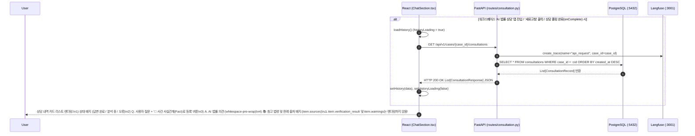

# EVT-022: 분석 결과 화면 표시 (Consultation Result UI Rendering)

## 1. 이벤트 메타데이터

| 항목 | 내용 |
|---|---|
| **이벤트 ID** | `EVT-022` |
| **이벤트 명칭** | 법률 상담 결과 및 상담 이력 화면 표시 |
| **구현 상태** | **PARTIAL** (질문·답변·출처 배지 및 사실관계 등록 버튼 렌더링 완료, 단 `verification_result`와 `warnings` 필드는 UI에서 누락) |
| **발생 화면 / 컴포넌트** | [`frontend/src/components/ChatSection.tsx:16-34, 111-235`](file:///c:/myprjs/ai-legal-helper/frontend/src/components/ChatSection.tsx#L111-L235), [`frontend/src/hooks/useConsultation.ts`](file:///c:/myprjs/ai-legal-helper/frontend/src/hooks/useConsultation.ts) |
| **호출 API** | `GET /api/v1/cases/{case_id}/consultations` 및 폴링 `GET /api/v1/consultations/{request_id}` |
| **백엔드 진입점** | [`api/routes/consultation.py:258-291`](file:///c:/myprjs/ai-legal-helper/backend/src/ai_legal_helper/api/routes/consultation.py#L258-L291) (`list_case_consultations`) |
| **연관 저장소** | PostgreSQL (`consultations`) |

---

## 2. End-to-End Sequence Diagram

---

## 3. 13단계 실행 경로 상세 추적

1. **이벤트 발생 화면 및 컴포넌트**: 워크스페이스 `chat` 탭의 [`ChatSection.tsx`](file:///c:/myprjs/ai-legal-helper/frontend/src/components/ChatSection.tsx).
2. **이벤트 핸들러**: `loadHistory()`(`ChatSection.tsx:16-28`) → `getCaseConsultations(caseId)`([`api/consultationClient.ts:29-37`](file:///c:/myprjs/ai-legal-helper/frontend/src/api/consultationClient.ts#L29-L37)).
3. **호출되는 API와 HTTP Method**: `GET /api/v1/cases/{case_id}/consultations`.
4. **FastAPI Router**: [`api/routes/consultation.py:258`](file:///c:/myprjs/ai-legal-helper/backend/src/ai_legal_helper/api/routes/consultation.py#L258) `list_case_consultations()`.
5. **Service / Repository 함수**: 라우터 내부에서 `ConsultationRecord` 직접 조회 후 `SourceItem` 리스트로 매핑.
   - *(참고: `list_case_consultations`의 276행은 `get_consultation`과 달리 `os.path.basename`을 호출하지 않고 `s.get("source")`를 그대로 사용하여 `NameError`가 발생하지 않는다!)*
6. **DB 읽기·쓰기**: PostgreSQL `consultations` 테이블 `SELECT` (Read-Only).
7. **AI Agent 또는 RAG 호출**: 없음.
8. **외부 LLM·도구 호출**: 없음.
9. **응답 JSON 구조**: `List[ConsultationResponse]` 배열.
10. **프런트엔드 상태 변경**: `history` 상태 배열 갱신.
11. **화면 출력**:
    - 각 상담 카드의 질문(`item.question`), 상태 배지(`COMPLETED` → 초록색 `답변 완료`, `ERROR` → 빨간색 `오류`), 답변(`item.answer`), 출처 배지(`item.sources`) 출력.
    - 질문 우측의 `📌 사건 사실관계(Fact)로 등록` 버튼(`ChatSection.tsx:202`) 클릭 시 `handleRegisterAsFact(item.question)`이 호출되어 [`EVT-032`](EVT-032.md)를 트리거한다.
12. **Langfuse 기록**: `api_request` Root Trace 기록.
13. **실패·예외 처리 및 UI 누락 사항**:
    - 백엔드 응답 스키마에는 `verification_result`와 `warnings`가 포함되어 있으나, `ChatSection.tsx`에는 해당 필드를 표시하는 JSX가 없다.

