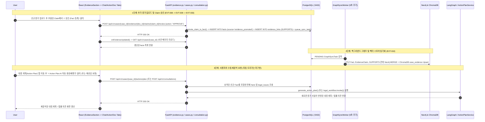

# EVT-023: 새로운 증거 추가 후 재분석 (Re-Analysis After New Evidence)

## 1. 이벤트 메타데이터

| 항목 | 내용 |
|---|---|
| **이벤트 ID** | `EVT-023` |
| **이벤트 명칭** | 새로운 증거 추가·검토 승인 후 사건 메모리 갱신 및 재분석 |
| **구현 상태** | **PARTIAL** (증거 업로드 → Claim 승인 → Fact 승격 → 그래프/벡터 동기화 → 수동 재상담/재계획 흐름은 동작하나, 증거 승인 시 기존 상담/대응계획을 자동으로 재실행하는 이벤트 트리거는 없음) |
| **발생 화면 / 컴포넌트** | [`EvidenceSection.tsx`](file:///c:/myprjs/ai-legal-helper/frontend/src/components/EvidenceSection.tsx) → [`ChatSection.tsx`](file:///c:/myprjs/ai-legal-helper/frontend/src/components/ChatSection.tsx) / [`ActionPlanSection.tsx`](file:///c:/myprjs/ai-legal-helper/frontend/src/components/ActionPlanSection.tsx) / [`DocumentSection.tsx`](file:///c:/myprjs/ai-legal-helper/frontend/src/components/DocumentSection.tsx) |
| **호출 API** | `POST .../evidence` (`EVT-008`) → `POST .../claims/{id}/review` (`EVT-033`) → `POST /api/v1/consultations` (`EVT-012`) 또는 `POST /api/v1/cases/{id}/actions/plan` (`EVT-025`) |
| **연관 저장소** | PostgreSQL (`facts`, `evidence_links`, `graph_sync_tasks`), Neo4j, ChromaDB |

---

## 2. End-to-End Sequence Diagram

---

## 3. 13단계 실행 경로 상세 추적

1. **이벤트 발생 화면 및 컴포넌트**: `EvidenceSection.tsx`에서 Claim 승인 후 `CaseWorkspace.tsx`의 `onEvidenceUpdated={() => loadCase(caseId)}` 콜백(`CaseWorkspace.tsx:260`) 실행, 이어서 `ChatSection.tsx` 또는 `ActionPlanSection.tsx`에서 재분석 실행.
2. **이벤트 핸들러**: `handleApprove`(`EvidenceSection.tsx:354`) → `loadCase`(`CaseWorkspace.tsx:136`) → `handleGenerate`(`ActionPlanSection.tsx:33`) 또는 `handleSubmit`(`ChatSection.tsx:36`).
3. **호출되는 API와 HTTP Method**: `POST .../review` → `GET /api/v1/cases/{case_id}` → `POST /api/v1/cases/{case_id}/actions/plan` (또는 `POST /api/v1/consultations`).
4. **FastAPI Router**: `evidence.py`, `cases.py`, `consultation.py`.
5. **Service / Repository 함수**: `promote_claim_to_fact()`, `sync_case_to_graph()`, `generate_action_plan()`.
6. **DB 읽기·쓰기**: 승인된 Claim이 `facts` 테이블에 `source="evidence_promoted"`, `status="verified"`로 추가되므로 이후 모든 분석 API(`consultation.py:98`, `action_service.py:67`, `document_workflow.py:64`)가 자동으로 신규 `Fact`를 조회하여 프롬프트에 포함한다.
7. **AI Agent 또는 RAG 호출**: 재실행된 워크플로우가 갱신된 `Fact` 목록과 Neo4j 서브그래프(`SUPPORTS` 엣지 포함)를 기반으로 추론 수행.
8. **외부 LLM·도구 호출**: Azure OpenAI 호출.
9. **응답 JSON 구조**: 각 분석 API의 응답 스키마(`ActionPlanListSchema`, `ConsultationResponse`, `LegalDocumentResponse`).
10. **프런트엔드 상태 변경**: `activeCase` 상태 갱신 후 각 탭의 분석 결과 상태 갱신.
11. **화면 출력**: 추가된 증거 사실이 반영된 새로운 대응 계획/상담 결과 표시.
12. **Langfuse 기록**: 각 API 호출별 Root Trace 및 하위 Span/Generation 기록.
13. **실패·예외 처리 및 한계점**:
    - 증거 승인 시 기존 대응 계획이나 문서를 `"재분석 필요(STALE)"` 상태로 표시하거나 자동으로 백그라운드 재분석을 트리거하는 기능은 없으며, 사용자가 직접 각 탭에서 생성 버튼을 다시 눌러야 한다.

