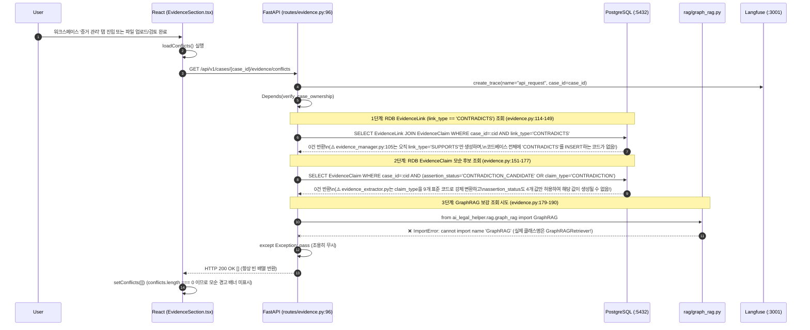

# EVT-024: 증거 불일치 탐지 (Evidence Contradiction Detection)

## 1. 이벤트 메타데이터

| 항목 | 내용 |
|---|---|
| **이벤트 ID** | `EVT-024` |
| **이벤트 명칭** | 사건 내 증거·사실 간 모순(불일치) 탐지 및 조회 |
| **구현 상태** | **PARTIAL (명목상 구현 — 실제로는 항상 빈 배열 `[]` 반환)** |
| **발생 화면 / 컴포넌트** | [`frontend/src/components/EvidenceSection.tsx:266-309, 478-506`](file:///c:/myprjs/ai-legal-helper/frontend/src/components/EvidenceSection.tsx#L266-L309) |
| **호출 API** | `GET /api/v1/cases/{case_id}/evidence/conflicts` |
| **백엔드 진입점** | [`api/routes/evidence.py:96-202`](file:///c:/myprjs/ai-legal-helper/backend/src/ai_legal_helper/api/routes/evidence.py#L96-L202) (`get_evidence_conflicts`) |
| **연관 저장소** | PostgreSQL (`evidence_links`, `evidence_claims`), Neo4j (호출 시도하나 `ImportError`) |

---

## 2. End-to-End Sequence Diagram (As-Is 3단계 조회 및 실패 경로)

---

## 3. 13단계 실행 경로 상세 추적

1. **이벤트 발생 화면 및 컴포넌트**: [`EvidenceSection.tsx`](file:///c:/myprjs/ai-legal-helper/frontend/src/components/EvidenceSection.tsx) 마운트, 업로드(`handleUpload`), 추출(`handleExtract`), 검토(`handleApprove`/`handleReviewSubmit`), 삭제(`handleDelete`) 시마다 `loadConflicts()` 호출.
2. **이벤트 핸들러**: `loadConflicts()`(`EvidenceSection.tsx:299-309`) → `getEvidenceConflicts(caseId)`([`api/evidenceClient.ts:95-101`](file:///c:/myprjs/ai-legal-helper/frontend/src/api/evidenceClient.ts#L95-L101)).
3. **호출되는 API와 HTTP Method**: `GET /api/v1/cases/{case_id}/evidence/conflicts`.
4. **FastAPI Router**: [`api/routes/evidence.py:96`](file:///c:/myprjs/ai-legal-helper/backend/src/ai_legal_helper/api/routes/evidence.py#L96) `get_evidence_conflicts()`.
5. **Service / Repository 함수**: 라우터 내부에 직접 작성된 3단계 조회 로직.
6. **DB 읽기·쓰기**: PostgreSQL `evidence_links`, `evidence_claims`, `evidence_documents`, `facts`, `legal_issues` `SELECT` (Read-Only).
7. **AI Agent 또는 RAG 호출**: `from ai_legal_helper.rag.graph_rag import GraphRAG`를 호출하려 하나 `ImportError`로 실행되지 않음.
8. **외부 LLM·도구 호출**: 없음.
9. **응답 JSON 구조** (`List[EvidenceConflictResponse]` — [`api/schemas/evidence.py:72-83`](file:///c:/myprjs/ai-legal-helper/backend/src/ai_legal_helper/api/schemas/evidence.py#L72-L83)):
   - 스키마 정의는 존재하나 실제로는 항상 `[]` 반환.
10. **프런트엔드 상태 변경**: `conflicts = []`.
11. **화면 출력**: `EvidenceSection.tsx:478`에 `conflicts.length > 0`일 때 빨간색 경고 박스(`⚠️ 발견된 사실/증거 모순 (N건)`)를 렌더링하는 UI 코드는 완성되어 있으나, 백엔드가 항상 `[]`를 반환하므로 화면에 나타나지 않는다.
12. **Langfuse 기록**: `api_request` Root Trace 기록.
13. **실패·예외 처리 및 근본 원인 요약**:
    - **원인 1 (생산자 로직 부재)**: `evidence_extractor.py`나 `evidence_manager.py`에 기존 `Fact`와 새로운 `EvidenceClaim`을 비교하여 `link_type="CONTRADICTS"` 또는 `assertion_status="CONTRADICTION_CANDIDATE"`를 생성하는 LLM/규칙 기반 모순 탐지기가 구현되어 있지 않다.
    - **원인 2 (`ImportError` 은폐)**: [`evidence.py:182`](file:///c:/myprjs/ai-legal-helper/backend/src/ai_legal_helper/api/routes/evidence.py#L182)가 `GraphRAGRetriever` 대신 존재하지 않는 `GraphRAG`를 임포트하고 `except Exception: pass`로 에러를 삼킨다.

