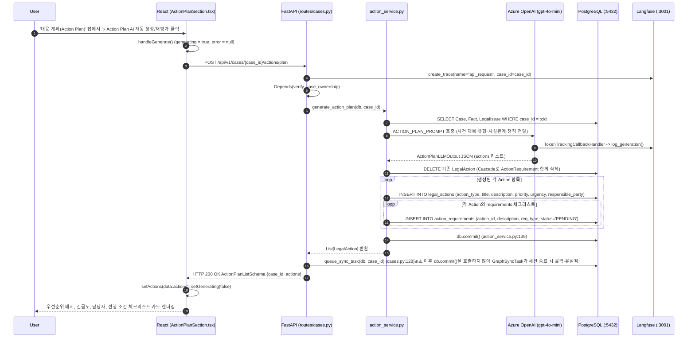

# EVT-025: Next Action 생성·갱신 (Action Plan & Next Action Generation)

## 1. 이벤트 메타데이터

| 항목 | 내용 |
|---|---|
| **이벤트 ID** | `EVT-025` |
| **이벤트 명칭** | AI 대응 계획(Action Plan) 자동 생성·갱신 및 워크플로우 Next Action 추천 |
| **구현 상태** | **PARTIAL** (LLM 기반 대응 계획 생성·저장 및 UI 표시 동작 완료, 단 `cases.py:128`에서 `queue_sync_task` 호출 후 `db.commit()` 누락으로 Neo4j 동기화 태스크 유실) |
| **발생 화면 / 컴포넌트** | 1) [`frontend/src/components/ActionPlanSection.tsx:33-53, 82-98`](file:///c:/myprjs/ai-legal-helper/frontend/src/components/ActionPlanSection.tsx#L33-L53) (`⚡ Action Plan AI 자동 생성/재평가` 버튼)<br>2) [`CaseWorkspace.tsx:OverviewTab`](file:///c:/myprjs/ai-legal-helper/frontend/src/pages/CaseWorkspace.tsx#L351-L375) (추천 다음 단계 배너) |
| **호출 API** | `POST /api/v1/cases/{case_id}/actions/plan`, `GET /api/v1/cases/{case_id}/actions`, `GET /api/v1/cases/{case_id}/workflow/summary` |
| **백엔드 진입점** | [`api/routes/cases.py:105-139`](file:///c:/myprjs/ai-legal-helper/backend/src/ai_legal_helper/api/routes/cases.py#L105-L139) (`create_action_plan`, `list_actions`), [`case_intelligence/action_service.py:55-182`](file:///c:/myprjs/ai-legal-helper/backend/src/ai_legal_helper/case_intelligence/action_service.py#L55-L182) (`generate_action_plan`) |
| **연관 저장소** | PostgreSQL (`legal_actions`, `action_requirements`, `graph_sync_tasks`) |

---

## 2. End-to-End Sequence Diagram



---

## 3. 13단계 실행 경로 상세 추적

1. **이벤트 발생 화면 및 컴포넌트**: 워크스페이스 `action` 탭의 [`ActionPlanSection.tsx`](file:///c:/myprjs/ai-legal-helper/frontend/src/components/ActionPlanSection.tsx) 생성 버튼 및 마운트 시 자동 조회(`fetchActions`).
2. **이벤트 핸들러**: `handleGenerate`(`ActionPlanSection.tsx:33-53`) → `generateActionPlan(caseId)`([`api/actionClient.ts:36-42`](file:///c:/myprjs/ai-legal-helper/frontend/src/api/actionClient.ts#L36-L42)).
3. **호출되는 API와 HTTP Method**:
   - 생성/재평가: `POST /api/v1/cases/{case_id}/actions/plan`
   - 목록 조회: `GET /api/v1/cases/{case_id}/actions`
4. **FastAPI Router**: [`api/routes/cases.py:105`](file:///c:/myprjs/ai-legal-helper/backend/src/ai_legal_helper/api/routes/cases.py#L105) `create_action_plan()`, `list_actions()`(`136행`).
5. **Service / Repository 함수**: [`case_intelligence/action_service.py:55`](file:///c:/myprjs/ai-legal-helper/backend/src/ai_legal_helper/case_intelligence/action_service.py#L55) `generate_action_plan()`, `get_case_actions()`(`168행`).
6. **DB 읽기·쓰기**:
   - PostgreSQL `cases`, `facts`, `legal_issues` 조회.
   - 기존 `legal_actions` 삭제 후 새로운 `LegalAction` 및 `ActionRequirement` 행 `INSERT` 및 `db.commit()`.
   - `prerequisites` 문자열이 다른 액션의 제목을 포함하면 `prerequisite_action_id`로 매핑 저장(`action_service.py:124-137`).
7. **AI Agent 또는 RAG 호출**: `ACTION_PLAN_PROMPT | llm` 체인 실행(`invoke_with_retry` 적용).
8. **외부 LLM·도구 호출**: Azure OpenAI(`gpt-4o-mini`, `temperature=0.1`).
9. **응답 JSON 구조** (`ActionPlanListSchema` — [`api/schemas/case.py:86-88`](file:///c:/myprjs/ai-legal-helper/backend/src/ai_legal_helper/api/schemas/case.py#L86-L88)):
   ```json
   {
     "case_id": "synth-case-lease-001",
     "actions": [
       {
         "id": "act-uuid",
         "action_type": "EVIDENCE_COLLECTION",
         "title": "임대차계약서 및 보증금 이체내역서 확보",
         "description": "...",
         "priority": 1,
         "urgency": "HIGH",
         "responsible_party": "USER",
         "status": "PENDING",
         "requirements": [{"id": "req-uuid", "description": "은행 이체확인증 발급", "req_type": "EVIDENCE", "status": "PENDING"}],
         "prerequisite_action_ids": []
       }
     ]
   }
   ```
10. **프런트엔드 상태 변경**: `actions` 상태 배열 업데이트.
11. **화면 출력**: 우선순위 순(`priority`)으로 정렬된 대응 계획 카드와 하위 필수 준비 사항(`requirements`) 체크리스트 표시. (단, 개별 체크박스를 클릭해 완료 상태로 바꾸는 API나 핸들러는 아직 없고 `readOnly` 체크박스로 렌더링된다.)
12. **Langfuse 기록**: `api_request` Root Trace 및 `TokenTrackingCallbackHandler` Generation 기록.
13. **실패·예외 처리 및 결함**:
    - **결함 (`queue_sync_task` 미커밋)**: [`cases.py:121-128`](file:///c:/myprjs/ai-legal-helper/backend/src/ai_legal_helper/api/routes/cases.py#L121-L128)에서 `generate_action_plan(db, case_id)`(내부에서 `db.commit()` 완료)를 호출한 뒤 128행에서 `queue_sync_task(db, case_id)`만 호출하고 `db.commit()`을 하지 않아 `GraphSyncTask`가 DB에 저장되지 않는다.

