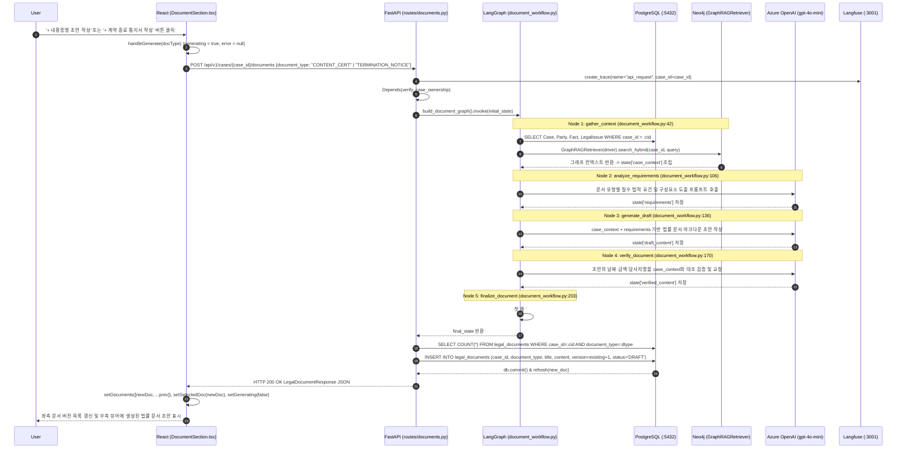

# EVT-026: 법률 문서 초안 생성 (Legal Document Draft Generation)

## 1. 이벤트 메타데이터

| 항목 | 내용 |
|---|---|
| **이벤트 ID** | `EVT-026` |
| **이벤트 명칭** | LangGraph 기반 법률 문서(내용증명·계약종료통지서 등) 초안 생성 및 버전 관리 |
| **구현 상태** | **PARTIAL** (5단계 LangGraph 실행, DB 저장, 문서 탭 렌더링은 정상 동작하나, 문서 생성 후 `OverviewTab` 조회 시 `workflow.py:305`의 `d.doc_type` `AttributeError`로 HTTP 500 발생) |
| **발생 화면 / 컴포넌트** | [`frontend/src/components/DocumentSection.tsx:36-49, 89-105`](file:///c:/myprjs/ai-legal-helper/frontend/src/components/DocumentSection.tsx#L36-L49) |
| **호출 API** | `POST /api/v1/cases/{case_id}/documents`, `GET /api/v1/cases/{case_id}/documents` |
| **백엔드 진입점** | [`api/routes/documents.py:16-64`](file:///c:/myprjs/ai-legal-helper/backend/src/ai_legal_helper/api/routes/documents.py#L16-L64) (`create_legal_document`, `list_legal_documents`) |
| **워크플로우 코드** | [`workflows/document_workflow.py:42-246`](file:///c:/myprjs/ai-legal-helper/backend/src/ai_legal_helper/workflows/document_workflow.py#L42-L246) (`build_document_graph`) |
| **연관 저장소** | PostgreSQL (`legal_documents`, `cases`, `parties`, `facts`, `legal_issues`), Neo4j (`GraphRAGRetriever`) |

---

## 2. End-to-End Sequence Diagram



---

## 3. 13단계 실행 경로 상세 추적

1. **이벤트 발생 화면 및 컴포넌트**: 워크스페이스 `docs` 탭의 [`DocumentSection.tsx`](file:///c:/myprjs/ai-legal-helper/frontend/src/components/DocumentSection.tsx) 상단 `+ 내용증명 초안 작성`(`CONTENT_CERT`), `+ 계약 종료 통지서 작성`(`TERMINATION_NOTICE`) 버튼.
2. **이벤트 핸들러**: `handleGenerate`(`DocumentSection.tsx:36-49`) → `generateDocument(caseId, docType)`([`api/documentClient.ts:27-36`](file:///c:/myprjs/ai-legal-helper/frontend/src/api/documentClient.ts#L27-L36)).
3. **호출되는 API와 HTTP Method**:
   - 문서 생성: `POST /api/v1/cases/{case_id}/documents`
   - 목록 조회: `GET /api/v1/cases/{case_id}/documents`
4. **FastAPI Router**: [`api/routes/documents.py:16`](file:///c:/myprjs/ai-legal-helper/backend/src/ai_legal_helper/api/routes/documents.py#L16) `create_legal_document()`, `list_legal_documents()`(`53행`).
5. **Service / Repository 함수**: `build_document_graph().invoke()`(`document_workflow.py:224`).
6. **DB 읽기·쓰기**:
   - `gather_context`에서 PostgreSQL 사건 데이터 조회 및 Neo4j 그래프 조회.
   - `create_legal_document`에서 동일 `case_id` + `document_type`의 기존 문서 개수를 세어 `version = existing_docs + 1`로 `legal_documents` 테이블에 `INSERT`.
7. **AI Agent 또는 RAG 호출**: 5단계 LangGraph(`gather_context` → `analyze_requirements` → `generate_draft` → `verify_document` → `finalize_document`) 및 `GraphRAGRetriever.search_hybrid()`.
8. **외부 LLM·도구 호출**: Azure OpenAI 총 3회 연속 호출(`analyze_requirements`, `generate_draft`, `verify_document`).
9. **응답 JSON 구조** (`LegalDocumentResponse` — [`api/schemas/document.py:12-23`](file:///c:/myprjs/ai-legal-helper/backend/src/ai_legal_helper/api/schemas/document.py#L12-L23)):
   ```json
   {
     "id": "doc-uuid",
     "case_id": "synth-case-lease-001",
     "document_type": "CONTENT_CERT",
     "title": "임대차보증금 반환 청구의 건",
     "content": "# 임대차보증금 반환 청구의 건\n\n수신인: ...",
     "version": 1,
     "status": "DRAFT",
     "created_at": "2026-10-16T09:20:00Z"
   }
   ```
10. **프런트엔드 상태 변경**: `documents` 배열 선두에 `newDoc` 추가 및 `selectedDoc = newDoc` 설정.
11. **화면 출력**: 좌측 사이드바에 문서 제목·유형 배지·버전(`v1`) 표시, 우측 문서 뷰어에 본문 및 AI 면책 경고문 표시.
12. **Langfuse 기록**: `api_request` Root Trace 및 `doc_gather_context`, `doc_analyze_requirements`, `doc_generate_draft`, `doc_verify_document`, `doc_finalize_document` 5개 Span + 3개 LLM Generation 기록.
13. **실패·예외 처리 및 후속 부작용 결함**:
    - **치명적 후속 결함 (`workflow.py:305`)**: 문서 생성 자체는 성공하여 `legal_documents` 테이블에 1건 이상이 저장되지만, 그 직후 사용자가 `전체 진행 요약(OverviewTab)` 탭을 열면 [`workflow.py:305`](file:///c:/myprjs/ai-legal-helper/backend/src/ai_legal_helper/api/routes/workflow.py#L305)가 `d.doc_type`(`d.document_type`의 오타)을 참조하여 `AttributeError`로 **HTTP 500**을 일으킨다!

