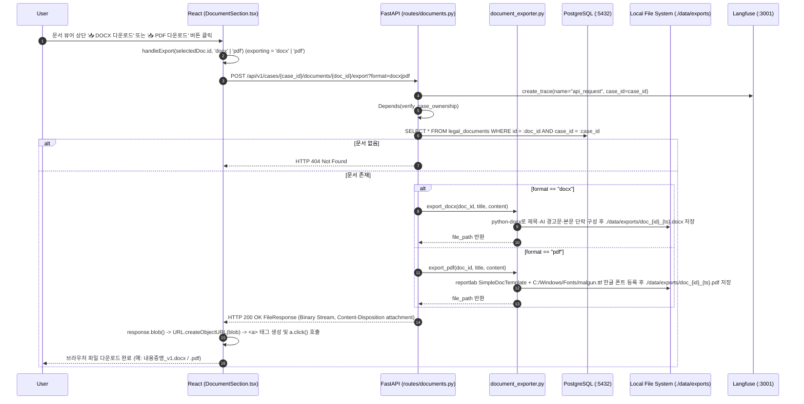

# EVT-027: DOCX/PDF 다운로드 (Legal Document DOCX/PDF Export)

## 1. 이벤트 메타데이터

| 항목 | 내용 |
|---|---|
| **이벤트 ID** | `EVT-027` |
| **이벤트 명칭** | 생성된 법률 문서 초안의 DOCX / PDF 변환 및 브라우저 다운로드 |
| **구현 상태** | **IMPLEMENTED** |
| **발생 화면 / 컴포넌트** | [`frontend/src/components/DocumentSection.tsx:51-62, 179-192`](file:///c:/myprjs/ai-legal-helper/frontend/src/components/DocumentSection.tsx#L51-L62) |
| **호출 API** | `POST /api/v1/cases/{case_id}/documents/{doc_id}/export?format=docx\|pdf` |
| **백엔드 진입점** | [`api/routes/documents.py:66-101`](file:///c:/myprjs/ai-legal-helper/backend/src/ai_legal_helper/api/routes/documents.py#L66-L101) (`export_legal_document`) |
| **서비스 함수** | [`case_intelligence/document_exporter.py:13-112`](file:///c:/myprjs/ai-legal-helper/backend/src/ai_legal_helper/case_intelligence/document_exporter.py#L13-L112) (`export_docx`, `export_pdf`) |
| **연관 저장소** | PostgreSQL (`legal_documents`), Local File System (`./data/exports/`) |

---

## 2. End-to-End Sequence Diagram

---

## 3. 13단계 실행 경로 상세 추적

1. **이벤트 발생 화면 및 컴포넌트**: 워크스페이스 `docs` 탭 [`DocumentSection.tsx`](file:///c:/myprjs/ai-legal-helper/frontend/src/components/DocumentSection.tsx) 우측 상단 `📥 DOCX 다운로드`, `📥 PDF 다운로드` 버튼.
2. **이벤트 핸들러**: `handleExport`(`DocumentSection.tsx:51-62`) → `exportDocument(caseId, docId, format, filename)`([`api/documentClient.ts:38-60`](file:///c:/myprjs/ai-legal-helper/frontend/src/api/documentClient.ts#L38-L60)).
3. **호출되는 API와 HTTP Method**: `POST /api/v1/cases/{case_id}/documents/{doc_id}/export?format=docx` (또는 `format=pdf`).
4. **FastAPI Router**: [`api/routes/documents.py:66`](file:///c:/myprjs/ai-legal-helper/backend/src/ai_legal_helper/api/routes/documents.py#L66) `export_legal_document()`.
5. **Service / Repository 함수**: [`case_intelligence/document_exporter.py:19`](file:///c:/myprjs/ai-legal-helper/backend/src/ai_legal_helper/case_intelligence/document_exporter.py#L19) `export_docx()`, `export_pdf()`(`53행`).
6. **DB 읽기·쓰기**:
   - PostgreSQL `legal_documents`에서 해당 문서 `SELECT`.
   - Local FS `./data/exports/doc_{doc_id}_{timestamp}.{ext}` 파일 생성.
7. **AI Agent 또는 RAG 호출**: 없음.
8. **외부 LLM·도구 호출**: `python-docx` 라이브러리(DOCX 생성), `reportlab` 라이브러리 + Windows `malgun.ttf` 폰트(PDF 생성).
9. **응답 JSON 구조**: JSON이 아닌 바이너리 `FileResponse`:
   - DOCX Media Type: `application/vnd.openxmlformats-officedocument.wordprocessingml.document`
   - PDF Media Type: `application/pdf`
10. **프런트엔드 상태 변경**: 다운로드 중 `exporting = format`, 완료 후 `exporting = null`.
11. **화면 출력**: 버튼 텍스트가 `"변환 중..."`으로 표시된 후 브라우저 다운로드 창 실행.
12. **Langfuse 기록**: `api_request` Root Trace 기록.
13. **실패·예외 처리 경로**:
    - 허용되지 않는 포맷 요청 시 HTTP 400 반환.
    - Windows 한글 폰트(`C:/Windows/Fonts/malgun.ttf`)가 없는 Linux/Docker 환경에서는 `document_exporter.py:66`의 `except Exception`이 기본 `Helvetica` 폰트로 폴백한다(이 경우 PDF 내 한글이 깨질 수 있음).

