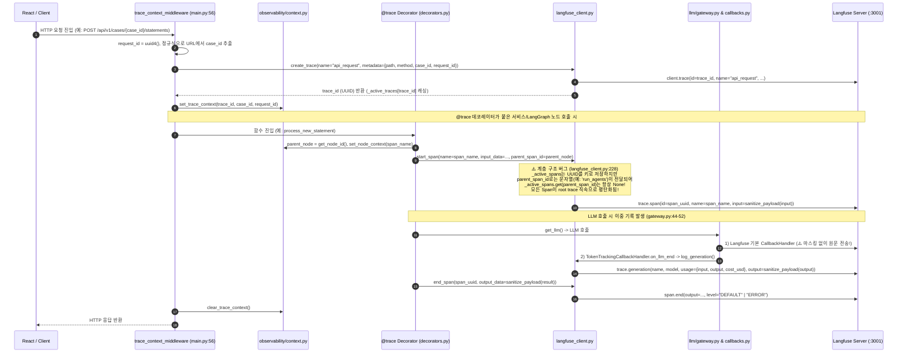

# EVT-028: Langfuse Trace 기록 (Langfuse Observability & Tracing)

## 1. 이벤트 메타데이터

| 항목 | 내용 |
|---|---|
| **이벤트 ID** | `EVT-028` |
| **이벤트 명칭** | API 요청·LangGraph 노드·에이전트·LLM 호출의 Langfuse Trace / Span / Generation 기록 |
| **구현 상태** | **PARTIAL** (미들웨어·데코레이터·콜백 계측 동작, 단 UUID vs 노드명 불일치로 Span 트리 계층 평탄화 및 기본 `CallbackHandler`의 원문 마스킹 우회 결함 존재) |
| **발생 트리거** | 모든 HTTP API 요청 진입, `@trace` 데코레이터 함수 실행, `get_llm()` 기반 LLM 호출 |
| **백엔드 진입점** | [`api/main.py:56-116`](file:///c:/myprjs/ai-legal-helper/backend/src/ai_legal_helper/api/main.py#L56-L116) (`trace_context_middleware`), [`observability/decorators.py:16-123`](file:///c:/myprjs/ai-legal-helper/backend/src/ai_legal_helper/observability/decorators.py#L16-L123) (`@trace`), [`observability/callbacks.py:30-88`](file:///c:/myprjs/ai-legal-helper/backend/src/ai_legal_helper/observability/callbacks.py#L30-L88) (`TokenTrackingCallbackHandler`), [`observability/langfuse_client.py`](file:///c:/myprjs/ai-legal-helper/backend/src/ai_legal_helper/observability/langfuse_client.py) |
| **연관 외부 시스템** | Langfuse Server (`http://localhost:3001`) |

---

## 2. End-to-End Sequence Diagram

---

## 3. 13단계 실행 경로 상세 추적

1. **이벤트 발생 화면 및 컴포넌트**: 모든 프런트엔드 API 호출 시 백엔드에서 자동 발생.
2. **이벤트 핸들러**: `trace_context_middleware`, `@trace`, `TokenTrackingCallbackHandler`.
3. **호출되는 API와 HTTP Method**: 전 API 엔드포인트 공통.
4. **FastAPI Router**: `api/main.py` 미들웨어 체인.
5. **Service / Repository 함수**: `create_trace()`, `start_span()`, `end_span()`, `log_generation()`, `sanitize_payload()`.
6. **DB 읽기·쓰기**: 없음 (인메모리 `_active_traces`, `_active_spans` 딕셔너리 및 `ContextVar` 사용).
7. **AI Agent 또는 RAG 호출**: 총 24개 함수/메서드(`09_LANGFUSE_TRACE_FLOW.md` 참조)에 `@trace`가 적용되어 있다.
8. **외부 LLM·도구 호출**: Langfuse Python SDK v2를 통해 `http://localhost:3001`로 비동기 배치 전송.
9. **응답 JSON 구조**: Langfuse 내부 이벤트 페이로드 (`trace`, `span`, `generation`).
10. **프런트엔드 상태 변경**: 없음.
11. **화면 출력**: Langfuse 대시보드(`:3001`)에서 확인.
12. **Langfuse 기록**:
    - `LANGFUSE_CAPTURE_CONTENT=false`(기본값)일 때 `sanitize_payload()`([`langfuse_client.py:29-54`](file:///c:/myprjs/ai-legal-helper/backend/src/ai_legal_helper/observability/langfuse_client.py#L29-L54))가 문자열을 `"[MASKED (len=N)]"`으로 마스킹한다.
13. **실패·예외 처리 및 구조적 결함**:
    - Langfuse 서버 연결 실패나 SDK 오류 시 모든 함수가 `except Exception as e: logger.debug(...)`로 예외를 흡수하여 본 서비스 로직에는 영향을 주지 않는다(Graceful Degradation).
    - **결함 1**: `_active_spans`의 UUID 키와 `parent_span_id`(노드명 문자열) 불일치로 Span 중첩 트리가 형성되지 않는다.
    - **결함 2**: `get_llm()`이 등록하는 기본 `CallbackHandler`는 `sanitize_payload()`를 거치지 않아 원문이 노출된다.

