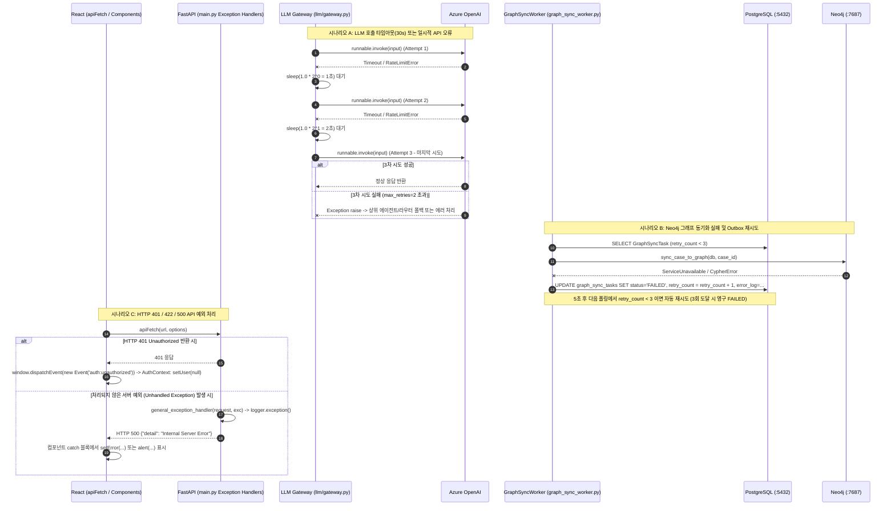

# EVT-029: 오류·타임아웃·재시도 처리 (Error, Timeout & Retry Handling)

## 1. 이벤트 메타데이터

| 항목 | 내용 |
|---|---|
| **이벤트 ID** | `EVT-029` |
| **이벤트 명칭** | 전 계층 오류·타임아웃·지수 백오프 재시도·트랜잭션 롤백 처리 |
| **구현 상태** | **PARTIAL** (LLM 재시도, Outbox 3회 재시도, 전역 예외 핸들러, 401 이벤트 처리는 구현 완료, 단 `VerificationAgent`의 `PASS` 폴백 및 다수의 `except: pass` 존재) |
| **발생 트리거** | API 예외(401/403/404/422/500), LLM 타임아웃/RateLimit, DB 트랜잭션 오류, Neo4j/ChromaDB 연결 실패 |
| **백엔드 진입점** | [`llm/gateway.py:70-124`](file:///c:/myprjs/ai-legal-helper/backend/src/ai_legal_helper/llm/gateway.py#L70-L124) (`invoke_with_retry`), [`database/graph_sync_worker.py:21-69`](file:///c:/myprjs/ai-legal-helper/backend/src/ai_legal_helper/database/graph_sync_worker.py#L21-L69), [`api/main.py:118-145`](file:///c:/myprjs/ai-legal-helper/backend/src/ai_legal_helper/api/main.py#L118-L145) |
| **프런트엔드 진입점** | [`frontend/src/api/apiFetch.ts:11-30`](file:///c:/myprjs/ai-legal-helper/frontend/src/api/apiFetch.ts#L11-L30), [`frontend/src/context/AuthContext.tsx:29-35`](file:///c:/myprjs/ai-legal-helper/frontend/src/context/AuthContext.tsx#L29-L35) |

---

## 2. End-to-End Sequence Diagram

---

## 3. 13단계 실행 경로 상세 추적

1. **이벤트 발생 화면 및 컴포넌트**: 전 화면 API 호출 및 백그라운드 워커/LLM 호출 전반.
2. **이벤트 핸들러**: `apiFetch`(`apiFetch.ts:11`), `http_exception_handler` / `validation_exception_handler` / `general_exception_handler`(`main.py:118-145`), `invoke_with_retry`(`gateway.py:70`), `process_pending_sync_tasks`(`graph_sync_worker.py:21`).
3. **호출되는 API와 HTTP Method**: 전 엔드포인트 공통.
4. **FastAPI Router**: `api/main.py` 전역 예외 핸들러.
5. **Service / Repository 함수**: 각 서비스 내 `try ... except Exception: db.rollback()`.
6. **DB 읽기·쓰기**:
   - 트랜잭션 중 오류 발생 시 `db.rollback()` 호출(`manager.py:51, 157`, `evidence_ingestion.py:140`, `evidence_extractor.py:203`, `evidence_manager.py:115`, `action_service.py:164`, `cases.py:175`).
   - 파일 업로드 중 DB 커밋 실패 시 디스크에 저장된 물리 파일(`os.remove(storage_path)`) 즉시 롤백 삭제(`evidence_ingestion.py:141`).
7. **AI Agent 또는 RAG 호출**:
   - `RouterAgent` 실패 시 `"민법"` 폴백(`router.py:139`).
   - `SynthesizerAgent` 실패 시 하위 에이전트 원문 결합 폴백(`synthesizer.py:72`).
   - `rewrite_query` 실패 시 원본 질문 폴백(`query_rewrite.py:74`).
8. **외부 LLM·도구 호출**: `get_llm()`에 `timeout=30`, `invoke_with_retry()`에 `max_retries=2`, `retry_delay=1.0`(지수 백오프: 1초 → 2초) 적용.
9. **응답 JSON 구조**:
   - 400/401/403/404/409/500: `{"detail": "에러 메시지"}`
   - 422: `{"detail": [{"loc": [...], "msg": "...", "type": "..."}]}`
10. **프런트엔드 상태 변경**: `error` 상태 설정, `loading = false` 해제, 401 시 `user = null`.
11. **화면 출력**: 빨간색 에러 배너 또는 브라우저 `alert()` 표시.
12. **Langfuse 기록**: `@trace` 데코레이터의 `except` 블록(`decorators.py:67, 108`)이 `end_span(span_id, level="ERROR", status_message=str(e))`를 호출하여 에러 Span 기록.
13. **실패·예외 처리의 취약점**:
    - `extractor.py:92`와 `evidence_extractor.py:165`는 `invoke_with_retry()` 대신 `chain.invoke()`를 직접 호출하여 지수 백오프 재시도가 누락되어 있다.
    - `verification.py:80`은 JSON 파싱 실패 시 `status="PASS"`로 잘못 폴백하며, `base_agent.py:76`과 `evidence.py:189`는 `except Exception: pass`로 오류를 로그 없이 삼킨다.

