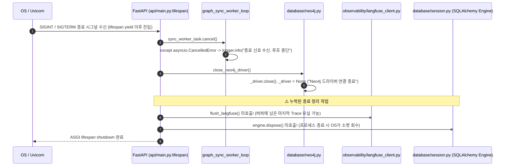

# EVT-030: 서비스 종료 및 리소스 정리 (Service Shutdown & Resource Cleanup)

## 1. 이벤트 메타데이터

| 항목 | 내용 |
|---|---|
| **이벤트 ID** | `EVT-030` |
| **이벤트 명칭** | FastAPI 서버 종료 시 백그라운드 워커 취소 및 드라이버 리소스 정리 |
| **구현 상태** | **PARTIAL** (`graph_sync_worker` 태스크 취소 및 `close_neo4j_driver()` 호출은 구현 완료, 단 `flush_langfuse()` 및 SQLAlchemy `engine.dispose()` 누락) |
| **발생 트리거** | Uvicorn / FastAPI 프로세스 종료 시그널 (`SIGINT` / `SIGTERM`) |
| **백엔드 진입점** | [`backend/src/ai_legal_helper/api/main.py:48-51`](file:///c:/myprjs/ai-legal-helper/backend/src/ai_legal_helper/api/main.py#L48-L51) (`lifespan` 종료 블록) |
| **서비스 함수** | [`database/graph_sync_worker.py:90-92`](file:///c:/myprjs/ai-legal-helper/backend/src/ai_legal_helper/database/graph_sync_worker.py#L90-L92), [`database/neo4j.py:55-62`](file:///c:/myprjs/ai-legal-helper/backend/src/ai_legal_helper/database/neo4j.py#L55-L62) (`close_neo4j_driver`) |

---

## 2. End-to-End Sequence Diagram



---

## 3. 13단계 실행 경로 상세 추적

1. **이벤트 발생 화면 및 컴포넌트**: 서버 프로세스 종료 이벤트 (UI 없음).
2. **이벤트 핸들러**: [`api/main.py:48-51`](file:///c:/myprjs/ai-legal-helper/backend/src/ai_legal_helper/api/main.py#L48-L51) `lifespan` `yield` 이후 코드:
   ```python
   sync_worker_task.cancel()
   close_neo4j_driver()
   logger.info("AI Legal Helper API 서버 종료")
   ```
3. **호출되는 API와 HTTP Method**: 해당 없음.
4. **FastAPI Router**: `api/main.py`.
5. **Service / Repository 함수**: `sync_worker_task.cancel()`, `close_neo4j_driver()`.
6. **DB 읽기·쓰기**: Neo4j Bolt 커넥션 풀 종료(`_driver.close()`).
7. **AI Agent 또는 RAG 호출**: 없음.
8. **외부 LLM·도구 호출**: 없음.
9. **응답 JSON 구조**: 없음.
10. **프런트엔드 상태 변경**: 없음.
11. **화면 출력**: 서버 콘솔에 `"Neo4j 그래프 DB 백그라운드 동기화 워커 종료 신호 수신, 루프를 중단합니다."` 및 `"AI Legal Helper API 서버 종료"` 출력.
12. **Langfuse 기록**: [`observability/langfuse_client.py:345`](file:///c:/myprjs/ai-legal-helper/backend/src/ai_legal_helper/observability/langfuse_client.py#L345)에 `flush_langfuse()` 함수가 구현되어 있으나 `main.py` 종료 시 호출되지 않아, 종료 직전 큐에 남아 있는 Langfuse 이벤트가 전송되지 않고 유실될 수 있다.
13. **실패·예외 처리 및 보완 필요 사항**:
    - `sync_worker_task.cancel()` 호출 후 `await asyncio.gather(sync_worker_task, return_exceptions=True)`로 태스크 완료를 대기하지 않고 즉시 `close_neo4j_driver()`를 호출하므로, 워커가 한창 트랜잭션을 수행 중일 때 드라이버가 먼저 닫힐 수 있다.
    - 종료 블록에 `flush_langfuse()` 및 `engine.dispose()` 호출 추가가 권장된다.

