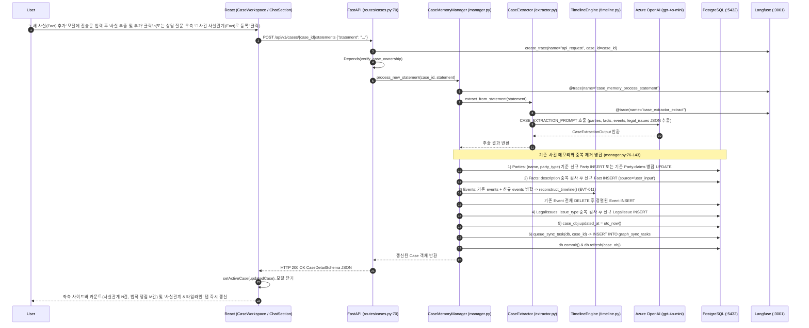

# EVT-032: 사건 진술(Statement) 추가 및 사실·쟁점·당사자 추출 (Statement Addition & Case Memory Extraction)

## 1. 이벤트 메타데이터

| 항목 | 내용 |
|---|---|
| **이벤트 ID** | `EVT-032` *(코드 전수 조사 추가 발견 이벤트)* |
| **이벤트 명칭** | 자유 진술문(Statement) 입력 및 당사자·사실·이벤트·법적 쟁점 LLM 구조화 추출·병합 |
| **구현 상태** | **IMPLEMENTED** |
| **발생 화면 / 컴포넌트** | 1) [`frontend/src/pages/CaseWorkspace.tsx:37-118, 223`](file:///c:/myprjs/ai-legal-helper/frontend/src/pages/CaseWorkspace.tsx#L37-L118) (`AddStatementModal`, 사이드바 `+ 새 사실(Fact) 추가` 버튼) 2) [`frontend/src/components/ChatSection.tsx:43-58, 202`](file:///c:/myprjs/ai-legal-helper/frontend/src/components/ChatSection.tsx#L43-L58) (`📌 사건 사실관계(Fact)로 등록` 버튼) |
| **호출 API** | `POST /api/v1/cases/{case_id}/statements` |
| **백엔드 진입점** | [`api/routes/cases.py:70-102`](file:///c:/myprjs/ai-legal-helper/backend/src/ai_legal_helper/api/routes/cases.py#L70-L102) (`add_statement`) |
| **서비스 함수** | [`case_intelligence/manager.py:55-160`](file:///c:/myprjs/ai-legal-helper/backend/src/ai_legal_helper/case_intelligence/manager.py#L55-L160) (`CaseMemoryManager.process_new_statement`), [`case_intelligence/extractor.py:72-99`](file:///c:/myprjs/ai-legal-helper/backend/src/ai_legal_helper/case_intelligence/extractor.py#L72-L99) (`CaseExtractor.extract_from_statement`), [`case_intelligence/timeline.py:47-84`](file:///c:/myprjs/ai-legal-helper/backend/src/ai_legal_helper/case_intelligence/timeline.py#L47-L84) |
| **연관 저장소** | PostgreSQL (`cases`, `parties`, `facts`, `events`, `legal_issues`, `graph_sync_tasks`), Neo4j & ChromaDB (via Worker) |

---

## 2. End-to-End Sequence Diagram

---

## 3. 13단계 실행 경로 상세 추적

1. **이벤트 발생 화면 및 컴포넌트**: [`CaseWorkspace.tsx`](file:///c:/myprjs/ai-legal-helper/frontend/src/pages/CaseWorkspace.tsx) 좌측 사이드바 하단 `+ 새 사실(Fact) 추가` 버튼(`AddStatementModal`) 또는 [`ChatSection.tsx:202`](file:///c:/myprjs/ai-legal-helper/frontend/src/components/ChatSection.tsx#L202)의 `📌 사건 사실관계(Fact)로 등록` 버튼.
2. **이벤트 핸들러**: `handleAddStatement`(`CaseWorkspace.tsx:154`) / `handleRegisterAsFact`(`ChatSection.tsx:43`) → `addStatement(caseId, statement)`([`api/caseClient.ts:40-48`](file:///c:/myprjs/ai-legal-helper/frontend/src/api/caseClient.ts#L40-L48)).
3. **호출되는 API와 HTTP Method**: `POST /api/v1/cases/{case_id}/statements` (Body: `{"statement": "..."}`).
4. **FastAPI Router**: [`api/routes/cases.py:70`](file:///c:/myprjs/ai-legal-helper/backend/src/ai_legal_helper/api/routes/cases.py#L70) `add_statement()`.
5. **Service / Repository 함수**: `CaseMemoryManager.process_new_statement()`, `CaseExtractor.extract_from_statement()`, `TimelineEngine.reconstruct_timeline()`, `queue_sync_task()`.
6. **DB 읽기·쓰기**:
   - PostgreSQL `parties`, `facts`, `events`, `legal_issues`, `cases`, `graph_sync_tasks` 단일 트랜잭션 갱신 및 `db.commit()`.
   - 이후 백그라운드 워커(`EVT-010`)가 Neo4j와 ChromaDB에 동기화.
7. **AI Agent 또는 RAG 호출**: `CaseExtractor`가 `CASE_EXTRACTION_PROMPT | llm | JsonOutputParser(pydantic_object=CaseExtractionOutput)` 체인을 실행하여 자유 진술문을 4개 구조화 엔티티(`Party`, `Fact`, `Event`, `LegalIssue`)로 분해한다.
8. **외부 LLM·도구 호출**: Azure OpenAI(`gpt-4o-mini`, `temperature=0.0`).
9. **응답 JSON 구조**: 갱신된 `CaseDetailSchema` 전체(`parties`, `facts`, `events`, `legal_issues` 배열 포함).
10. **프런트엔드 상태 변경**: `setActiveCase(updatedCase)`로 워크스페이스 전역 사건 상태 즉시 업데이트.
11. **화면 출력**: 사이드바의 `추출된 사실관계`, `도출된 법적 쟁점`, `관련 당사자` 수치 배지가 즉시 올라가고 `FactsTab`에 추출된 항목이 표시된다.
12. **Langfuse 기록**: `api_request` Root Trace + `case_memory_process_statement`, `case_extractor_extract`, `timeline_reconstruct` 3개 Span + LLM Generation 기록.
13. **실패·예외 처리 경로**:
    - LLM 추출 실패 시 `extractor.py:98`에서 빈 `CaseExtractionOutput()`을 반환하여 트랜잭션이 깨지지 않도록 방어한다.
    - DB 오류 발생 시 `manager.py:157`에서 `self.db.rollback()` 후 예외를 던지며, 라우터(`cases.py:98`)가 HTTP 500을 반환하고 모달에 에러 배너가 표시된다.

