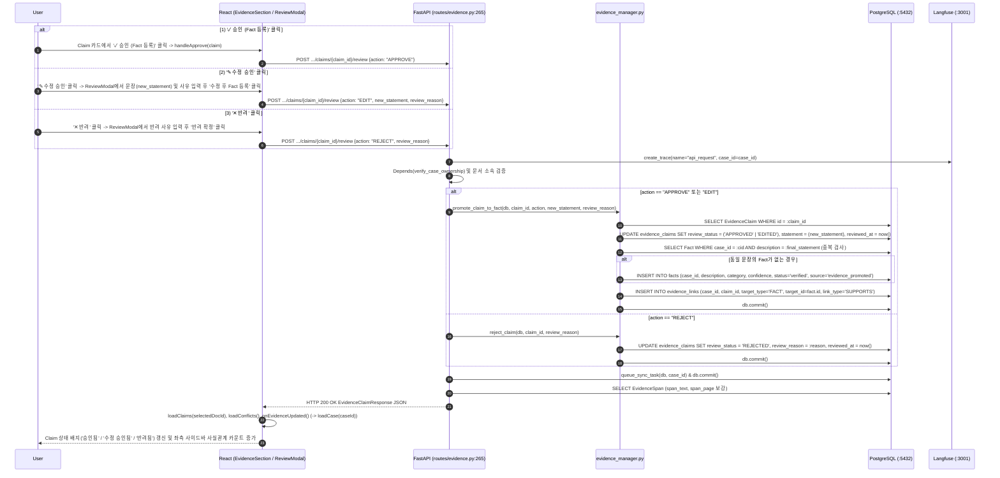

# EVT-033: 증거 추출 주장(Claim) 검토 — 승인·수정승인·반려 (Evidence Claim Review & Fact Promotion)

## 1. 이벤트 메타데이터

| 항목 | 내용 |
|---|---|
| **이벤트 ID** | `EVT-033` *(코드 전수 조사 추가 발견 이벤트)* |
| **이벤트 명칭** | 증거 문서에서 추출된 주장(`EvidenceClaim`)의 사용자 검토(`APPROVE` / `EDIT` / `REJECT`) 및 사실(`Fact`) 승격 |
| **구현 상태** | **IMPLEMENTED** |
| **발생 화면 / 컴포넌트** | [`frontend/src/components/EvidenceSection.tsx:114-243, 354-396, 632-655`](file:///c:/myprjs/ai-legal-helper/frontend/src/components/EvidenceSection.tsx#L354-L396) (`ReviewModal` 및 Claim 카드 버튼) |
| **호출 API** | `POST /api/v1/cases/{case_id}/evidence/{doc_id}/claims/{claim_id}/review` |
| **백엔드 진입점** | [`api/routes/evidence.py:265-318`](file:///c:/myprjs/ai-legal-helper/backend/src/ai_legal_helper/api/routes/evidence.py#L265-L318) (`review_evidence_claim`) |
| **서비스 함수** | [`case_intelligence/evidence_manager.py:16-148`](file:///c:/myprjs/ai-legal-helper/backend/src/ai_legal_helper/case_intelligence/evidence_manager.py#L16-L148) (`promote_claim_to_fact`, `reject_claim`) |
| **연관 저장소** | PostgreSQL (`evidence_claims`, `facts`, `evidence_links`, `graph_sync_tasks`), Neo4j & ChromaDB (via Worker) |

---

## 2. End-to-End Sequence Diagram

---

## 3. 13단계 실행 경로 상세 추적

1. **이벤트 발생 화면 및 컴포넌트**: 워크스페이스 `evidence` 탭 [`EvidenceSection.tsx`](file:///c:/myprjs/ai-legal-helper/frontend/src/components/EvidenceSection.tsx) 우측 패널의 `PENDING` 상태 Claim 카드 및 `ReviewModal`.
2. **이벤트 핸들러**: `handleApprove`(`EvidenceSection.tsx:354-367`), `handleReviewSubmit`(`369-396`) → `reviewClaim(caseId, docId, claimId, req)`([`api/evidenceClient.ts:81-93`](file:///c:/myprjs/ai-legal-helper/frontend/src/api/evidenceClient.ts#L81-L93)).
3. **호출되는 API와 HTTP Method**: `POST /api/v1/cases/{case_id}/evidence/{doc_id}/claims/{claim_id}/review`.
4. **FastAPI Router**: [`api/routes/evidence.py:265`](file:///c:/myprjs/ai-legal-helper/backend/src/ai_legal_helper/api/routes/evidence.py#L265) `review_evidence_claim()`.
5. **Service / Repository 함수**: [`case_intelligence/evidence_manager.py:16`](file:///c:/myprjs/ai-legal-helper/backend/src/ai_legal_helper/case_intelligence/evidence_manager.py#L16) `promote_claim_to_fact()`, `reject_claim()`(`120행`), `queue_sync_task()`.
6. **DB 읽기·쓰기**:
   - `evidence_claims` 상태(`APPROVED` / `EDITED` / `REJECTED`), `review_reason`, `reviewed_at` `UPDATE`.
   - 승인/수정승인 시 `facts` 테이블에 `status="verified"`, `source="evidence_promoted"`로 `INSERT` (동일 `description`이 이미 있으면 기존 `Fact` 재사용).
   - `evidence_links` 테이블에 `target_type="FACT"`, `link_type="SUPPORTS"`로 `INSERT`.
   - `graph_sync_tasks`에 동기화 태스크 `INSERT` 및 `db.commit()`.
7. **AI Agent 또는 RAG 호출**: 없음 (Human-in-the-Loop 검증 단계).
8. **외부 LLM·도구 호출**: 없음.
9. **응답 JSON 구조**: 갱신된 `EvidenceClaimResponse` JSON.
10. **프런트엔드 상태 변경**: `claims` 배열 갱신, `ReviewModal` 닫기, 부모 `CaseWorkspace`의 `loadCase(caseId)` 호출로 `activeCase.facts` 즉시 갱신.
11. **화면 출력**: 검토 버튼들이 사라지고 초록색(`승인됨`), 보라색(`수정 승인됨`), 회색(`반려됨`) 배지로 전환되며, 반려/수정 사유가 하단에 표시된다.
12. **Langfuse 기록**: `api_request` Root Trace 기록.
13. **실패·예외 처리 경로**:
    - 이미 검토 완료된(`review_status != "PENDING"`) 주장을 다시 검토하려 하면 `evidence_manager.py:45, 134`에서 **HTTP 400**(`"이미 검토가 완료된 주장입니다"`)을 반환한다.
    - `EDIT` 액션인데 `new_statement`가 비어 있으면 **HTTP 400**을 반환한다.

