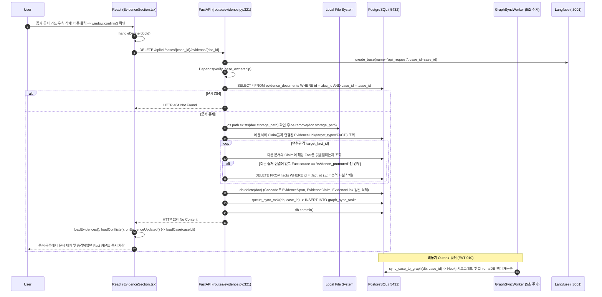

# EVT-034: 증거 파일 삭제 (Evidence Document Deletion)

## 1. 이벤트 메타데이터

| 항목 | 내용 |
|---|---|
| **이벤트 ID** | `EVT-034` *(코드 전수 조사 추가 발견 이벤트)* |
| **이벤트 명칭** | 업로드된 개별 증거 문서 삭제 및 승격된 사실(`Fact`)·그래프 연쇄 정리 |
| **구현 상태** | **IMPLEMENTED** |
| **발생 화면 / 컴포넌트** | [`frontend/src/components/EvidenceSection.tsx:398-420, 523`](file:///c:/myprjs/ai-legal-helper/frontend/src/components/EvidenceSection.tsx#L398-L420) (`삭제` 버튼) |
| **호출 API** | `DELETE /api/v1/cases/{case_id}/evidence/{doc_id}` |
| **백엔드 진입점** | [`api/routes/evidence.py:321-387`](file:///c:/myprjs/ai-legal-helper/backend/src/ai_legal_helper/api/routes/evidence.py#L321-L387) (`delete_evidence_document`) |
| **연관 저장소** | Local File System (`./storage/evidence/`), PostgreSQL (`evidence_documents`, `evidence_spans`, `evidence_claims`, `evidence_links`, `facts`, `graph_sync_tasks`), Neo4j & ChromaDB (via Worker) |

---

## 2. End-to-End Sequence Diagram

---

## 3. 13단계 실행 경로 상세 추적

1. **이벤트 발생 화면 및 컴포넌트**: 워크스페이스 `evidence` 탭 [`EvidenceSection.tsx:523`](file:///c:/myprjs/ai-legal-helper/frontend/src/components/EvidenceSection.tsx#L523) 각 문서 카드의 `삭제` 버튼.
2. **이벤트 핸들러**: `handleDelete`(`EvidenceSection.tsx:398-420`) → `deleteEvidence(caseId, docId)`([`api/evidenceClient.ts:103-109`](file:///c:/myprjs/ai-legal-helper/frontend/src/api/evidenceClient.ts#L103-L109)).
3. **호출되는 API와 HTTP Method**: `DELETE /api/v1/cases/{case_id}/evidence/{doc_id}`.
4. **FastAPI Router**: [`api/routes/evidence.py:321`](file:///c:/myprjs/ai-legal-helper/backend/src/ai_legal_helper/api/routes/evidence.py#L321) `delete_evidence_document()`.
5. **Service / Repository 함수**: 라우터 내부 정교한 참조 무결성 정리 로직 + `queue_sync_task()`.
6. **DB 읽기·쓰기**:
   - Local FS에서 물리 파일 삭제.
   - 해당 문서의 `EvidenceClaim`으로부터 승격되었던 `Fact`(`source == "evidence_promoted"`) 중 다른 문서의 Claim이 참조하지 않는 `Fact`를 찾아 함께 `DELETE`(`evidence.py:345-373`).
   - `EvidenceDocument` 삭제(ORM Cascade로 `EvidenceSpan`, `EvidenceClaim`, `EvidenceLink` 삭제).
   - `GraphSyncTask` 큐잉 및 `db.commit()`.
7. **AI Agent 또는 RAG 호출**: 없음.
8. **외부 LLM·도구 호출**: 없음.
9. **응답 JSON 구조**: HTTP 204 No Content (빈 본문).
10. **프런트엔드 상태 변경**: 삭제된 문서가 현재 선택된 문서(`selectedDocId`)였다면 남은 첫 번째 문서로 선택 변경, `evidences`, `claims`, `activeCase` 상태 갱신.
11. **화면 출력**: 좌측 증거 목록 및 우측 Claim 목록 갱신.
12. **Langfuse 기록**: `api_request` Root Trace 기록.
13. **실패·예외 처리 경로**: 물리 파일 삭제 실패 시 경고 로그만 남기고 DB 정리는 계속 진행하며, DB 예외 발생 시 `db.rollback()` 후 HTTP 500 반환.

