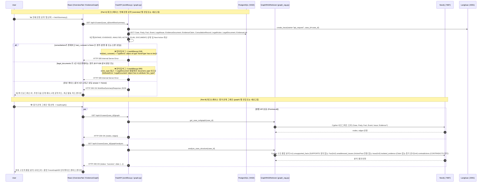

# EVT-035: 통합 워크플로우 요약 및 증거 그래프 시각화·분석 조회 (Workflow Summary & Graph Visualization)

## 1. 이벤트 메타데이터

| 항목 | 내용 |
|---|---|
| **이벤트 ID** | `EVT-035` *(코드 전수 조사 추가 발견 이벤트)* |
| **이벤트 명칭** | 사건 5단계 워크플로우 요약 대시보드(`OverviewTab`) 및 Neo4j 증거 관계 그래프 시각화·구조 분석(`EvidenceGraph`) 조회 |
| **구현 상태** | **PARTIAL (잠복 HTTP 500 버그 2건 내포)** — 그래프 시각화·분석 및 기본 워크플로우 요약은 정상 동작하나, **`workflow.py:305`의 `d.doc_type` `AttributeError` 및 `workflow.py:218`의 `len(last_c.answer)` `TypeError` 버그 내포** |
| **발생 화면 / 컴포넌트** | 1) [`frontend/src/pages/CaseWorkspace.tsx:272-545`](file:///c:/myprjs/ai-legal-helper/frontend/src/pages/CaseWorkspace.tsx#L272-L545) (`OverviewTab`) 2) [`frontend/src/components/EvidenceGraph.tsx`](file:///c:/myprjs/ai-legal-helper/frontend/src/components/EvidenceGraph.tsx) (`EvidenceGraph`) |
| **호출 API** | `GET /api/v1/cases/{case_id}/workflow/summary`, `GET /api/v1/cases/{case_id}/graph`, `GET /api/v1/cases/{case_id}/graph/analysis` |
| **백엔드 진입점** | [`api/routes/workflow.py:115-315`](file:///c:/myprjs/ai-legal-helper/backend/src/ai_legal_helper/api/routes/workflow.py#L115-L315) (`get_workflow_summary`), [`api/routes/graph.py:71-125`](file:///c:/myprjs/ai-legal-helper/backend/src/ai_legal_helper/api/routes/graph.py#L71-L125) (`get_case_graph`, `analyze_case_graph`) |
| **서비스 함수** | [`rag/graph_rag.py:72-153, 281-395`](file:///c:/myprjs/ai-legal-helper/backend/src/ai_legal_helper/rag/graph_rag.py#L281-L395) (`get_case_subgraph`, `analyze_case_structure`) |
| **연관 저장소** | PostgreSQL (사건 하위 전 테이블 집계), Neo4j (`:7687`) |

---

## 2. End-to-End Sequence Diagram

---

## 3. 13단계 실행 경로 상세 추적

1. **이벤트 발생 화면 및 컴포넌트**:
   - `overview` 탭: [`CaseWorkspace.tsx:272`](file:///c:/myprjs/ai-legal-helper/frontend/src/pages/CaseWorkspace.tsx#L272) `OverviewTab`
   - `graph` 탭: [`EvidenceGraph.tsx:52`](file:///c:/myprjs/ai-legal-helper/frontend/src/components/EvidenceGraph.tsx#L52) `EvidenceGraph`
2. **이벤트 핸들러**: `fetchSummary`(`CaseWorkspace.tsx:278`) → `getWorkflowSummary(caseId)`([`api/workflowClient.ts:75`](file:///c:/myprjs/ai-legal-helper/frontend/src/api/workflowClient.ts#L75)), `loadGraph`(`EvidenceGraph.tsx:58`) → `getCaseGraph(caseId)` & `getCaseGraphAnalysis(caseId)`([`api/graphClient.ts:38-55`](file:///c:/myprjs/ai-legal-helper/frontend/src/api/graphClient.ts#L38-L55)).
3. **호출되는 API와 HTTP Method**:
   - `GET /api/v1/cases/{case_id}/workflow/summary`
   - `GET /api/v1/cases/{case_id}/graph`
   - `GET /api/v1/cases/{case_id}/graph/analysis`
4. **FastAPI Router**: [`api/routes/workflow.py:115`](file:///c:/myprjs/ai-legal-helper/backend/src/ai_legal_helper/api/routes/workflow.py#L115), [`api/routes/graph.py:71, 110`](file:///c:/myprjs/ai-legal-helper/backend/src/ai_legal_helper/api/routes/graph.py#L71).
5. **Service / Repository 함수**: `get_workflow_summary()`, `GraphRAGRetriever.get_case_subgraph()`, `GraphRAGRetriever.analyze_case_structure()`.
6. **DB 읽기·쓰기**:
   - `workflow/summary`: PostgreSQL에서 사건 하위 10개 테이블을 모두 Read-Only 조회하여 집계.
   - `graph` / `graph/analysis`: Neo4j에서 Cypher Read-Only 트랜잭션 실행.
7. **AI Agent 또는 RAG 호출**: `GraphRAGRetriever.analyze_case_structure()`(`graph_rag.py:281-395`)가 그래프 위상(Topology) 쿼리로 **미입증 사실(`unsupported_facts`)**, **미해결 쟁점(`unaddressed_issues`)**, **고립된 증거(`isolated_evidence`)**, **모순 관계(`contradictions`)**를 계산한다.
8. **외부 LLM·도구 호출**: 없음 (순수 DB/Cypher 집계).
9. **응답 JSON 구조**:
   - `WorkflowSummaryResponse` ([`workflow.py:86-98`](file:///c:/myprjs/ai-legal-helper/backend/src/ai_legal_helper/api/routes/workflow.py#L86-L98))
   - `GraphData` (`{nodes, edges, message}`) 및 `GraphAnalysisResponse` (`{status, data: {summary, unsupported_facts, unaddressed_issues, isolated_evidence, contradictions}}`).
10. **프런트엔드 상태 변경**: `OverviewTab`의 `summary` 상태, `EvidenceGraph`의 `graphData`, `analysis`, `selectedNode` 상태 갱신.
11. **화면 출력**:
    - `OverviewTab`: 5단계 스텝 인디케이터, `해당 단계로 이동 ->` 버튼이 있는 추천 다음 단계 배너, 4개 도메인 요약 카드, 타임라인/최근 활동 피드.
    - `EvidenceGraph`: `react-force-graph-2d` 캔버스(노드 클릭 시 줌인 및 우측 하단 상세 패널 표시, `🎯 화면 맞춤` 버튼 지원) 및 좌측 구조 분석 패널.
12. **Langfuse 기록**: 각 GET 요청별 `api_request` Root Trace 기록.
13. **실패·예외 처리 및 잠복 버그 2건**:
    - **잠복 버그 1 (`workflow.py:305`)**: `[{"id": d.id, "title": d.title, "doc_type": d.doc_type, "status": d.status} for d in documents[:3]]`에서 `LegalDocument` 모델은 `document_type` 컬럼만 가지고 있어 문서가 1건이라도 생성되면 즉시 `AttributeError` (HTTP 500)가 발생한다.
    - **잠복 버그 2 (`workflow.py:218`)**: `last_c.answer[:120] + "..." if len(last_c.answer) > 120 else last_c.answer`에서 최근 상담이 `IN_PROGRESS`이거나 `answer`가 `None`인 상태면 `len(None)`으로 `TypeError` (HTTP 500)가 발생한다.

