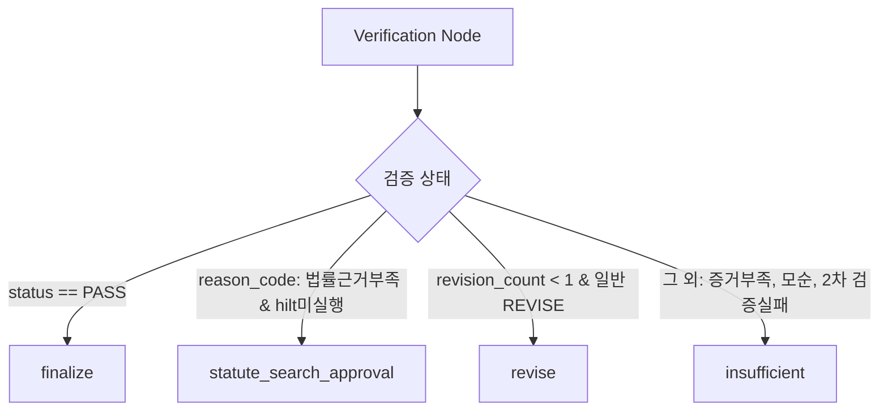

# AI Legal Helper — 03. P0 결함 수정 설계 및 상태 전이 모델

## 1. 개요
본 문서는 Phase B에서 적용할 P0 결함 4건의 상세 수정 설계와 상태 전이 정책을 기술한다.

---

## 2. P0-01: Verification Agent Fail-Safe 설계

### 2.1 예외 처리 정책
1. `run_verification()` 내에서 LLM 호출, 타임아웃, 파싱 등 예외 발생 시 일시적 오류(Timeout, ConnectionError)에 대해 1회 제한적 재시도를 수행한다.
2. 재시도 후에도 실패하거나 치명적 오류인 경우:
   - `status`: `"INSUFFICIENT"` (안전 종료 및 미검증 경고 분기 유도)
   - `reason_code`: `"VERIFICATION_ERROR"`
   - `recommended_action`: `"SAFE_FALLBACK"`
   - `warnings`: `["법률검증 시스템 오류로 인해 답변을 검증하지 못했습니다. 전문가 상담을 권고합니다."]`
   - **절대로 `PASS`나 `FINALIZE`를 반환하지 않는다.**

---

## 3. P0-02: HILT 검증 정책 및 라우팅 설계

### 3.1 HILT 진입 라우팅 정책
- 오직 사유가 법률 근거 부족(`reason_code in ("LEGAL_SOURCE_MISSING", "LEGAL_SOURCE_INSUFFICIENT")`)이고 실제 후보 법령(`candidate_laws`)이 식별된 경우에만 `statute_search_approval`로 분기한다.
- `CASE_EVIDENCE_MISSING`(증거 부족), `EVIDENCE_CONFLICT`(증거 모순) 등 사실관계 문제는 HILT 법령 검색으로 진입하지 않고 `insufficient_node`로 안전 분기한다.

### 3.2 HILT 완료 후 2차 검증 라우팅 정책
- `hilt_executed == True`이더라도 Verifier 결과가 `PASS`인 경우에만 `finalize`로 전이한다.
- 2차 검증에서 `status in ("INSUFFICIENT", "REVISE", "ERROR")`인 경우:
  - 이미 1회 재작성 및 HILT를 거쳤으므로(`revision_count >= 1`), 무한 루프를 방지하고 `insufficient_node`로 안전하게 전이하여 검증 실패 사실을 고지한다.

---

## 4. P0-03: PostgreSQL 영속 Checkpointer 설계

### 4.1 Checkpointer 인스턴스 전략
1. Windows 비동기 환경(`psycopg` Proactor 제약) 극복:
   - `main.py` 및 백엔드 기동 시 `sys.platform == 'win32'`이면 `WindowsSelectorEventLoopPolicy`를 등록.
2. `get_checkpointer()` 구현:
   - `psycopg_pool.AsyncConnectionPool` 기반 `AsyncPostgresSaver`를 싱글톤 풀로 연결.
   - 데이터베이스 URL 환경변수(`DATABASE_URL`)를 참조하여 PostgreSQL의 영구 `checkpoints` 테이블에 상태를 저장.
   - 서버 프로세스 재시작 후에도 동일한 `thread_id`로 `Command(resume=...)` 실행 시 정확히 중단 지점 복원.

---

## 5. P0-04: 공식 법령 검색 보안 및 무결성 설계

### 5.1 엔드포인트 및 통신 암호화
- 모든 법제처 API 호출을 `https://www.law.go.kr`로 변경.
- HTTP 요청 헤더에 적절한 User-Agent 및 10초 타임아웃, 1회 지수 백오프 재시도 적용.

### 5.2 임의 법령 채택 제거 (Strict Law Match)
- `search_root.find(".//law")`로 첫 번째 법령을 임의 선택하던 라인을 완전히 삭제.
- 완전 일치 및 정제 일치(공백/특수문자 제거)가 모두 실패하면 즉시 빈 목록을 반환하여 잘못된 법령 인용 원천 차단.
- API 키 파라미터(`OC=...`)는 로그 및 예외 출력 시 `OC=[MASKED]`로 마스킹.

