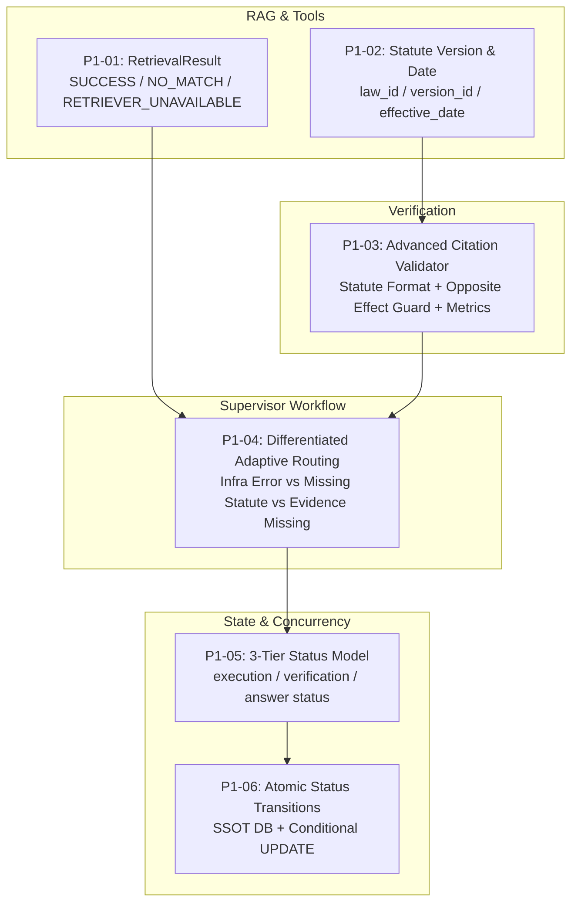

# P1 결함 수정 및 논리 개선 상세 설계서 (Remediation Design)

**프로젝트:** AI Legal Helper  
**수행 일자:** 2026-10-18  
**설계 대상:** P1 (P1-01 ~ P1-06)  

---

## 1. 아키텍처 및 계층별 설계



---

## 2. 세부 설계 내역

### 2.1 P1-01: RAG 검색 결과와 검색 장애 구분
- **`RetrievalStatus` Enum:**
  - `SUCCESS`: 1건 이상의 문서 검색 성공
  - `NO_MATCH`: 정상 검색되었으나 관련 문서가 0건
  - `COLLECTION_MISSING`: 해당 법률 카테고리의 Chroma 컬렉션이 존재하지 않음
  - `RETRIEVER_UNAVAILABLE`: Chroma 연결 단절, 타임아웃, 소켓 오류
  - `EMBEDDING_ERROR`: 임베딩 API 호출 실패
  - `CONFIGURATION_ERROR`: 잘못된 설정값
- **`RetrievalResult` Dataclass:**
  - `status: RetrievalStatus`
  - `documents: List[Document]`
  - `error_detail: Optional[str]`
  - `collection_name: Optional[str]`
  - `used_index_info: str` ("HTTP_REMOTE", "LOCAL_PERSISTENT", "EPHEMERAL_TEST")
- **호환성 보장:**
  - 기존 `retrieve(...) -> List[Document]`는 `retrieve_with_status(...).documents`를 반환하여 기존 호출부 100% 호환.
  - 신규 코드는 `retrieve_with_status`를 호출하여 상태별 분기 가능.

### 2.2 P1-02: 법령 시행일 및 버전 관리
- **`StandardSource` 스키마 확장:**
  - `law_id: Optional[str] = None` (법제처 법령ID, 6자리)
  - `promulgation_date: Optional[str] = None` (공포일자 YYYY-MM-DD)
  - `promulgation_number: Optional[str] = None` (공포번호)
  - `version_id: Optional[str] = None` (법령일련번호 MST)
- **날짜 비교 유틸리티:**
  - `is_statute_applicable_to_date(source_dict: Dict, target_date_str: str) -> bool`
  - 사건 발생일과 `effective_date`를 비교하여 법령 시행 이전 사건인지 검증.

### 2.3 P1-03: Source Registry 및 Citation Validator 고도화
- **법령 전용 인용 정규식 확장:**
  - `(법령명 제X조)` 또는 `(법령명 제X조의Y)` 패턴을 인식:
    `STATUTE_CITATION_PATTERN = re.compile(r"\(([가-힣]+법(?:률)?)\s*(제\s*\d+\s*조(?:\s*의\s*\d+)?)\)")`
- **조문 번호 일치 검증:**
  - 인용된 조문(예: `제6조의2`)이 실제 `retrieved_sources`의 `article`과 일치하는지 대조 (`ARTICLE_MISMATCH` 감지).
- **법률 효과 왜곡(Opposite Effect) 감지:**
  - 본문에 "3개월", "유예", "경과" 등의 기간 요건이 명시된 조문에 대해 초안이 "즉시", "당일", "즉각" 효력이 발생한다고 단정하는 경우 불일치(`LEGAL_EFFECT_CONTRADICTION`) 처리.
- **평가지표 정밀화:**
  - `citation_coverage_rate`: 초안의 법률 주장 문장 중 출처가 인용된 비율.
  - 제로 분모(인용 0건) 시 `1.0`이 아닌 `"N/A"` 또는 `0.0` 산출.

### 2.4 P1-04: Adaptive Retrieval 의사결정 차별화
- `verification_condition()` 정밀 분기:
  1. `reason_code in ("RETRIEVER_UNAVAILABLE", "COLLECTION_MISSING")` -> `insufficient` (인프라 장애 안내 및 안전 종료)
  2. `reason_code in ("LEGAL_SOURCE_MISSING", "LEGAL_SOURCE_INSUFFICIENT")` and `candidate_laws` -> `statute_search_approval` (HILT)
  3. `reason_code == "CASE_EVIDENCE_MISSING"` -> `insufficient` (사용자에게 증거 보강 안내)
  4. `status == "REVISE"` or `reason_code == "ANSWER_REVISION_REQUIRED"` -> 1회 한정 `revise`

### 2.5 P1-05: 3계층 상태 모델
- `ConsultationRecord` (DB) 및 `ConsultationResponse` (API) 필드 분리:
  - `execution_status`: `IN_PROGRESS`, `APPROVAL_REQUIRED`, `COMPLETED`, `FAILED`
  - `verification_status`: `PASS`, `REVISE`, `INSUFFICIENT`, `ERROR`, `UNVERIFIED`
  - `answer_status`: `VERIFIED`, `PARTIAL`, `WITHHELD`, `PENDING`
  - 기존 `status` 필드는 `execution_status`와 동기화하여 하위 호환성 유지.

### 2.6 P1-06: API 동시성 및 DB 일관성
- SSOT: PostgreSQL `ConsultationRecord`.
- 원자적 전이:
  ```python
  updated = db.query(ConsultationRecord).filter(
      ConsultationRecord.request_id == request_id,
      ConsultationRecord.status == "APPROVAL_REQUIRED",
  ).update({
      "status": "IN_PROGRESS",
      "execution_status": "IN_PROGRESS"
  }, synchronize_session=False)
  db.commit()
  if updated == 0:
      raise HTTPException(status_code=409, detail="이미 처리 중이거나 유효하지 않은 승인 상태입니다.")
  ```

