# P0 핵심 결함 4건 수정 설계서

**문서 번호:** `docs/code-audit/p0-followup/02_DESIGN.md`  
**작성 일자:** 2026-10-18  
**대상 저장소:** `yjjungyo/ai-legal-helper`

---

## 1. 아키텍처 불변조건 (Invariants)

본 설계는 다음 세 가지 핵심 불변조건을 시스템 수준에서 강제한다.

- **불변조건 1:** 공식 법령(`OFFICIAL_STATUTE_SEARCH`)을 검색했다는 이유만으로 답변을 `PASS` 처리하지 않는다.
- **불변조건 2:** 미검증 법률 분석은 고객 답변(`final_answer` / API `answer`)으로 확정되거나 고객에게 노출되지 않는다.
- **불변조건 3:** 고객에게 검증된 출처(`cited_sources`)로 표시되는 자료는 최종 답변의 검증된 주장과 반드시 연결되어 있어야 한다.

---

## 2. 상태 전이 및 답변 전달 정책 모델

### 2.1 3단계 답변 전달 정책 (Answer Delivery Policy)

| 상태 (`answer_status`) | 조건 | 고객 화면 노출 정책 | 내부 감사 저장 |
|---|---|---|---|
| `DELIVERED` | `verification_status == "PASS"` | 정밀 검증 완료된 최종 법률 의견서 및 인용 출처 표시 | 정규 검증 Trace 및 인용 감사 기록 |
| `CAUTIONARY` | `verification_status == "REVISE"` | 제한된 조건부 설명 및 법적 주의사항(⚠️) 배너 표시 | 보완 지침 및 유의사항 메타데이터 |
| `WITHHELD` | `verification_status in ("INSUFFICIENT", "FAIL", "UNVERIFIED")` | **미검증 초안 완전 비노출**, 판단 유보 사유(🛡️) 및 안전 안내만 표시 | `internal_draft`, `missing_evidence`, `unresolved_issues` |

### 2.2 레거시 데이터 호환 정책

과거 데이터베이스 레코드에 `answer_status`가 없는 경우:
- `verification_status == "PASS"` -> `DELIVERED`로 보정
- `verification_status == "REVISE"` -> `CAUTIONARY`로 보정
- 그 외(`INSUFFICIENT`, `FAIL`, `UNVERIFIED`, `None`) -> `WITHHELD`로 안전 처리 (임의로 `DELIVERED` 처리 절대 금지)

---

## 3. 데이터 계층 및 Source Registry 분리 모델

검색된 전체 출처와 고객에게 노출되는 검증 출처를 논리적으로 엄격히 분리한다.

```mermaid
flowchart TD
    subgraph RAG & Search Layer
        A1[ChromaDB Vector Store] --> R[retrieved_sources / 100% 원본 보존]
        A2[Neo4j Graph Store] --> R
        A3[open.law.go.kr 공식 검색] --> R
    end

    subgraph LLM Generation Layer
        R --> Draft[답변 초안 작성]
        Draft --> GenCites[generated_citations / 생성된 인용 ID]
    end

    subgraph Verification Layer
        GenCites --> GroundingAudit[Grounding & Content Support Audit]
        R --> GroundingAudit
        GroundingAudit --> ValCites[validated_citations / 본문 뒷받침 통과]
        GroundingAudit --> RejCites[rejected_citations / 허위·무관 인용]
    end

    subgraph Final Delivery Layer
        ValCites --> CitedSources[cited_sources / 고객용 검증 출처]
        RejCites -.-> Excluded[고객 출처에서 제외]
        CitedSources --> CustomerUI[고객 상담 화면 Two-Tier View]
    end
```

### 3.1 출처 데이터 계층 정의
1. `retrieval_source_ids`: 검색된 원본 출처 전체 ID (청크 다중 건 손실 없이 보존)
2. `retrieved_chunk_ids`: 원본 검색 청크 식별자 전체
3. `generated_citation_ids`: 초안에 실제 등장한 인용 ID
4. `validated_citation_ids`: 출처 본문과 대조하여 뒷받침이 입증된 인용 ID
5. `cited_sources`: **최종 답변에서 실제로 인용되고 검증을 통과한 출처 목록만** 포함 (답변에 미인용된 출처는 완전 배제)
6. `rejected_citation_ids`: 존재하지 않거나 본문과 불일치하는 인용 ID

---

## 4. HILT 재분석 도메인 중립화 및 동적 맥락 설계

`re_analyze_node`의 전세보증금 편향을 완전히 제거하고, 도메인 중립적 4단계 표준 구조를 확립한다.

### 4.1 동적 맥락 주입 (Dynamic Context Injection)
- `categories`: 사건 분야 (예: "임대차", "대여금", "노동/임금")
- `case_context`: 사건 타임라인 및 객관적 사실관계
- `agent_context_text`: 라우터 및 분야별 전문 에이전트(Specialist)의 분석 내용 보존 및 주입
- `official_statutes_text`: 외부 공식 법령 검색으로 확보된 신뢰할 수 있는 법조문 원문

### 4.2 4단계 표준 답변 구성 체계
1. `[1. 핵심 결론]`: 질문에 대한 3줄 이내 요약
2. `[2. 지금 해야 할 일 (Action Plan)]`: 사건 유형에 맞는 단계별 우선순위 조치
3. `[3. 쟁점별 상세 법률 분석]`: 확보된 법령에 기반한 법률요건 충족 및 법률 효과 분석
4. `[4. 추가 확인사항 및 유의사항]`: 증거 보강 필요사항, 상대방의 항변 위험, 실무상 유의사항

