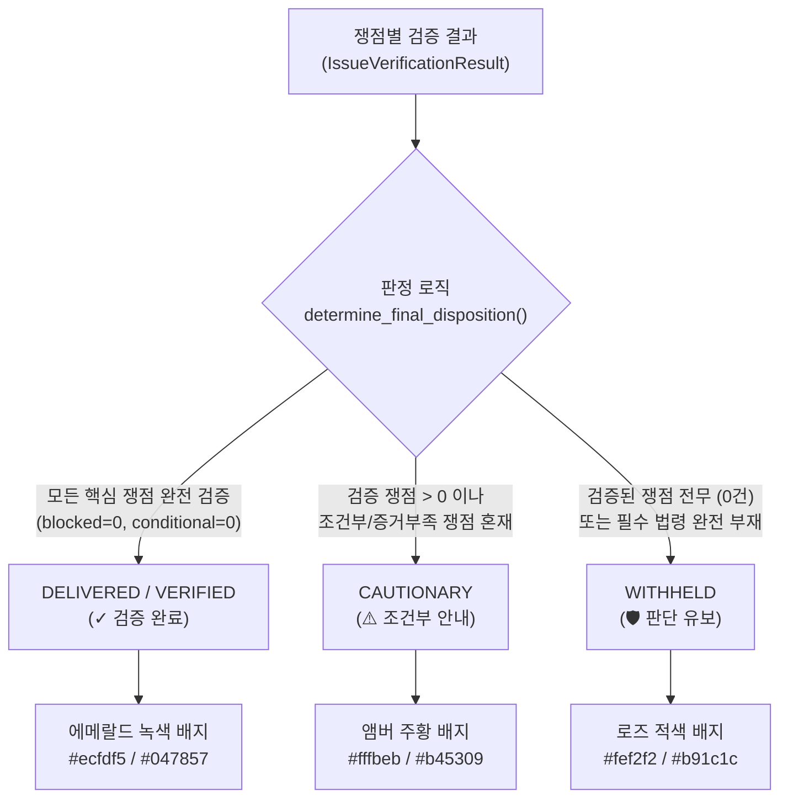

# AI Legal Helper — 시스템 전체 코드값(Code Values) 명세 및 최종 처분 배지 정의서

> **문서 개요:** 본 문서는 AI Legal Helper 시스템의 프론트엔드와 백엔드 전반에서 사용되는 모든 핵심 코드값(Enum, Status Code, Disposition Code)의 정의, 생성 위치, 판정 조건, 사용처, 그리고 UI 최종 검증 판정 배지 렌더러(`VERIFIED`, `CAUTIONARY`, `WITHHELD`)의 동작 원리를 체계적으로 설명합니다.

---

## 1. 최종 검증 판정 배지 렌더러 (Final Disposition Badges)

### 1.1 UI 배지 렌더러 소스 위치
- **컴포넌트:** [`frontend/src/components/chat/AssistantMessage.tsx`](file:///c:/myprjs/ai-legal-helper/frontend/src/components/chat/AssistantMessage.tsx#L52-L88)
- **함수:** `renderDispositionBadge(disposition?: string)`
- **호출 위치:** 라인 165: `renderDispositionBadge(message.final_disposition || message.answer_status)`

```tsx
function renderDispositionBadge(disposition?: string) {
  if (!disposition) return null;
  switch (disposition) {
    case 'VERIFIED':
    case 'DELIVERED':
      return (
        <span className="badge" style={{ backgroundColor: '#ecfdf5', color: '#047857', border: '1px solid #a7f3d0' }}>
          ✓ 검증 완료
        </span>
      );
    case 'CAUTIONARY':
      return (
        <span className="badge" style={{ backgroundColor: '#fffbeb', color: '#b45309', border: '1px solid #fde68a' }}>
          ⚠️ 조건부 안내
        </span>
      );
    case 'WITHHELD':
      return (
        <span className="badge" style={{ backgroundColor: '#fef2f2', color: '#b91c1c', border: '1px solid #fecaca' }}>
          🛡️ 판단 유보
        </span>
      );
    default:
      return null;
  }
}
```

---

### 1.2 3대 최종 처분 코드 상세 분석



---

#### ① `CAUTIONARY` (⚠️ 조건부 안내)
- **개념 및 법률적 의미:**
  - "부분적으로 입증된 사실과 법률 쟁점은 실질적인 분석을 제공하되, 미확인된 사실이나 전제조건이 존재하여 조건부로 유의사항을 병기한 답변"
  - 일부 쟁점의 증거가 부족하다고 해서 전체 답변을 버리지 않고, **확인된 범위 내에서 의뢰인을 구제할 수 있는 실질적 조언을 안전하게 보존(Partial Answer Preservation)**하는 것이 핵심 가치입니다.
- **언제, 어디서 값을 지정하는가? (Assignment):**
  - **파일:** [`backend/src/ai_legal_helper/workflows/final_disposition.py`](file:///c:/myprjs/ai-legal-helper/backend/src/ai_legal_helper/workflows/final_disposition.py#L265-L303) (`determine_final_disposition`)
  - **판정 조건:**
    1. 검증 완료된 쟁점(`verified_count > 0`)이 1건 이상 존재함.
    2. 동시에 조건부 쟁점(`conditional_count > 0`) 또는 추가 증거 필요 쟁점(`needs_evidence_count > 0`), 차단된 쟁점(`blocked_count > 0`)이 섞여 있음.
    3. 코드:
       ```python
       return "CAUTIONARY", (
           f"검증 완료 쟁점 {verified_count}건, 조건부 쟁점 {conditional_count}건이 "
           f"식별되어 확인된 범위 내에서 실질적 분석을 제공합니다."
       )
       ```
  - **발생 예시:**
    - "2022년 입주·전입·확정일자로 대항력과 우선변제권 구조는 검증되었으나(`VERIFIED`), 현재 점유를 유지하고 있다는 사실은 증빙 서류가 아닌 의뢰인 진술에 의존하고 있는 경우(`CONDITIONAL`)"
    - "가압류보다 대항력이 선순위임은 확인되었으나, 최신 등기부상 선순위 근저당권 존재 여부는 추가 확인이 필요한 경우"
- **어디에서 사용되는가? (Usage):**
  - **백엔드:** `legal_workflow.py`의 `finalize_node`에서 답변 조립 모듈이 유의사항(점유 유지, 등기부 추가 열람 등)을 답변에 포함시키도록 유도.
  - **프론트엔드:** `AssistantMessage.tsx`에서 `renderDispositionBadge()`에 전달되어 상단 헤더에 `⚠️ 조건부 안내` 배지를 렌더링.

---

#### ② `VERIFIED` / `DELIVERED` (✓ 검증 완료)
- **개념 및 법률적 의미:**
  - "등록된 객관적 증거와 현행 법령 조문에 의해 모든 핵심 쟁점의 성립 요건이 100% 입증되고, 모순이나 미확인 전제조건이 없는 완전 신뢰 답변"
- **언제, 어디서 값을 지정하는가? (Assignment):**
  - **파일:** `final_disposition.py` 라인 295:
    ```python
    if verified_count > 0 and conditional_count == 0 and needs_evidence_count == 0 and blocked_count == 0:
        return "DELIVERED", f"핵심 법률 쟁점 {verified_count}건이 등록 증거 및 관련 법령에 의해 검증되었습니다."
    ```
  - **판정 조건:** 모든 단위 쟁점이 `VERIFIED` 상태이며, 조건부나 결함 쟁점이 0건인 경우.
- **어디에서 사용되는가? (Usage):**
  - `AssistantMessage.tsx`에서 에메랄드 녹색의 `✓ 검증 완료` 배지로 표시.
  - 의뢰인에게 가장 높은 수준의 법률적 확신과 행동 지침을 부여.

---

#### ③ `WITHHELD` (🛡️ 판단 유보)
- **개념 및 법률적 의미:**
  - "증거 불충분, 필수 법령 부재, 또는 법적 모순으로 인해 AI가 섣불리 단정적인 결론을 내려서는 안 되는 상태"
  - **허위 법률 조언(환각)을 원천 차단**하기 위해 법률 판단을 의도적으로 유보하고, 사실관계 확인 가이드만 제공.
- **언제, 어디서 값을 지정하는가? (Assignment):**
  - **파일:** `final_disposition.py` 라인 291:
    - 검증 완료 및 조건부 쟁점이 전혀 없을 때 (`verified_count == 0 and conditional_count == 0`).
  - **파일:** [`legal_workflow.py`](file:///c:/myprjs/ai-legal-helper/backend/src/ai_legal_helper/workflows/legal_workflow.py#L3307) (`insufficient_node`):
    - RAG 법령 검색 결과가 비어 있거나 외부 API가 중단된 경우 (`LEGAL_SOURCE_MISSING`).
    - 재작성 2회 한도 도달 후에도 근거가 부족할 때 (`revision_count >= 2`).
    - 라우터 분야 판별 실패 시 (`ROUTING_EXIT`).
- **어디에서 사용되는가? (Usage):**
  - `AssistantMessage.tsx`에서 적색의 `🛡️ 판단 유보` 배지로 표시.
  - 본문에는 법률 결론 대신 "추가 사실 확인 및 관할 기관(주택과, 법률구조공단 등) 확인 필요" 고지문이 출력됨.

---

## 2. 3계층 상태 분리 모델 (Three-Tier Status Model)

AI Legal Helper는 상담의 진행 상태, 검증기의 품질 판정, 그리고 고객에게 제공되는 답변 처분을 서로 섞지 않고 3개 계층으로 엄격히 분리하여 관리합니다 ([`schemas/consultation.py`](file:///c:/myprjs/ai-legal-helper/backend/src/ai_legal_helper/api/schemas/consultation.py#L223-L235)).

| 계층 (Tier) | 필드명 | 허용 코드값 | 설명 |
|---|---|---|---|
| **Tier 1: 시스템 실행 상태** | `execution_status` | `IN_PROGRESS` | LangGraph 백그라운드 워크플로우 실행 중 |
| | | `APPROVAL_REQUIRED` | HITL 외부 법령 검색 사용자 승인 대기 |
| | | `COMPLETED` | 워크플로우 정상 완료 (답변 생성 성공) |
| | | `ERROR` | 예외 발생으로 인한 비정상 중단 |
| **Tier 2: 검증기 품질 판정** | `verification_status` | `PASS` | 인용 출처 및 사실-법령 포섭 검증 전원 통과 |
| | | `REVISE` | 출처 불일치, 금액 오류 등으로 LLM 재작성 요구 |
| | | `INSUFFICIENT` | 필수 근거 부재로 재작성 중단 및 유보 안내 전환 |
| | | `UNVERIFIED` | 검증 노드를 거치지 않은 상태 |
| **Tier 3: 최종 답변 처분 정책** | `answer_status` / `final_disposition` | `DELIVERED` | 모든 핵심 쟁점 검증 완료 (배지: ✓ 검증 완료) |
| | | `CAUTIONARY` | 조건부 쟁점 혼재, 부분 답변 보존 (배지: ⚠️ 조건부 안내) |
| | | `WITHHELD` | 근거 불충분으로 법률 판단 유보 (배지: 🛡️ 판단 유보) |
| | | `REVISED` | 검증 피드백 반영 후 수정본으로 납품된 상태 |

---

## 3. 단위 쟁점 검증 상태 (Issue Verification Status)

[`issue_verifier.py`](file:///c:/myprjs/ai-legal-helper/backend/src/ai_legal_helper/agents/issue_verifier.py) 및 `final_disposition.py`에서 단위 법률 쟁점(`IssueVerificationResult.status`)마다 판정하는 5대 코드값입니다:

| 코드값 | 국문 명칭 | 판정 기준 및 법률적 의미 |
|---|---|---|
| `VERIFIED` | 쟁점 검증 완료 | 등록된 객관적 증거와 현행 법령 조문에 의해 법률 요건이 100% 입증됨 |
| `CONDITIONAL` | 조건부 성립 | 특정 법률상 전제조건(예: 주민등록·점유 유지, 배당요구 종기 준수 등) 하에서만 효력이 인정됨 |
| `NEEDS_EVIDENCE` | 증거 부족 | 핵심 사실을 뒷받침할 객관적 증빙 서류(계약서, 금융거래내역, 등기부등본 등)가 미제출됨 |
| `NEEDS_LEGAL_SOURCE` | 법률 근거 부족 | 해당 주장을 뒷받침할 공인 법령 조문 또는 판례가 RAG에서 검색되지 않음 |
| `BLOCKED` | 쟁점 차단/불성립 | 상반되는 객관적 증거에 의해 모순되거나, 법률상 성립 요건이 명백히 결여되어 배척됨 |

---

## 4. 결정론적 QA 검증 사유 코드 (QA Defect Reason Codes)

[`qa_checker.py`](file:///c:/myprjs/ai-legal-helper/backend/src/ai_legal_helper/agents/qa_checker.py)에서 LLM 호출 전에 결정론적(Python 코드, 0ms)으로 검사하여 결함을 포착하는 사유 코드입니다:

| 결함 코드 | 발생 조건 및 검사 내용 | 후속 조치 |
|---|---|---|
| `CLAIM_CITATION_MISMATCH` | 답변에 기재된 `[E01]`, `[주택임대차보호법 제3조]` 태그가 실제 검색된 출처 목록에 존재하지 않음 | LLM에 출처 정정 재작성(`REVISE`) 지시 |
| `LEGAL_SOURCE_MISSING` | 답변이 주장하는 법률 효과에 필요한 필수 법조문이 RAG 검색 출처에 전혀 없음 | 근거 보충 시도 후 실패 시 `WITHHELD` 전환 |
| `FACT_CONFLICT` | 승인된 사실관계(Facts)와 반대되는 내용(예: 3억 원 계약인데 2억 원으로 기재)이 답변에 포함됨 | 사실 왜곡 교정 재작성(`REVISE`) 지시 |
| `QUESTION_UNMET` | 사용자가 질문에서 명시적으로 요구한 핵심 항목(예: 반환 잔액 계산, 이사 전 조치 등)이 누락됨 | 누락 항목 보완 재작성(`REVISE`) 지시 |
| `AMOUNT_MISMATCH` | 계약 보증금, 기반환액, 청구 잔액 등의 계산 수치가 금융거래 입증액과 불일치함 | 금액 교정 지시 |
| `TEMPORAL_MISMATCH` | 사건 발생일 시점에 시행되지 않은 미래 법령이나 구법을 잘못 적용함 | 적용 시점 일치 법령으로 교체 지시 |

---

## 5. 데이터베이스 엔티티 상태 코드 (Database Entity Statuses)

[`models.py`](file:///c:/myprjs/ai-legal-helper/backend/src/ai_legal_helper/database/models.py)의 주요 테이블에서 사용되는 정형 상태 코드입니다:

### 5.1 사실관계 사법적 판정 (`FactAdjudication.adjudication_status`)
- `EVIDENCE_SUPPORTED`: 제출된 서류 증거(계약서, 이체증 등)에 의해 직접 객관적으로 입증됨 (신뢰도 1.0)
- `CORROBORATED`: 복수의 간접 정황에 의해 신빙성이 보강됨
- `CONTRADICTED`: 상반되는 객관적 증거에 의해 거짓으로 판명되어 배척됨
- `DISPUTED`: 임대인과 임차인의 주장이 팽팽히 맞서 추가 입증이 필요한 다툼 상태
- `UNVERIFIED`: 객관적 증빙이 제출되지 않은 일방적 진술

### 5.2 증거 문서 및 추출 클레임 검토 (`review_status`)
- `APPROVED`: 사용자가 사실관계를 확인하고 최종 승인함 (답변 생성 시 100% 사실로 채택)
- `REJECTED`: 허위 사실이거나 사건과 무관하여 배제함
- `PENDING`: 사용자의 확인/승인을 기다리는 초기 추출 상태

### 5.3 사건 상태 (`Case.status`)
- `OPEN` / `ACTIVE`: 상담 및 증거 수집이 진행 중인 활성 사건
- `CLOSED`: 분쟁 해결 또는 상담 종결

### 5.4 법률 행동 계획 (`LegalAction.status`)
- `RECOMMENDED`: AI가 법률적으로 권고한 초기 상태
- `IN_PROGRESS`: 사용자가 해당 절차(예: 내용증명 발송)를 진행 중
- `COMPLETED`: 절차 이행 완료
- `DISMISSED`: 사용자가 불필요하다고 판단하여 취소

---

## 6. 상담 6단계 실시간 진행 상태 코드 (ConsultationStepStatus)

[`api/schemas/consultation.py`](file:///c:/myprjs/ai-legal-helper/backend/src/ai_legal_helper/api/schemas/consultation.py#L19-L26)에서 프론트엔드의 6단계 진행률 카드 렌더링에 사용되는 코드값입니다:

| 코드값 | UI 표시 | 의미 및 동작 |
|---|---|---|
| `PENDING` | 대기 중 (회색 원) | 아직 실행 순서가 도달하지 않은 후속 단계 |
| `RUNNING` | 분석 중... (파란색 스피너) | 현재 LangGraph 노드가 실행 중인 단계 |
| `COMPLETED` | 완료 (녹색 체크 ✓) | 정상적으로 실행이 완료된 단계 |
| `SKIPPED` | 생략됨 | 추가 조회가 불필요하여 건너뛴 단계 (예: 추가 법령 조회가 불필요한 경우) |
| `WAITING_APPROVAL` | 승인 대기 중 (주황색) | 국가법령정보센터 외부 검색을 위해 사용자의 승인을 기다리는 HITL 단계 |
| `FAILED` | 실패 (적색 느낌표 ⚠️) | 해당 노드 실행 중 오류가 발생한 단계 |

---

## 7. RAG 및 시간적 법률 적용 코드 (Temporal RAG Codes)

[`tools/statute_temporal.py`](file:///c:/myprjs/ai-legal-helper/backend/src/ai_legal_helper/tools/statute_temporal.py) 및 `index_worker.py`에서 법령의 효력 시점을 판정하는 코드값입니다:

| 코드값 | 의미 |
|---|---|
| `EFFECTIVE_DATE_VERIFIED` | 법제처 공포번호 및 부칙 해석을 통해 개별 조문의 실제 시행일자가 공식 확인됨 |
| `SOURCE_DERIVED` | 법령 XML 부칙 원문 텍스트에서 직접 규칙 기반으로 도출된 시행일자 |
| `SOURCE_GROUNDED_CANDIDATE` | LLM 보조 해석을 통해 부칙 원문 인용과 함께 도출된 후보 시행일자 |
| `UNCONFIRMED` | 부칙 규정이 모호하거나 공포일만 존재하여 정확한 조문 시행일이 확정되지 않음 |
| `OUT_OF_SCOPE` | 사건 기준일(예: 2024년) 시점에 아직 시행되지 않았거나 이미 폐지된 법령 |
