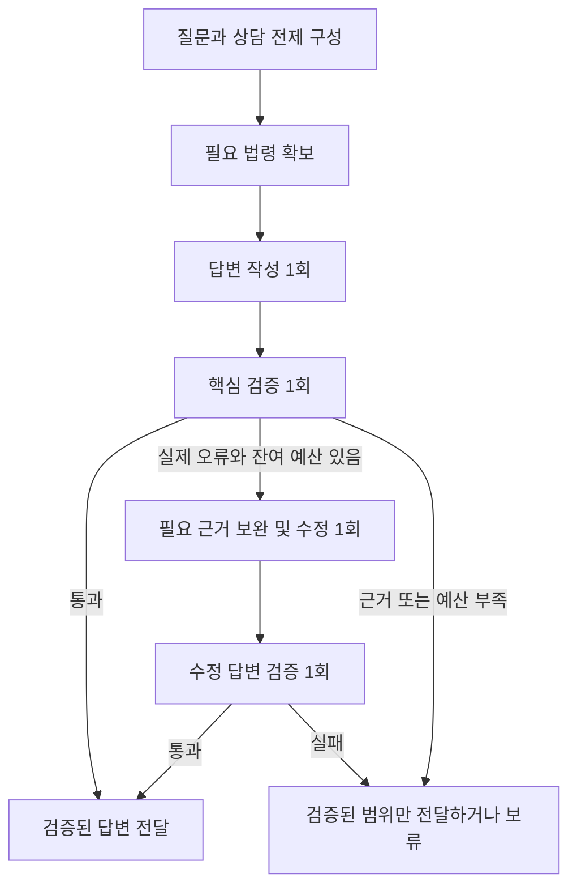

# 법률 상담 품질·응답시간 개선 개발 지시서

- 작성일: 2026-11-01 / 버전: 1.0
- 대상: `ai-legal-helper` 문서 기반 사건 상담 경로
- 상태: **구현 지시 및 수용 기준. 구현 완료 보고서가 아니다.**
- 목표: 등록 사실에 기초해 질문에 직접 답하고, 잘못된 법률 결론을 차단하면서 수분 단위의 반복 생성을 제거한다.

## 1. 작업 지시

아래 요구사항에 따라 현재 문서 상담 경로를 수정하고, 실패 trace를 재현하여 품질과 성능을 함께 검증하라. 프롬프트 문구만 추가하거나 검증을 완화하는 임시 수정으로 완료 처리하지 말라.

이 문서를 구현 작업으로 전달받은 개발 에이전트는 현재 작업 트리와 기존 변경을 먼저 확인하고 아래 순서대로 구현한다. 승인된 개발 범위의 일반 수정·검증은 진행하되, 배포·공유 데이터 변경 등 별도 작업으로 범위를 확대하지 않는다. 이 지시서의 작성 자체는 구현 실행을 의미하지 않는다.

### 필수 선행 문서

- 저장소 [AGENTS.md](../../AGENTS.md)
- [소스코드 주석 작성 표준](CODING_COMMENT_STANDARD.md)
- [10월 31일 실패 분석](../evaluation/SC001_TRACE_8FE8F0BE_FAILURE_ANALYSIS_2026-10-31.md)
- [11월 1일 품질·지연 분석](../evaluation/SC001_TRACE_DAE222E6_QUALITY_LATENCY_REVIEW_2026-11-01.md)

### 기준 trace

| 사례 | trace ID | 실제 관찰 |
|---|---|---|
| 검증 오탐·전체 보류 | `8fe8f0be-cd77-42bf-bab6-d80d2bc149ee` | 공식 조문 30개 확보 후 반복 수정, WITHHELD |
| 위험 판단 과장·12분 지연 | `dae222e6-857b-4991-a78f-5c885f37c917` | 최종 PASS/CAUTIONARY이나 수동 품질 실패, 모델 15회 |

두 번째 trace의 기준값은 전체 727.017초, 승인 전후 간격 제외 처리 651.061초, 모델 호출 구간 합계 641.991초, 공식 검색 두 번 합계 약 1.599초, 최종 답변 5,780자다. 검증기의 PASS를 제품 품질 PASS로 사용하지 않는다.

현재 파일에는 해당 trace 이후 변경이 있을 수 있다. 현재 코드와 과거 실행 코드를 동일하다고 가정하지 말고, 재현 시 코드·프롬프트·설정의 버전을 기록한다.

## 2. 범위와 개발 제약

### 포함

- 질문의 요청 항목과 상담 사실 전제 구성.
- 문서·사용자 진술·추론·법률 근거의 구분.
- 날짜 역할 및 사실 충돌 처리.
- 법령 선검색과 쟁점별 근거 확보 여부 관리.
- 작성·검증·수정·제한 답변의 실행 순서와 전역 예산.
- 사용자 답변, 인용, 부분 답변 상태, API/UI 상태 표시.
- Langfuse 관측 및 단위·통합·실제 모델 검증.

### 제약

- 기존 dirty/untracked 파일을 보존하고 필요한 부분만 수정한다. 기존 변경을 일괄 초기화하지 않는다.
- React/TypeScript + FastAPI + Python LangGraph 구조를 유지한다. 외부 레거시 프로젝트에 의존하지 않는다.
- 모델 교체를 선행 조건으로 삼지 않는다. 우선 현재 Azure 배포 모델로 변경 전후를 비교한다.
- 새 외부 라이브러리는 필요성과 호환성을 확인하고 `backend/requirements.txt`, `backend/pyproject.toml`에 함께 반영한다.
- 모든 신규·수정 코드의 한국어 Docstring/JSDoc 및 상태 전이 설명을 갱신한다.
- 실제 사건 DB에 테스트 사실을 추가하거나 기존 상담을 덮어쓰지 않는다. 승인된 가상 데이터와 격리 fixture를 사용한다.
- 일반 로그에 상담 원문·증거 본문·API Key를 기록하지 않는다. trace 수집은 기존 마스킹·수집 설정을 준수한다.

## 3. 필수 정책 A — 등록 사실을 상담 전제로 사용

### A-1. 전제 채택과 객관적 입증을 분리한다

사용자가 등록·확인한 사실 및 현재 질의에 직접 제시한 사실은 **상담의 전제로 채택**한다. 공적 원본이 없다는 이유만으로 모든 설명을 보류하거나 매번 재입증을 요구하지 않는다.

동시에 사용자 진술을 공적 증명·법원 확정 사실로 표시하지 않는다. 이는 상담 수행을 위한 전제 채택 정책이며, 증거의 진정성 보증 정책이 아니다.

| 입력 종류 | 처리 규칙 |
|---|---|
| 등록 계약서·지급 자료 | 해당 내용·행위자·금액·지급 방향을 분석 전제로 사용 |
| 등록 사실 및 사용자의 직접 진술 | 원문과 출처를 보존해 상담 전제로 사용 |
| 상대방 주장·발언 기록 | 발언이 있었다는 사실과 발언 내용의 진실을 구분 |
| 승인 전·반려·삭제된 증거 | 기존 권한·상태 정책에 따라 제외; 자동 승인 금지 |
| AI 추출 사실 | 원문 연결 및 검토 상태에 따라 사용; 추출했다는 이유만으로 승격 금지 |
| AI 추론·과거 AI 답변 | 사실 전제로 자동 채택하지 않음 |

현재 질문도 검증기의 근거 입력으로 다룬다. 예를 들어 “8월 12일 발견했다”는 사용자 진술은 `USER_INPUT:<request_id>:` 같은 식별자로 연결할 수 있어야 한다. 이를 법령 출처로 인정해서는 안 된다.

### A-2. 최소 사실 구조

아래 의미를 기존 스키마에 추가하거나 매핑한다. 이름 자체보다 구분과 동작을 지켜야 한다.

| 필드 | 의미 |
|---|---|
| fact_id | 사건 안에서 안정적인 사실 식별자 |
| proposition | 원문에 부합하는 단일 사실 표현 |
| subject / action / object | 누가 무엇을 누구에게 했는지 |
| source_kind / source_id / source_span | 문서·사용자 진술 등 출처와 원문 위치 |
| analysis_status | ACCEPTED_PREMISE / DISPUTED / MISSING / SUPERSEDED / INFERENCE |
| date_value / date_role | 날짜와 그 역할 |
| asserted_at / valid_as_of | 진술 시점과 사실이 적용되는 기준 시점 |
| scope | 예: 열람 메모에 기재된 을구 내용에 한정 |
| conflicts_with / supersedes | 실제 충돌과 명시적 정정 관계 |

가능한 한 기존 구조를 활용하고, 상담마다 전체 증거를 다시 LLM으로 구조화하는 별도 반복 호출을 추가하지 않는다. 추출 캐시는 문서 버전과 함께 관리한다.

### A-3. 충돌·정정 규칙

- 같은 사건·대상·속성·날짜 역할·적용 시점에 양립 불가능한 값이 있을 때 충돌로 판단한다.
- 발견일과 접수일, 통지일과 지정 종료일은 값이 달라도 그 자체로 충돌이 아니다.
- 명시적 정정은 이전 값과 정정 근거를 남기고 적용한다. 단순히 더 최근 메시지라는 이유만으로 모든 문서를 덮어쓰지 않는다.
- 과거 기준일의 거주 진술을 영구적 현재 상태로 바꾸지 않는다. 반대로 후속 변경 자료가 없다는 이유만으로 기존 진술을 매 질의마다 무효화하지도 않는다. 기준일을 표시하고 결론에 중요한 경우만 현재 상태를 확인한다.
- 충돌이 있어도 공통 전제로 답할 수 있는 부분은 설명한다. 결론에 영향 없는 차이로 전체 상담을 중단하지 않는다.
- 이번 사례의 “2022년 4월”과 E03의 “2022.02.22”를 조용히 합치지 않는다. 날짜 차이를 표시하되 두 값 모두 해당 가압류보다 앞선다는 공통 범위와 정확한 권리 취득일 확인을 구별한다.

**금지:** 모든 입력을 VERIFIED_FACT로 바꾸기, USER_STATEMENT를 일괄 UNSUPPORTED로 처리하기, ‘공적 원본 없음’을 모든 판단의 차단 조건으로 사용하기.

## 4. 필수 정책 B — 질문에 필요한 법률 판단을 분리

### B-1. 질문 범위를 먼저 고정한다

사용자 요청을 `requested_outputs`로 표현하고, 작성·검증이 같은 목록을 사용한다. 가압류 질의의 핵심은 해당 가압류가 기존 권리에 미치는 영향과 대응 변화다. 계약 전체를 처음부터 다시 설명하거나 질문 밖의 권리 검토를 통과 조건으로 추가하지 않는다.

관련 후속 사건은 무시하지 않되, 직접 답변에 필요한 정도로 사용한다. 해지 통지가 등록된 사건을 단순히 갱신 중으로만 단정해서는 안 된다.

### B-2. 다음 세 결론을 합치지 않는다

| 판단 | 필요한 분석 | 금지되는 도약 |
|---|---|---|
| 법적 우선순위 | 대항요건·확정일자·유지 상태와 비교 대상 권리의 성격·시점 | 후발 가압류 존재만으로 임차인 순위 하락 |
| 지급 지연 가능성 | 반환 요청, 분할반환 제안, 지급 곤란 발언 등 | 지연 정황을 곧바로 최종 손실로 전환 |
| 최종 회수액·손실 | 권리순위, 자산가치, 다른 우선권, 대항력·인수관계 등 | 채권자 수나 호가만으로 일부 미회수 확정·증가 단정 |

SC-001의 후발 일반 가압류 사례에서는 대항요건과 확정일자를 먼저 갖추고 유지한다는 전제를 적용해 상대적 순위를 설명한다. 확정일자만으로 모든 요건이 갖춰졌다고 보거나, 조세·다른 우선권 등 별개 문제까지 해결됐다고 표현하지 않는다.

법적 기대 결과는 실제 조문을 확보하여 검토한다. 참고 기준은 [주택임대차보호법 제3조의2](https://www.law.go.kr/법령/주택임대차보호법/제3조의2), [제3조의5](https://www.law.go.kr/법령/주택임대차보호법/제3조의5)이며, 이 문서의 예시를 사건별 법률 정답으로 하드코딩하지 않는다.

### B-3. 추론의 인과관계를 검증한다

- `CASE_INFERENCE`는 법률 근거 검사를 우회하는 유형이 아니다.
- 법률 효과와 정황 추론이 섞인 문장은 단일 주장으로 검증하지 않는다.
- 추론은 `premise_ids → reasoning → conclusion → claim_specific_limit`으로 연결한다.
- 한계 문구는 해당 주장과 의미상 연결되어야 한다. 다른 문단의 시세 한계 문구로 서두의 손실 위험 단정을 통과시키지 않는다.
- ‘기존보다 위험 증가’에는 비교 기준 시점·기존 자료·새 자료·변화한 요인을 제시해야 한다. 기존에 이미 알려진 사정을 새 가압류의 효과로 중복 계산하지 않는다.
- 긍정·부정어 누락으로 의미가 바뀌는 문장도 검출한다. 예: “반환받을 위험”과 “반환받지 못할 위험”.

## 5. 필수 정책 C — 답변 작성 전 필요한 근거 확보

### C-1. 검색 계획

긴 초안을 먼저 만든 뒤 검증기가 필요한 법령을 발견하는 순서를 기본 경로로 사용하지 않는다.

1. 현재 요청과 채택한 사실 전제로 필요한 쟁점을 정한다.
2. 사건에 유효한 기존 법령 근거와 버전을 확인한다.
3. 부족한 법령·조문만 검색한다.
4. 쟁점별 근거 확보 여부를 확인한 뒤 답변을 작성한다.

검색 계획은 기존 사건 유형·법령 매핑을 우선 활용한다. 모델이 필요한 경우 분류·요청 해석·검색 계획을 하나의 경량 호출에 통합하고 전역 호출 수에 포함한다.

검색 요청은 최소한 `question_part`, `issue_id`, `law_name`, `articles`, `reason`을 가진다. 법령명 목록 API에는 정규 법령명만 전송한다. 조문 가지번호를 정확히 구별하고 동일 번호의 다른 법을 혼동하지 않는다.

### C-2. 검색 결과와 충족 여부

- 조문을 찾은 개수로 쟁점 해결을 판정하지 않는다.
- 쟁점별로 확보 출처와 미확보 이유를 기록한다.
- 필요한 조문을 이미 확보했다면 설명 수정 문제를 법령 부족으로 다시 검색하지 않는다.
- 새 쟁점·미확보 조문에 대한 추가 검색은 최대 한 번 허용한다. 동일 요청 반복을 막고 전역 시간 예산에도 포함한다.
- 승인된 공개 법령 검색 범위는 같은 요청의 재개 후에도 유지한다. 범위 밖 조회는 기존 승인 정책을 따른다. 새 대기 시간과 승인 범위를 명시적으로 기록한다.
- 공식 검색·네트워크 실패·관련 결과 없음·확보 후 해석 오류를 서로 다른 상태로 다룬다.

사건 원문을 무작정 앞 N개·본문 앞 N자로 자르지 않는다. 질문에 필요한 자료를 선택하면서 관련 후속 사건·충돌 자료를 보존하고, 선택·제외 목록 및 원문 위치를 기록한다. 작성자와 검증기는 동일한 근거 버전을 사용해야 한다.

## 6. 필수 정책 D — 검증은 핵심 오류를 찾아 제한적으로 수정

### D-1. 검증 결과 구조

| 항목 | 요구사항 |
|---|---|
| status | PASS / REVISE / INSUFFICIENT의 의미 유지 |
| blockers | 잘못된 실제 문장/부분, 오류 종류, 근거, 필요한 수정 |
| suggestions | 표현·가독성 개선 권고. 단독으로 재작성시키지 않음 |
| coverage | 최초 요청 항목별 충족 여부와 제한 범위 |
| claims | 최종 결론과 중요 사실·법률 판단의 간결한 근거 연결 |
| preserved_points | 수정 중 유지할 설명. 현재 근거로 재대조하며 모순된 지침을 누적하지 않음 |
| model_decision / policy_adjustments | 모델 판단과 후처리 변경 사유를 분리 |

차단 대상은 질문 미응답, 당사자·금액·지급 방향·날짜 역할 오류, 법적 효과의 잘못된 적용, 근거 없는 중요 주장, 허위 출처, 모순된 첫 결론이다. 질문 밖의 추가 쟁점이나 더 자세한 설명의 필요성만으로 REVISE를 반복하지 않는다.

정상 주장마다 장문 이유를 생성하지 않는다. 오류 위치와 근거를 확인할 수 있는 간결한 결과를 사용한다. 구조화 출력의 형식 오류에 대한 재시도도 호출 예산에 포함한다.

### D-2. 후처리와 수정

- 모델 판정을 바꾸면 변경 전 판정·사유와 정책 변경 이유를 남긴다.
- SUPPORTED를 UNSUPPORTED로 바꾸면서 “자료에 부합한다”는 사유만 남기지 않는다.
- 표현에 ‘위험’, ‘가능성’이 들어 있다는 이유로 LEGAL_APPLICATION을 CASE_INFERENCE로 바꾸지 않는다.
- 인용 문자열의 존재와 주장 내용의 뒷받침을 구별한다.
- 일반 날짜 문자열을 판례번호로 인식하지 않는다. 지원하지 않는 번호 형식은 검증되지 않은 상태로 남긴다.
- 수정 시 원문·요청·정상 설명을 유지하며 실제 차단 오류만 고친다. 정정된 지침과 과거 지침의 충돌을 해소한다.

**금지:** 검증 상태만 PASS로 변경, 불확실한 주요 주장을 배열에서 제거해 PASS, 유형을 바꿔 법률 근거 검사 우회, 검증이 실패한 전체 초안 공개.

## 7. 필수 정책 E — 전역 호출·시간 예산

### E-1. 목표 실행 경로

기본 작성·검증은 2회다. 통합 계획 모델이 필요하면 1회를 추가한다. 수정은 작성·검증 한 쌍만 허용한다.

### E-2. 초기 POC 예산

아래는 이번 개발의 기본 설정과 수용 목표다. 달성 실적이 아니다. 환경상 미달이면 측정 결과와 이유를 보고하며 자동으로 기준을 완화하지 않는다.

| 항목 | 기준 |
|---|---|
| 정상 경로 모델 호출 | 2회, 통합 계획 필요 시 3회 |
| 요청 전체 모델 호출 상한 | **5회**. 분류·계획·작성·검증·수정·복구·SDK 재시도 모두 포함 |
| 수정 상한 | **1회** 및 그 결과의 검증 1회 |
| 공식 검색 | 최초 확보 + 필요한 추가 보완 1회 이내 |
| 활성 처리시간 목표 | 일반 질의 p50 ≤ 30초, p95 ≤ 60초 |
| 활성 처리시간 강제 한도 | 90초. 승인 대기 구간 제외, 재개 시 남은 예산 유지 |
| 일반 답변 분량 | 본문 약 800~1,500자 목표. 상세 요청은 별도 분량 정책 적용 |

90초 종료를 지켰다고 p95 60초 목표를 달성한 것으로 보지 않는다. 짧은 오류·보류 답변으로 지연 통계를 낮춘 것도 성공으로 집계하지 않는다.

### E-3. 구현 요구

- Gateway/공통 실행 래퍼에서 모든 실제 모델 호출을 계수한다. 노드마다 카운터를 따로 두지 않는다.
- SDK의 숨은 자동 재시도도 한도 안에서 제어한다. 실제 요청 횟수를 알 수 없으면 자동 재시도를 제한하고 공통 래퍼에서 관리한다.
- 단계 진입 전 남은 시간과 후속 검증 가능 여부를 확인한다. 검증할 시간이 없는데 새 초안을 시작하지 않는다.
- 요청 timeout과 출력 토큰 상한은 남은 예산에서 계산한다. 배포 모델의 지원 파라미터를 확인해 적용한다.
- timeout 후 백그라운드 호출이 계속 답변을 저장하거나 상태를 SUCCESS로 덮어쓰지 못하게 한다.
- 승인 interrupt/resume, 체크포인트 복원, 재시작 후에도 소비한 예산을 초기화하지 않는다. 실행 시간과 사용자 대기 시간을 분리 기록한다.
- 추가 검색 후 재작성, 제한 답변, JSON 복구를 별도 무료 호출로 취급하지 않는다.
- `finish_answer`는 기본적으로 전달·무결성 확인을 담당한다. 종료 노드 안에서 숨은 작성·검증 호출을 추가하지 않는다.

## 8. 필수 정책 F — 부분 답변과 사용자 표현

- 첫 문단에서 현재 질문에 직접 답한다. 확정적 첫 결론을 뒤의 일반 주의문으로 정당화하지 않는다.
- 등록 사실을 반복 나열하거나 같은 법률 설명을 여러 절에 복제하지 않는다.
- 상태별 분기가 필요하면 채택한 사실에 맞는 경로를 우선 설명하고 실제로 불명확한 부분만 분기한다.
- ‘지적했어야 한다’, ‘검증 실패’, 내부 JSON 등 검토자용 문장을 사용자 답변으로 내보내지 않는다.
- 법적 판단 한계와 표현상 겸손을 구별한다. 답할 수 있는 사항을 ‘확인 필요’로 회피하지 않는다.
- 답변 전체가 통과하지 못한 경우, 검증된 범위의 부분 답변은 수정 1회 예산 안에서 구성·검증한다. 사실·출처 연결과 맥락이 깨지는 단순 문장 삭제를 하지 않는다.
- 이미 검증된 독립 블록을 재사용하는 구현은 블록 경계·의존 전제·부정어·인용 연결을 검증해야 한다. 근거가 없으면 보류하고 임의의 새 법률 설명을 만들지 않는다.
- 타임아웃·보류는 상태를 명확히 전달한다. CAUTIONARY는 조건·한계가 있는 검증된 답변이지 검증 실패를 표시하는 우회 상태가 아니다.
- API의 실행 상태, 답변 처분, 검증 상태가 UI 배지와 모순되지 않게 한다. 기존 상태의 호환성을 유지한다.
- 검증 전 초안 전체를 스트리밍해 사용자에게 먼저 확정 조언처럼 보여주지 않는다. 진행 단계 표시는 가능하지만 최종 답변 지연 개선과 별도 측정한다.

## 9. 구현 대상과 순서

현재 코드 기준의 주요 위치다. 구현 전에 실제 함수와 호출 관계를 다시 확인한다.

| 순서 | 대상 | 변경 책임 |
|---|---|---|
| 1 | `case_intelligence/case_briefing.py`, `workflows/state.py` | 상담 전제·출처·날짜 역할·요청 범위와 전역 예산 |
| 2 | `llm/gateway.py`, `workflows/legal_workflow.py` | 호출 계수·timeout·재개 시 예산 보존·선검색 경로 |
| 3 | `workflows/document_search.py`, `tools/official_statute_search.py` | 쟁점별 검색·정확한 조문·승인 범위·중복 방지 |
| 4 | `agents/document_answer.py` | 질문 중심 작성, 상담 전제, 분리된 법률 판단과 추론 |
| 5 | `agents/document_verification_prompt.py`, `agents/verification.py` | 핵심 차단 오류·간결한 검증·변경 사유·실제 원문 대조 |
| 6 | `workflows/document_consultation.py` | 최대 1회 수정, 예산 내 부분 답변, 종료 노드의 숨은 호출 제거 |
| 7 | `api/routes/consultation.py`, 프런트 답변/상태 컴포넌트 | 완료·부분 답변·보류·시간 초과의 일관된 표시 |
| 8 | 테스트·재현 스크립트·평가 보고서 | 아래 수용 기준 검증 |

현재 파일의 중복 분기·도달 불가능한 코드도 변경 범위 안에서 정리한다. 프롬프트·후처리·워크플로우가 서로 다른 정책을 적용하지 않도록 공통 계약을 정의한다.

## 10. 필수 회귀 테스트

### 10-1. 사실·질문·법률 판단

| ID | 입력/반례 | 기대 결과 |
|---|---|---|
| Q01 | E01~E03만 등록, 계약·당사자·지급·권리 질의 | 최초 지급을 반환으로 오인하지 않음. 계약 종료·부분 반환을 창작하지 않음 |
| Q02 | 선행 대항요건·확정일자 유지 + 후발 일반 가압류 | 상대적 우선순위를 직접 설명. 가압류만으로 손실 증가 단정 금지 |
| Q03 | Q02에 분할반환 제안 추가 | 지급 지연 정황과 법적 순위·최종 손실을 분리 |
| Q04 | 가압류가 요건 구비보다 앞서는 반례 | Q02 결론을 그대로 재사용하지 않음. 해당 법리·순위를 별도 분석 |
| Q05 | 사용자가 발견일 명시, 문서에 다른 접수일 | 둘 다 역할대로 사용. 근거 없는 날짜 또는 충돌로 처리하지 않음 |
| Q06 | 같은 사건의 같은 접수일에 서로 다른 두 값 | 실제 충돌 표시. 조용히 한 값을 선택하지 않음 |
| Q07 | 사용자가 점유·전입 유지 진술, 반대 자료 없음 | 상담 전제로 적용. 공적 증명 미제출만으로 전체 보류하지 않음 |
| Q08 | 상대방 주장과 사용자 진술 상충 | 상대방 주장을 확정 사실로 승격하지 않음 |
| Q09 | 등록된 미래 지정일 통지 + 현재 기준일 | 도달일+기간만으로 지정일을 앞당기지 않음. 후속 통지도 무시하지 않음 |
| Q10 | AI 과거 답변에만 있는 변제·종료 사실 | 새 사실 전제로 사용하지 않음 |
| Q11 | 정황 추론에 무관한 다른 문단의 한계 문구 | 그 한계 문구만으로 추론 통과 금지 |
| Q12 | 법률 효과와 위험 추론이 섞인 문장 | 분리 검증. CASE_INFERENCE 전환만으로 법률 근거 검사 우회 금지 |
| Q13 | ‘2024년과 2026년’ 및 실제 판례번호 | 일반 연도는 판례 인용으로 집계하지 않음. 유효 번호 처리는 유지 |
| Q14 | 질문과 무관한 추가 법률 검토 요구 | suggestions로 분리하거나 제외. 재작성·추가 승인 강제 금지 |

Q04 등 법률 반례의 기대 결론은 현행·적용시점 법령과 필요한 판례를 확인한 뒤 고정한다. 테스트 작성자의 추측을 법률 정답으로 사용하지 않는다.

### 10-2. 실행·안전성·상태

| ID | 입력/반례 | 기대 결과 |
|---|---|---|
| W01 | 동일 누락 조문 반복 요청 | 재검색·재작성 무한 반복 없음 |
| W02 | 승인 범위 내 새 조문 / 범위 밖 새 법령 | 범위 내 보완만 재승인 없이 실행, 범위 밖은 정책 적용 |
| W03 | 모델 5회 소모 후 복구·재시도 요청 | 여섯 번째 호출 발생하지 않음 |
| W04 | 90초 활성 시간 소모 및 지연 응답 | 추가 호출·늦은 저장 차단, 검증 우회 금지 |
| W05 | 승인 대기·재개·프로세스 재시작 | 대기 시간은 분리, 이미 사용한 호출·시간 예산은 보존 |
| W06 | 최종 보류/부분 답변 경로 | 숨은 추가 모델 호출 없음. 표시한 실제 답변이 검증 대상과 일치 |
| W07 | 작성 후 문서 삭제·승인 철회·재추출 | 기존 스냅샷의 최종 답변 확정 차단 |
| W08 | 검색/모델 timeout, JSON 불량, 출력 상한 초과 | 오류 종류 구분. 실패를 PASS로 바꾸지 않음 |
| W09 | 지적사항은 표현 권고뿐 | 불필요한 전체 재작성 없음 |
| W10 | 최종 부분 답변/API 재조회/화면 재로드 | 출처·답변 처분·검증 상태 일치 |
| W11 | 긴 증거와 뒤쪽에 추가된 핵심 법령 | 근거 선택과 전달 누락 감지. 조용한 앞부분 잘라내기 금지 |
| W12 | 복수 사건·수정된 문서·정정 사용자 진술 | 캐시와 상담 전제가 다른 사건/버전으로 섞이지 않음 |

단위 테스트의 정상 경로뿐 아니라 실제 LangGraph 분기·interrupt/resume·최종 API 반환을 통합 테스트한다. Mock 성공은 실제 모델 답변 품질 통과로 집계하지 않는다.

## 11. 실제 모델·성능 평가

### 실행 구성

- 기본 3개 시나리오: E01~E03 개요, 갱신·지정일 통지, E01~E11 가압류 영향.
- 시나리오별 최소 10회, 총 최소 30회. 냉 캐시와 온 캐시를 구분하고 실행 순서·문서 버전·질문을 고정한다.
- 먼저 각 시나리오 1회 smoke 검증을 통과시킨다. 중대한 오류가 발견되면 전체 반복 실행을 중지하고 해당 원인을 수정한다.
- 전체 반복 측정은 최종 코드 버전에서 수행한다. 버전이 다른 결과를 섞어 p50/p95를 계산하지 않는다.
- 현재 Azure 배포 모델을 고정한다. 별도 모델 비교를 한다면 동일 입력·근거·설정 조건으로 별도 결과를 제시한다.
- 같은 자료·질문으로 단일 LLM 작성 결과도 소규모 비교해 추가 파이프라인의 실익을 확인한다. 동일 자료 접근과 답변 과제를 유지하고, 비검증 직접 답변을 운영 대안으로 자동 전환하지 않는다.

### 통과 기준

- 단위·통합 필수 반례 통과 및 기존 관련 테스트 회귀 없음.
- 실제 실행에서 잘못된 당사자·금액·지급 방향·날짜 역할·근거 없는 법률 효과 등 **중대 오류 0건**.
- 법률 적용과 질문 충족에 대한 독립 수동 검토를 포함한다. 작성·검증에 사용한 동일 모델의 자체 PASS만 사용하지 않는다.
- 실제 답변의 질문 충족·사용 가능 판정률 **90% 이상**. 보류·timeout·형식 오류는 유효 답변으로 세지 않는다.
- 전체 요청의 모델 호출 상한 5회, 활성 처리 한도 90초 준수.
- 일반 질의 처리시간 p50 ≤ 30초, p95 ≤ 60초 목표 달성 여부를 보고한다. timeout/실패도 별도 집계하고 성공 표본만으로 전체 성능을 과장하지 않는다.
- 냉 캐시/온 캐시, 전체 경과/승인 대기 제외 처리시간, 성공/실패를 각각 표시한다. 표본 수와 percentile 계산 방식도 기록한다.

품질은 통과했지만 속도가 미달이면 성능 미달로 보고한다. 속도를 통과했지만 품질이 미달이면 품질 실패로 보고한다. 어느 경우도 POC baseline 확정으로 표시하지 않는다.

## 12. Langfuse 및 완료 산출물

trace에는 다음을 기록한다. 원문 대신 식별자·해시·상태·개수·시간을 우선 사용한다.

- request_id, case/document snapshot version, 코드·프롬프트 해시, 모델 배포명.
- 요청 항목, 사실 전제 ID와 상태, 실제 충돌 수.
- 요청 쟁점별 법령 확보 상태, 검색 시도 키, 승인 범위.
- 모델 실제 호출 수·단계·재시도, 소비 시간·대기 시간·남은 예산.
- 검증 blocker/suggestion 수, 정책 변경 사유, 수정 원인.
- 최종 답변 해시·출처 manifest, 검증 상태, 답변 처분, 부분 답변 범위.
- 종료 이유: 정상/근거 부족/사실 충돌/예산 소진/외부 오류를 구분.

완료 시 다음을 제출한다.

1. 변경 파일과 문제별 구현 내용을 설명한 Markdown 보고서.
2. 실제 실행한 테스트 명령, 통과·실패·제외 내역과 제외 사유.
3. 두 기준 trace에 대응하는 새 trace 링크와 사용자에게 반환된 답변.
4. 법률·사실·질문 충족의 수동 평가 및 실패 사례.
5. 호출 수·토큰·시간의 변경 전후 비교, 냉/온 캐시 결과 및 재현 설정.
6. 남은 결함·운영 제한·목표 미달 항목.
7. **주석 표준 준수 점검** 및 신규 의존성 파일 동기화 여부.

코드에 분기가 있다는 사실, 단위 테스트 통과, 모델의 PASS 각각을 실제 제품 품질 달성과 혼동하지 말라. 검증된 결과만 완료로 보고하라.
