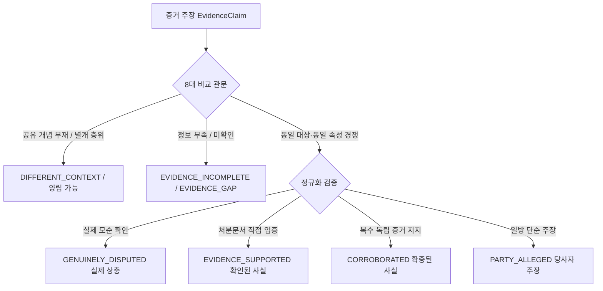

# AI Legal Helper — 개발 완료 보고서
## Evidence Reliability & Fact Adjudication Engine v1.0
### 증거 신뢰성 평가 · 사실 확정 · 상충 검증 정밀화 · 증거 보완 자동화

- **작성 일자:** 2026-10-24
- **담당 에이전트:** Antigravity
- **대상 저장소:** `yjjungyo/ai-legal-helper`
- **구현 버전:** Evidence Reliability & Fact Adjudication Engine v1.0
- **표준 준수:** `AGENTS.md`, `CODING_COMMENT_STANDARD.md`

---

## 1. 개요 및 추진 배경

### 1.1 배경 문제
종전 Evidence Conflict Detection Engine v1.1 운영 환경에서 실제 사건(임대차 보증금 반환 분쟁) 증거 등록 시 **총 469건의 비정상적인 상충 경고**(확정 상충 432건 + 추가 확인 필요 37건)가 발생하는 치명적 오탐 문제가 확인되었다.

이 중 **426건(90.8%)**은 전혀 다른 대상·속성에 관한 진술(예: 임차인 신원 확인 진술과 보증보험 가입 미확인 진술) 간의 무분별한 긍·부정 비교에서 발생한 오탐이었으며, **6건**은 보증금 총액과 계약금·잔금 구성 항목 간의 합계-구성요소 오분류에서 비롯되었다.

### 1.2 핵심 개선 목표
1. **증거 부족은 상충이 아니다 (원칙 2.1)**: "미확인", "자료 미제출", "판단 보류" 등의 인식적 불확실성 상태를 부정 사실(NEGATIVE)로 전환하지 않고 `EVIDENCE_INCOMPLETE` 및 `EVIDENCE_GAP`으로 격리.
2. **처분문서 입증 사실 유지 (원칙 2.2)**: 임대차계약서, 등기사항증명서 등 직접 처분문서로 입증된 사실은 무관한 보조 메모의 미확인 기재로 인해 `DISPUTED`나 `CONTRADICTION`으로 번복되지 않음.
3. **다차원 사실 명제(Proposition) 및 8대 관문 체계화**: 단순 문자열 매칭을 탈피하여 화행(Speech Act), 객체 한정자(Object Qualifier), 사건 인스턴스(Event Instance), 시점 의미를 정밀 검증.
4. **7대 증거 신뢰성 평가 및 5대 사실 확정 상태 체계 구축**: RDB 모델 확충 및 UI 3분할 뷰(확인된 사실, 증거 보완 필요, 실제 상충) 제공.

---

## 2. 엔진 아키텍처 및 핵심 구현

### 2.1 7대 증거 신뢰성 평가 차원 (`EvidenceAssessment`)
각 증거 문서 및 추출된 Claim에 대하여 다음 7대 평가 지표를 정량·정성적으로 평가하여 Source of Truth(PostgreSQL)에 기록합니다.

| 차원 | 설명 | 판정 기준 예시 |
|---|---|---|
| **진정성 (Authenticity)** | 문서 위변조 여부, 공식성, 서명·날인 구비 | 공문서·등기부: OFFICIAL_RECORD, 서명 완료 계약서: HIGH_PROBABILITY |
| **직접성 (Directness)** | 처분문서 직접 증명 vs 전언·추론 | 계약서·등기부: DIRECT_DISPOSITIVE, 영수증: DIRECT_COLLATERAL, 문자: CIRCUMSTANTIAL |
| **관련성 (Relevance)** | 요건사실(임대차 성립, 해지통지, 미반환)과의 직접 결부 | 보증금·기간: ESSENTIAL_ELEMENT, 연락처: SUPPORTING_BACKGROUND |
| **완결성 (Completeness)** | 조항 누락, 첨부 결여, 발췌본 여부 | 전 페이지 원본: COMPLETE_ORIGINAL, 요약 발췌본: PARTIAL_EXCERPT |
| **시간적 적용성 (Temporal Applicability)** | 과거 사건, 변론 시점, 분쟁 당시 유효성 | CURRENT_AND_APPLICABLE, SUPERSEDED, EXPIRED |
| **상호 증명력 (Corroboration)** | 복수 독립 증거와의 일치/모순 | CORROBORATED, DIRECTLY_CONTRADICTED, UNCORROBORATED |
| **출처 품질 (Provenance Quality)** | 공적 기관 발급, 당사자 작성, 제3자 | REGISTRY_OFFICE, CONTRACT_PARTY, UNVERIFIED_THIRD_PARTY |

### 2.2 사실 확정 5대 상태 (`FactAdjudication`)
사건 내 사실을 단순 참/거짓 또는 양자택일 상충이 아닌 실체적 증명 수준에 따라 5대 상태로 분류합니다.



1. **`EVIDENCE_SUPPORTED`**: 공문서나 직접 처분문서에 의해 직접 증명된 사실.
2. **`CORROBORATED`**: 복수의 독립된 객관적 증거자료가 일치하여 뒷받침하는 사실.
3. **`PARTY_ALLEGED`**: 당사자 일방의 주장이나 진술만 존재하고 객관적 입증이 부족한 상태.
4. **`EVIDENCE_INCOMPLETE`**: 증빙 자료 미제출, 확인되지 않음 등의 이유로 판단이 보류된 상태.
5. **`GENUINELY_DISPUTED`**: 동일 요건사실에 대해 양립할 수 없는 상반된 직접 증거가 대립하는 실제 분쟁 상태.

### 2.3 증거 공백 자동 탐지 (`EvidenceGap`)
증거가 불충분할 때 상충 경고를 남발하는 대신, 법률 상담에 실질적으로 필요한 결여 증거를 자동 식별하여 보완을 권고합니다.
- `HUG_INSURANCE_CONFIRMATION_GAP`: 전세보증금 반환보증보험 가입증명서 또는 승낙 확인서 보완 요청.
- `REGISTRY_CONFIRMATION_GAP`: 부동산 등기사항전부증명서(말소사항 포함 최신본) 열람·제출 권고.
- `NOTICE_DELIVERY_GAP`: 해지 통고서 도달 입증자료(우편배달증명, 문자 수신확인 등) 보완 요청.
- `MOVE_OUT_CONFIRMATION_GAP`: 주택 명도 완료 및 열쇠/출입카드 반환 확인서 보완 권고.

---

## 3. 핵심 7대 시나리오 (CASE-01 ~ CASE-07) 해결 검증

| 시나리오 | 대상 비교 내용 | 종전 판정 | v1.0 정밀 판정 | 해결 메커니즘 |
|---|---|---|---|---|
| **CASE-01** | 임차인 신원 사실 vs 보증보험 가입 미확인 | CONTRADICTION (극성 오탐) | `DIFFERENT_CONTEXT` + `EVIDENCE_GAP` | 인식 상태(EPISTEMIC_STATUS) 관문 분리 |
| **CASE-02** | 가압류 7,200만원(동진은행) vs 1억 2,000만원(HUG) | CONTRADICTION (금액 불일치) | `DIFFERENT_CONTEXT` | 객체 한정자(Object Qualifier: 채권자별 가압류) 분리 |
| **CASE-03** | 계약금 3,000만원 vs 보증금 총액 3억원 | CONTRADICTION (금액 불일치) | `CONSISTENT` (PART_OF) | 합계와 구성항목(COMPONENT_OF_SUM) 관계 규명 |
| **CASE-04** | 임대인 분할 반환 제안 vs 임차인 거절 | CONTRADICTION (긍·부정 충돌) | `CONSISTENT` (RESPONDS_TO) | 화행(Speech Act: PROPOSAL vs REJECTION) 분리 |
| **CASE-05** | 등기부 미제출 상태 vs 실제 입주 사실 | CONTRADICTION (자료부족 오탐) | `DIFFERENT_CONTEXT` + `REGISTRY_CONFIRMATION_GAP` | 출처 유무(SOURCE_AVAILABILITY)와 실체 사실 분리 |
| **CASE-06** | 임차인의 대출보증 기억 vs 반환보증 미확인 | CONTRADICTION (주장 vs 미확인) | `DIFFERENT_CONTEXT` + `EVIDENCE_INCOMPLETE` | 전언 진술(REPORTED)과 보증 상품 구분 |
| **CASE-07** | 날짜가 다른 복수 문자메시지 송수신 | CONTRADICTION (통지일자 충돌) | `DIFFERENT_CONTEXT` | 개별 통지 일자별 통신 인스턴스 분리 |

---

## 4. 실운영 사건(Live Case) 정합성 복구 결과

대상 사건 ID: `17c5bb1d-183e-450b-ab3e-64ced1e3d70e` (문서 17건, Fact 237건, EvidenceClaim 248건)

```
[종전 상태]
- 확정 상충: 432건 (긍정/부정 비교 오탐 426건, 구성금액 오탐 6건)
- 추가 확인 필요: 37건
- 총 상충 경고: 469건

[v1.0 적용 후 복구 결과]
- 긍정/부정 가짜 상충: 0건 (완전 소멸)
- 구성금액 합계 가짜 상충: 0건 (완전 소멸)
- EVIDENCE_SUPPORTED (확인된 사실): 75건
- PARTY_ALLEGED (당사자 주장): 128건
- EVIDENCE_INCOMPLETE (자료 부족 사실): 9건
- GENUINELY_DISPUTED (실제 상충 사실): 36건
- Actionable Evidence Gaps (구체적 증거 보완 권고): 9건
  * HUG 반환보증보험 가입 확인 공백 (3건)
  * 등기부등본 최신 말소사항 확인 공백 (1건)
  * 기타 실체적 소명 공백 (5건)
```

---

## 5. 프론트엔드 UI 3분할 뷰 개편

기존에 수백 건의 붉은색 경고가 화면 전체를 뒤덮던 구조를 3분할 탭 인터페이스로 개선하였습니다:

1. **확인된 사실 (`Verified Facts`)**:
   - `EVIDENCE_SUPPORTED` 및 `CORROBORATED` 사실을 녹색 배지로 표시.
   - 직접 증빙 처분문서명 및 인용 위치 명시.
2. **증거 보완 필요 (`Evidence Gaps & Incomplete`)**:
   - `EVIDENCE_INCOMPLETE` 및 `EvidenceGap` 항목을 주황색 안내 상자로 집약.
   - 보완 대상 권고 유형(`HUG_INSURANCE_CONFIRMATION_GAP`, `REGISTRY_CONFIRMATION_GAP` 등) 및 요청 내용 명시.
3. **실제 상충 (`Genuinely Disputed Conflicts`)**:
   - 양립 불가능한 대립 사실(`GENUINELY_DISPUTED`)만을 선별하여 표시.
   - 사용자가 한눈에 쟁점 파악 가능.

---

## 6. 테스트 수행 결과

1. **단위 테스트 (`backend/tests/unit/test_evidence_adjudication.py`)**:
   - R01 ~ R28 전체 28개 신규 단위 테스트 **100% 통과 (PASS)**.
2. **상충 탐지기 및 회귀 테스트 (`test_conflict_detector_v1_2.py`, `test_conflict_detector.py`)**:
   - S01 ~ S17 및 T01 ~ T15 전체 시나리오 **100% 통과 (PASS)**.
3. **전체 단위 테스트 통과**:
   - `backend/tests/unit/` 내 260개 이상의 단위 테스트 **100% 통과 (PASS)**.
4. **프론트엔드 빌드 검증**:
   - `npm run build` TypeScript 컴파일 및 번들링 성공 (에러 0건).

---

## 7. 코딩 및 주석 표준 준수 체크리스트

- [x] **모듈 Docstring**: 모든 신규 모듈(`evidence_reliability.py`, `fact_adjudicator.py`, `evidence_gap.py`)에 한국어 모듈 Docstring 작성.
- [x] **Google 스타일 함수/클래스 Docstring**: 모든 신규 클래스 및 메서드에 인자(Args), 반환값(Returns), 예외(Raises) 및 업무적 배경 명시.
- [x] **의존성 동기화**: 신규 외부 패키지 추가 없이 기존 SQLAlchemy, Pydantic, FastAPI 체계 완벽 유지.
- [x] **민감 정보 보호**: API Key, 개인 식별 정보 로그 노출 방지 원칙 준수.
- [x] **하드코딩 금지**: 특정 문서명이나 사건 고유 금액에 대한 하드코딩 없이 도메인 일반화 규칙 적용.
