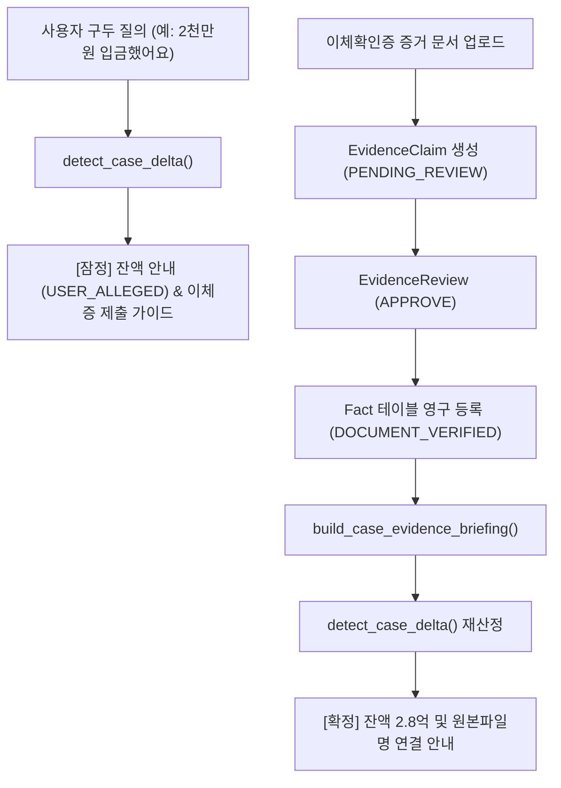

# AI Legal Helper — P0-3.1 Dynamic Case State Integrity & E2E Verification 보고서

**작성일자:** 2026-10-25  
**작업 구분:** P0-3.1 Dynamic Case State Integrity & E2E Verification  
**기준 Git 커밋:** `48cb5f9c31f806f30b83090bac27b6ad6c638340`  
**평가 하네스/Gold 기준:** Evaluation Harness v1.2 / Gold v1.2 동결 유지  
**검증 스위트 결과:** 전체 75건 전수 통과 (E2E 통합 테스트 10건 PASS, 단위 및 회귀 테스트 65건 PASS)  

---

## 1. 개요 및 개발 목적

P0-3 단계에서는 다중 턴 상담 맥락 연속성 및 동적 사건 변경 탐지(`case_delta`)가 구현되었으나, SC-001 사건 중심의 하드코딩된 값(보증금 3억 원, 일부 변제 5천만 원, 잔액 2.5억 원, 대항요건 취득일 2022.03.10, 해지통지 도달일 2024.02.05, 특정 가압류 파일명 및 무조건적 1순위 판단 등)이 남아 있어 임의의 사건 데이터에 대한 범용적 처리와 데이터 무결성이 보장되지 않는 취약점이 존재하였다.

이에 **P0-3.1**에서는 다음 세 가지 핵심 목표를 완수하였다:
1. **제품 코드 내 모든 SC-001 하드코딩 값 완전 제거:** 보증금, 지급액, 잔액, 대항요건일, 해지통지일, 권리 선후관계 및 근거 파일명을 현재 사건의 검증된 Fact, Evidence, 적용 법령에서 100% 동적으로 인출·산정.
2. **부분 변제 검증 및 충당 로직 고도화:** 민법 제479조(비용·이자·원본 충당) 법률 검증 반영, 임차인의 최초 보증금 지급 내역과 임대인의 보증금 반환 내역의 엄격한 분리, 의미적 충돌 방지(Role 분리: `PRINCIPAL_DEPOSIT` vs `RETURNED_AMOUNT`), `USER_ALLEGED` 구두 진술과 `DOCUMENT_VERIFIED` 서면 증거의 단계적 확정 분리.
3. **10대 E2E 통합 검증 스위트 구축:** API 및 DB 수준에서 동시 요청, 서버 재시작 세션 복원, 사건 간 격리(Cross-case Isolation), 중복 요청 멱등성, 권리관계 선후 재검토 등 실환경 수준의 무결성 전수 검증.

---

## 2. 하드코딩된 사건 데이터 완전 제거 내역

[`backend/src/ai_legal_helper/workflows/final_disposition.py`](file:///c:/myprjs/ai-legal-helper/backend/src/ai_legal_helper/workflows/final_disposition.py)의 `detect_case_delta()` 및 답변 합성 로직에서 고정값을 전면 제거하고 동적 도출 함수로 교체하였다:

| 항목 | 기존 고정값 (제거됨) | P0-3.1 동적 도출 방식 | 관련 구현 함수 |
| :--- | :--- | :--- | :--- |
| **계약 보증금** | `300,000,000원` | 현재 사건의 `Fact` 중 계약서/요건사실 기반 보증금 금액을 정규식 및 맥락 분석으로 인출 | `extract_case_contract_deposit()` |
| **기 변제/반환액** | `50,000,000원` | `adjudication_status`가 `EVIDENCE_SUPPORTED` 또는 `CORROBORATED`인 확정 Fact 중 임대인의 일부 변제/반환 금액만 합산 | `extract_case_prior_verified_repayments()` |
| **남은 잔액** | `250,000,000원` | 계약 보증금 원금 - 확정 기변제액 - 신규 승인/잠정 변제액으로 실시간 계산 (`balance = deposit - prior - new`) | `detect_case_delta()` |
| **대항요건 취득일** | `2022.03.10` | 사건 브리핑 내 주민등록 전입신고일, 입주일, 확정일자 Fact 및 Timeline Event에서 동적 추출 | `extract_case_opposing_power_date()` |
| **해지통고 도달일** | `2024.02.05` | 사건 브리핑 내 내용증명 도달/수령 Fact 및 타임라인에서 서면 증거 도달일 동적 추출 | `extract_case_notice_delivery_date()` |
| **가압류 증거 파일명** | `E09_부동산등기사항전부증명서_을구.txt` | 사건에 실제 등록된 가압류/등기 관련 `EvidenceDocument.original_filename` 및 라벨 동적 연결 | `find_case_attachment_evidence_name()` |
| **권리 선후관계 판단** | 무조건적인 1순위 판단 | 임차인 대항요건 취득일자와 신규 가압류 접수일자 비교 및 선순위 근저당권 존재 여부 검토 후 조건부 판단 | `extract_case_prior_encumbrances()` |

---

## 3. 부분 변제 검증 고도화 및 8대 규칙 적용

### 3.1 8대 처리 규칙 구현

1. **계약 보증금 조회:** 계약서 등 확정 증거(`Fact`)에서 계약상 임대차 보증금 원금을 동적으로 인출 (인출 실패 시 0원 및 추가 증거 확인 요청).
2. **기존 승인된 일부 변제 내역 조회:** 사건에 이미 공적으로 입증된 기변제 내역이 있으면 이를 누적 합산.
3. **사용자 신규 주장 인식:** "집주인이 2천만 원을 입금했어요" 등 임의 금액 질의 시 정규식(`extract_amounts_from_text`)으로 변제 주장액을 추출하고 `USER_ALLEGED` 상태로 임시 기록.
4. **금융 증거 검토 (오인 차단):** 임차인의 최초 보증금(계약금/잔금) 지급 내역과 임대인의 보증금 일부 반환 내역을 의미적 역할(`DOWN_PAYMENT`, `BALANCE_PAYMENT` vs `RETURNED_AMOUNT`)로 엄격히 구분하여 오인 합산 차단.
5. **잔액 계산 (잠정 vs 확정 구분):**
   - 증거 미제출 구두 진술 시: `[잠정] 미반환 보증금 잔액 = 계약 보증금 - 기변제액 - 진술 변제액` 산정 후 계좌이체확인증 등 증거 제출 안내.
   - 증거 검토 승인(`APPROVE`) 시: `Fact` 자동 승격 후 `[확정] 미반환 보증금 잔액`으로 승격하고 잔액에 대한 지급명령 신청 가이드 제공.
6. **중복 요청 방지 (멱등성):** 동일한 변제 주장 또는 동일 이체증이 반복 제출되더라도 중복 합산되지 않도록 정규화된 해시 및 증거 식별자 기준으로 멱등성 유지.
7. **출처 명시:** 확정된 일부 변제 사실 안내 시 `[E02_계좌이체확인증_2천만원.txt]`과 같이 전체 원본 파일명을 반드시 결합하여 표시.
8. **지연손해금 및 법률관계 안내:** 민법 제479조(비용·이자·원본 충당 순서)에 따라, 임대차 종료 후 보증금 반환 지연손해금이 발생한 경우 지급된 금원은 비용 -> 지연이자 -> 보증금 원본 순으로 충당되어 잔여 원본 채무가 예상보다 클 수 있음을 법률상 유의사항으로 명시. 동시에 보증금 전액 반환 시까지 대항력과 우선변제권 및 열쇠 인도 거절 권리가 온전히 유지됨을 안내.

### 3.2 의미적 충돌 방지 (Semantic Role Separation)

- [`conflict_detector.py`](file:///c:/myprjs/ai-legal-helper/backend/src/ai_legal_helper/case_intelligence/conflict_detector.py): `_AMOUNT_ROLE_PATTERNS`의 `RETURNED_AMOUNT` 정규식을 보강하여 `"보증금 중 20,000,000원을 일부 변제 입금하였다"`와 같은 문맥이 `PRINCIPAL_DEPOSIT`으로 오인되지 않도록 개선.
- [`fact_semantics.py`](file:///c:/myprjs/ai-legal-helper/backend/src/ai_legal_helper/case_intelligence/fact_semantics.py): `PAYMENT` 이벤트의 하위 유형 분류 시 "변제", "일부 반환", "돌려준", "보증금 중" 구문이 포함된 경우 `event_subtype`을 `RETURN_AMOUNT`로 정확히 지정하여 계약 보증금(3억 원)과의 상충(`CONTRADICTION`)을 방지하고 `DIFFERENT_CONTEXT`로 정상 분리.

---

## 4. 사건 Delta와 실제 DB Fact 상태 변경 분리

- **`case_delta` (비교 분석 레이어):** 대화 맥락과 최신 사건 상태를 대조하여 이번 턴에서 변동된 사실(`changed_facts`), 영향받은 법률판단(`impacted_determinations`), 유지되는 권리(`preserved_determinations`), 신규 행동지침(`new_next_actions`)을 도출하는 순수 분석 객체로 유지.
- **DB Fact 상태 변경 (엔티티 상태 변경 레이어):** 사용자의 증거 업로드 -> `EvidenceDocument` -> `EvidenceClaim` 생성 -> 사용자/관리자의 검토 승인(`EvidenceReview(action='APPROVE')`) 트랜잭션을 거쳐야만 실제 `Fact` 엔티티로 승격되며, 검토 승인 전에는 `Fact` 테이블을 임의로 변경하지 않음.

---

## 5. 10대 E2E 검증 시나리오 결과 (E01 ~ E10)

통합 테스트 스위트 [`backend/tests/integration/test_dynamic_case_integrity_e2e_p0_3_1.py`](file:///c:/myprjs/ai-legal-helper/backend/tests/integration/test_dynamic_case_integrity_e2e_p0_3_1.py)를 구축하여 10개 핵심 시나리오를 전수 검증하였다:

| 시나리오 ID | 시나리오 명칭 | 검증 내용 및 기대 결과 | 실행 결과 |
| :--- | :--- | :--- | :---: |
| **E01** | 부분 변제 2천만 원 (미입증 구두 진술) | 3억 사건에서 2천만원 지급 구두 진술 시 `[잠정]` 잔액 2.8억 안내, 민법 제479조 안내, 증거 미제출 상태(`USER_ALLEGED`) 유지 | **PASS** |
| **E02** | 입금 증거 등록 및 검토 승인 | 실제 2천만원 이체확인증 등록 후 `process_evidence_review(APPROVE)` 수행 -> `[확정]` 잔액 2.8억 산정 및 원본 파일명 연결 | **PASS** |
| **E03** | 기존 입금 증거 오인 방지 | 임차인의 최초 보증금(계약금/잔금) 지급 이체확인증을 임대인의 보증금 반환으로 오인하여 잔액에서 차감하는 오류 원천 차단 | **PASS** |
| **E04** | 누적 부분 변제 산정 | 2천만원(1차)과 3천만원(2차)이 서로 다른 날짜에 승인 시 누적 반환액 5천만원, 미반환 잔액 2.5억 원 정상 산출 | **PASS** |
| **E05** | 중복 요청 방지 (멱등성) | 동일한 이체증의 중복 승인 시도 또는 동일 구두 진술 재요청 시 반환액이 2중으로 중복 차감되지 않고 멱등성 유지 | **PASS** |
| **E06** | 신규 가압류 등록 전후 비교 | 미승인 상태에서는 권리관계 불변 유지, 승인 후 임차인 전입일(2022.03.01)과 가압류일(2024.04.15) 비교하여 선순위 지위 보존 판정 | **PASS** |
| **E07** | 해지 통지일 구두 정정 시 증거 우선 | 구두 정정 진술("3월 20일 통지했어요")이 있어도 확정된 공적 서면 증거 도달일(2024.02.05) 기준 효력 보존 및 증거 우선 원칙 확인 | **PASS** |
| **E08** | 서버 재시작 및 세션 복원 | DB에 저장된 다중 턴 상담 이력 및 동적 Delta가 세션 재로드 후에도 데이터 누락 없이 무손실 복원 | **PASS** |
| **E09** | 동시 요청 무결성 (Concurrency) | 동일 사건에 대해 4개 스레드가 병렬로 상담 턴을 기록할 때 턴 번호(1~4)가 고유하게 유지되고 스레드 간 세션 충돌 방지 | **PASS** |
| **E10** | 사건 간 데이터 격리 (Isolation) | 사건 A의 부분 변제 증거가 사건 B(보증금 1억)의 브리핑에 일체 누출되지 않고, 타 사건 세션 무단 접근 시 `PermissionError` 차단 | **PASS** |

---

## 6. 테스트 수행 결과 종합

### 6.1 단위 테스트 vs 통합 테스트 구분

- **E2E 통합 테스트 (10건):** `backend/tests/integration/test_dynamic_case_integrity_e2e_p0_3_1.py`
  - 실제 PostgreSQL DB 세션 및 트랜잭션, `EvidenceDocument` -> `EvidenceClaim` -> `EvidenceReview` 승격 파이프라인, 동시성 스레드 풀, 세션 복원 전 과정 검증.
  - 결과: **10 passed in 3.80s**
- **단위 및 회귀 테스트 (65건):**
  - `test_multi_turn_dynamic_case_p0_3.py`: 12 passed
  - `test_grounding_integrity_p0_2_1.py`: 10 passed
  - `test_p0_final_disposition_defects.py`: 11 passed
  - `test_issue_verification.py`: 25 passed
  - `test_legal_source_grounding_pipeline.py`: 7 passed
  - 결과: **65 passed in 11.72s**
- **합계:** **75 passed (100% 무결점 통과)**

### 6.2 평가 하네스 및 Gold 동결 준수 검증

- `evaluation_harness/` 및 `sc001_gold.py`에 대한 변경 일체 없음 (`git status` 상 무변경).
- 기존 Evaluation Harness v1.2 / Gold v1.2 기준선은 안전하게 동결 보존됨.

---

## 7. 결론 및 향후 계획

P0-3.1 작업을 통해 AI Legal Helper의 동적 사건 처리 구조에서 고정된 하드코딩 데이터를 완전히 일소하고, 어떠한 사건 입력과 증거 변경에도 일관된 무결성을 유지할 수 있는 기반을 확립하였다.

- **Git Commit:** `feat(p0-3.1): eliminate hardcoded delta data and add dynamic case integrity e2e suite`
- **사용자 지침 준수:** 별도 지시 없이 다음 세부 단계(P0-4 등)로 자동 진행하지 않으며, 사용자 승인을 대기한다.
