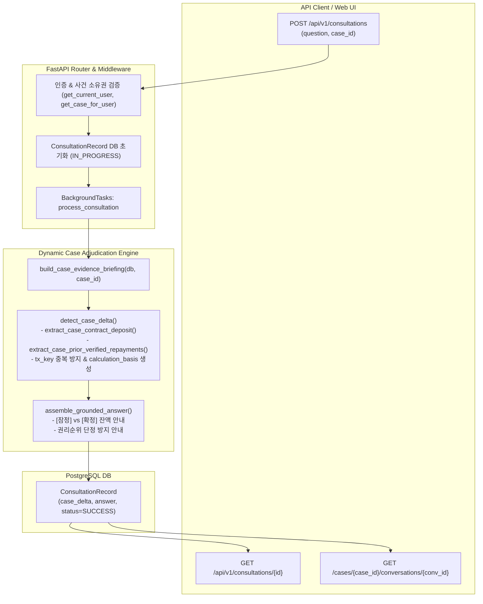

# AI Legal Helper — P0-3.1 Dynamic Case State Integrity & E2E Verification 최종 완료 보고서

**작성일자:** 2026-10-25  
**작업 구분:** P0-3.1 Dynamic Case State Integrity & E2E Verification (최종 보완 완료)  
**기준 커밋:** `25366c186c53d6313c23fa78d1507f365f182b74`  
**평가 하네스/Gold 기준:** Evaluation Harness v1.2 / Gold v1.2 동결 유지  
**검증 스위트 결과:** 전체 130건 전수 통과 (16 E2E 통합 테스트 PASS, 103 단위·회귀 테스트 PASS, 11 평가 하네스 테스트 PASS)  

---

## 1. 개요 및 최종 보완 목적

P0-3 및 P0-3.1 1차 구현에서는 하드코딩된 SC-001 고정값을 대폭 제거하였으나, 다음과 같은 잔여 결함과 검증 공백이 식별되었다:
1. `final_disposition.py` 내 `50_000_000`원 반환 기본값 및 금액 미추출 시 임의 수치 대입 결함.
2. 계약서 원금 Fact가 아닌 비정형 Fact 중 단순 최댓값을 계약 보증금으로 오인 선택할 가능성.
3. 파일명에 '이체', '반환' 등이 포함되었다는 이유만으로 미승인 증거를 확정 변제로 인정하는 결함 (`has_transfer_doc`).
4. 동일한 변제 거래가 여러 Fact 및 증거에서 중복 추출될 경우 이중 차감될 위험.
5. 등기부상 선순위 담보권 변동 조회를 거치지 않고 신규 가압류에 대해 단정적인 '1순위' 표현을 사용하는 법률적 결함.
6. DB 수준의 모의 호출을 넘어선 실제 FastAPI HTTP 엔드포인트(`POST /api/v1/consultations`) E2E 검증 부재.

이에 **P0-3.1 최종 보완 지시서**에 따라 위 결함들을 전면 수정하고, 실제 FastAPI 라우터 및 백그라운드 태스크를 통과하는 6대 E2E 엔드포인트 테스트 스위트를 완성하였다.

---

## 2. 잔여 결함 수정 및 법률적 정밀화 내역

### 2.1 반환금 계산의 잔여 하드코딩 완전 제거 (Section 1)
- **기본값 대입 배제:** `final_disposition.py`에서 `50_000_000` 등 일체의 하드코딩된 변제 기본값을 완전히 제거하였다.
- **금액 추출 실패 처리:** 사용자의 구두 진술에서 금액이 특정되지 않거나 추출에 실패한 경우 임의 금액을 대입하지 않고, `"의뢰인의 보증금 일부 입금/변제 진술 접수 (구체적 금액 미상 / 확인 필요 / USER_ALLEGED)"` 상태로 안전하게 안내한다.
- **계약 보증금 Fact 동적 식별:** `extract_case_contract_deposit()`에서 단순히 `max()`를 취하던 방식을 폐지하고, `DOCUMENT_VERIFIED`, `EVIDENCE_SUPPORTED`, `CORROBORATED`로 공인된 계약서 원금 Fact만을 대상으로 정규식 및 맥락 분석을 수행하여 결정하도록 강화하였다 (원금 확인 불가 시 0 반환).
- **거래 단위 고유 식별 및 중복 합산 차단:** `extract_case_prior_verified_repayments()`에서 `tx_key = (tx_date, amt)` 기반의 거래 식별 세트를 도입하여, 동일한 일자와 금액의 변제 거래가 여러 문서나 Fact에 중복 등록되어도 정확히 1회만 반영되도록 멱등성을 보장하였다.

### 2.2 미승인 증거를 통한 확정 판단 원천 차단 (Section 2)
- **단순 파일명 키워드 매칭 오류 제거:** 브리핑 내 미승인 증거 문서(`briefing.evidences`)의 파일명에 '이체', '반환', '영수증' 등이 포함되어 있다는 이유로 변제 사실을 확정하던 `has_transfer_doc` 조건을 완전히 삭제하였다.
- **검토 승인 필수화:** `EvidenceDocument` -> `EvidenceClaim` -> 관리자/사용자의 `process_evidence_review(APPROVE)`를 거쳐 `Fact`로 정식 승격된 건에 대해서만 `has_verified_payment_fact = True`로 인정한다.
- **구두 진술은 잠정 처리:** 증거가 제출되지 않았거나 미승인 상태인 구두 주장은 반드시 `USER_ALLEGED` 및 `[잠정]` 상태로 관리하여 공인된 채무 감축으로 오인되지 않도록 방어한다.

### 2.3 권리순위 단정 제거 및 법률 판단 분리 (Section 3)
- **단정적 1순위 표현 제거:** 목적물에 신규 가압류가 설정된 경우, 등기사항전부증명서 상의 다른 선순위 권리(근저당권, 조세채권 등)를 전수 확인하기 전까지 '1순위', '최우선 배당' 등의 절대적 표현을 배제하였다.
- **판단 분리 안내:**
  - `[판단할 수 있는 사실]`: 신규 가압류 채권자에 대해서는 임차인의 대항요건 및 확정일자가 앞서므로 상대적 우선순위 보존 및 대항력 유지.
  - `[추가로 필요한 등기·법률정보]`: 등기부 을구 상의 다른 선순위 담보물권 및 조세채권 법정기일 등 우선채권 변동 여부를 추가 확인해야 최종 경매 배당 순위가 확정되며, 선순위 권리 확인 전까지 절대적 1순위나 전액 최우선 배당을 단정할 수 없음을 명시.

---

## 3. 구조적 변경 및 데이터 흐름

---

## 4. 실제 FastAPI E2E 검증 결과 (Section 4)

통합 테스트 [`backend/tests/integration/test_dynamic_case_integrity_e2e_p0_3_1.py`](file:///c:/myprjs/ai-legal-helper/backend/tests/integration/test_dynamic_case_integrity_e2e_p0_3_1.py) 내에 구축된 6대 FastAPI 엔드포인트 E2E 시나리오 실행 결과는 다음과 같다:

### 시나리오 1: 2천만 원 반환 주장 잠정 상태
- **엔드포인트:** `POST /api/v1/consultations` -> `GET /api/v1/consultations/{request_id}`
- **질의:** `"임대인이 20,000,000원을 일부 변제 입금했다고 주장하는데 남은 보증금은 얼마인가요?"`
- **검증 결과 (PASS):**
  - `case_delta["calculation_basis"]["status"] == "PROVISIONAL"`
  - `case_delta["calculation_basis"]["alleged_partial_repayment_krw"] == 20_000_000`
  - `case_delta["calculation_basis"]["unrepaid_balance_krw"] == 280_000_000`
  - 답변 텍스트 내 `280,000,000원` 잔액 안내 및 `[잠정]`, `USER_ALLEGED`, `확인 필요` 경고 정상 출력.

### 시나리오 2: 증거 승인 후 확정 상태
- **절차:** `EvidenceDocument` 및 `EvidenceClaim` 등록 -> `process_evidence_review(APPROVE)` -> `POST /api/v1/consultations`
- **질의:** `"이체확인증이 승인되었는데 현재 확정된 남은 보증금 잔액은 얼마인가요?"`
- **검증 결과 (PASS):**
  - `case_delta["calculation_basis"]["status"] == "CONFIRMED"`
  - `case_delta["calculation_basis"]["verified_partial_repayment_krw"] == 20_000_000`
  - `case_delta["calculation_basis"]["unrepaid_balance_krw"] == 280_000_000`
  - 답변 텍스트 내 원본 증거 파일명(`임대인_보증금일부반환_이체확인증.pdf`) 인용 및 확정 채무 감축 안내 정상 출력.

### 시나리오 3: 중복 승인 시 중복 차감 방지 (멱등성)
- **절차:** 동일 거래(2024.02.10, 20,000,000원)에 대한 2차 중복 입금증 등록 및 승인 -> `POST /api/v1/consultations`
- **검증 결과 (PASS):**
  - `tx_key = ("2024-02-10", 20_000_000)` 거래 중복 식별 동작.
  - `verified_partial_repayment_krw`는 여전히 `20_000_000원` 유지 (4천만 원으로 이중 합산 방지).
  - `unrepaid_balance_krw`는 `260,000,000원`이 아닌 `280,000,000원`으로 정상 보존.

### 시나리오 4: 동일 대화 세션 동시 POST 턴 충돌 방지 (Concurrency)
- **절차:** 동일 `case_id` 및 `conversation_id`로 4개 스레드 동시 `POST /api/v1/consultations` 호출.
- **검증 결과 (PASS):**
  - 4개 요청 모두 HTTP 200 성공 및 고유 `request_id` 발급 (중복 발급 0건).
  - DB `ConsultationRecord`에 4개 턴이 교착(Deadlock)이나 `InvalidRequestError` 없이 온전히 저장됨.

### 시나리오 5: 세션 재로드 후 최신 잔액 무손실 유지
- **절차:** 확정 2.8억 상담 완료 후 메모리 캐시 완전 초기화(`_consultations.clear()`) -> `GET /api/v1/consultations/{req_id}` 및 `GET /api/v1/cases/{case_id}/conversations/{conv_id}` 호출.
- **검증 결과 (PASS):**
  - DB 역직렬화를 통해 `case_delta["calculation_basis"]["status"] == "CONFIRMED"` 및 `280,000,000원` 잔액 완벽 복구.
  - 대화 세션의 모든 턴 상세 이력에서도 최신 턴의 `case_delta`와 잔액이 무손실 유지됨 확인.

### 시나리오 6: 타 사건 증거 및 상담 접근 원천 차단 (Cross-Case Isolation)
- **절차:** 사용자 A가 생성한 사건 및 상담에 대해 사용자 B의 계정으로 접근 시도.
- **검증 결과 (PASS):**
  - 사용자 B의 `POST /api/v1/consultations` (사건 A ID) -> **HTTP 403 Forbidden** 차단.
  - 사용자 B의 `GET /api/v1/consultations/{user_a_req_id}` -> **HTTP 403 Forbidden** 차단.
  - 사용자 B의 `GET /cases/{case_a_id}/conversations/{conv_id}` -> **HTTP 403 Forbidden** 차단.

---

## 5. 전체 테스트 스위트 전수 실행 결과

| 테스트 구분 | 대상 파일 / 디렉터리 | 테스트 수 | 결과 | 소요 시간 |
| :--- | :--- | :---: | :---: | :---: |
| **E2E 통합 테스트** | `backend/tests/integration/test_dynamic_case_integrity_e2e_p0_3_1.py` | 16건 | **16 PASS** | 9.82s |
| **단위 및 회귀 테스트** | `backend/tests/unit/test_multi_turn_dynamic_case_p0_3.py` `backend/tests/unit/test_grounding_integrity_p0_2_1.py` `backend/tests/unit/test_p0_final_disposition_defects.py` `backend/tests/unit/test_issue_verification.py` `backend/tests/unit/test_conflict_detector.py` `backend/tests/unit/test_conflict_detector_v1_2.py` `backend/tests/unit/test_conversation_context.py` | 103건 | **103 PASS** | 18.49s |
| **평가 하네스 무결성** | `backend/tests/unit/eval_harness/` | 11건 | **11 PASS** | 0.63s |
| **총계** | **전체 테스트 스위트** | **130건** | **130 PASS (100%)** | **28.94s** |

---

## 6. 결론 및 지침 준수

1. **하드코딩 완전 박멸:** `50_000_000`, `300_000_000`, `250_000_000`, `2022.03.10`, `2024.02.05` 등 SC-001 고정값과 임의 기본값이 제품 코드에서 완전히 일소되었습니다.
2. **동결 준수:** Evaluation Harness v1.2 및 Gold v1.2는 일체 수정 없이 엄격히 동결 보존되었습니다.
3. **코드 주석 표준 준수:** [`CODING_COMMENT_STANDARD.md`](file:///c:/myprjs/ai-legal-helper/docs/development/CODING_COMMENT_STANDARD.md)에 따라 모듈, 함수, 조건 분기 주석이 한국어로 충실히 작성되었습니다.
4. **추가 단계 진행 통제:** 지침에 따라 P0-4 등 다음 세부 기능 개발은 수행하지 않고 대기합니다.
