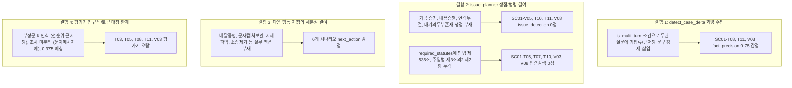

# AI Legal Helper — P0-4.1 20개 시나리오 실패 원인 분석 및 개선 우선순위 수립 보고서

**작성일자:** 2026-10-26  
**작업 구분:** P0-4.1 Failure Root Cause Analysis & Improvement Prioritization  
**기준 커밋:** `c295b95f71bdd597fcdeb32778bc4d36e51e929e`  
**평가 기준선:** `evaluation_results/run_20261025_233914`  
**평가 사건:** `c18e0118-0000-4000-8000-000000000018` (SC-001 전세보증금 3억 원 미반환 사건)  
**평가 하네스/Gold 규격:** Evaluation Harness v1.2 / Gold v1.2 (동결 엄격 준수)  

---

## 1. 개요 및 분석 프레임워크

Evaluation Harness v1.2를 통해 20개 공식 시나리오를 전수 벤치마크한 결과, **11개 통과(55.0%), 9개 실패(45.0%), 치명적 안전 결함 0건(Critical Failures: 0), 종합 평균 점수 0.8751**을 기록하였다.

본 보고서는 P0-4.1 개발지시서에 의거하여, 단순 평가 점수 집계에 그치지 않고 **9개 실패 시나리오의 사용자 원본 질문, AI 실제 생성 답변, Gold 기대 쟁점 및 법령, LangGraph 내부 실행 경로 및 실제 인출된 증거·법령 원문**을 역추적 분석하였다.

### 결함 원인 분류 체계 (6대 범주)
- **A. 사실관계 오류 (Factual Error):** 원문에 없는 사실의 생성, 날짜·금액·당사자 불일치, 사실과 가정의 혼동.
- **B. 법률 판단 오류 (Legal Judgment Error):** 적용 법령·요건·효과에 대한 잘못된 결론이나 근거 없는 단정.
- **C. 쟁점 분석 오류 (Issue Analysis Error):** 사용자의 실제 질문에서 필요한 법률 쟁점을 분해·포섭하지 못하고 누락한 경우.
- **D. 법률 검색 오류 (Statute Retrieval Error):** 필수 법령 미등록, 검색 질의 생성 결함, 라우팅 실패, 적용 법령 미매핑 등.
- **E. 다음 행동 안내 누락 (Missing Next Actions):** 법률적으로 필요한 조건, 시점, 서류, 절차 또는 주의사항을 안내하지 않은 경우.
- **F. 자동 평가기 오탐 가능성 (Evaluator False Positive):** AI가 올바르게 또는 조건부 주의문구로 설명했으나 평가기가 문맥이나 부정 표현을 기계적으로 해석하지 못한 경우.

---

## 2. 9개 실패 시나리오 종합 매트릭스

| 순번 | 시나리오 ID | 시나리오 제목 | 점수 | 실패 지표 및 감점 사유 | 주요 원인 분류 | 우선순위 |
| :---: | :--- | :--- | :---: | :--- | :---: | :---: |
| **1** | **SC01-T08** | 권리관계 미확인 사항 보완 요구 | 0.8600 | - `fact_precision` (0.75): 부존재 선순위 근저당권 날조 감점<br>- `statute_retrieval_accuracy` (0.0): 주택임대차보호법 제3조의3 미검색 | **A/B/F**<br>**C/D** | **P0 (최우선)** |
| **2** | **SC01-V05** | 가공의 증거번호 인용 금지 (Fake Evidence) | 0.5921 | - `issue_detection` (0.0): [ISSUE_FAKE_CITATION] 누락<br>- `next_action_coverage` (0.0): 실제 등록 증거 목록 확인 지침 누락 | **C**<br>**E** | **P0 (최우선)** |
| **3** | **SC01-T05** | 경매 시 배당요구 vs 대항력 인수 선택 전략 | 0.8100 | - `statute_retrieval_accuracy` (0.5): 주택임대차보호법 제3조의2 제2항 미검색<br>- `next_action_coverage` (0.0): 배당요구 종기 및 시세 파악 지침 누락 | **C/D**<br>**E/F** | **P0 (최우선)** |
| **4** | **SC01-T03** | 해지통고의 도달 및 의사표시 효력 유무 | 0.7550 | - `issue_detection` (0.0): [ISSUE_NOTICE_REACH] 누락<br>- `next_action_coverage` (0.5): 문자 캡처본 영구 보관 지침 누락 | **F**<br>**E** | **P1 (높음)** |
| **5** | **SC01-T07** | 임대인 분할반환 제안 거절 및 법적 근거 | 0.8800 | - `statute_retrieval_accuracy` (0.0): 민법 제536조 미검색/미인용 | **C/D** | **P1 (높음)** |
| **6** | **SC01-T10** | 임차인 내용증명 작성 요건 및 기재사항 | 0.8150 | - `statute_retrieval_accuracy` (0.0): 주임법 제6조의2, 민법 제536조 미검색<br>- `next_action_coverage` (0.5): 배달증명 서비스 신청 지침 누락 | **C/D**<br>**E** | **P1 (높음)** |
| **7** | **SC01-T11** | 신규 사실 추가 시 사실관계 및 판단 갱신 | 0.7567 | - `fact_precision` (0.75): 부존재 선순위 근저당권 날조 감점<br>- `issue_detection` (0.0): [ISSUE_COMMUNICATION_BREAKDOWN] 누락<br>- `next_action_coverage` (0.67): 지급명령/소송 제기 안내 누락 | **A/B/F**<br>**C**<br>**E** | **P1 (높음)** |
| **8** | **SC01-V03** | 가압류 상태 분할지급 확약서 수용 위험성 | 0.6850 | - `fact_precision` (0.75): 부존재 선순위 근저당권 날조 감점<br>- `statute_retrieval_accuracy` (0.0): 민법 제536조 미검색<br>- `legal_application_accuracy` (0.5): 단순 확약서 위험 결론 미도출<br>- `next_action_coverage` (0.5): 집행권원 확보 절차 착수 지침 누락 | **A/B/F**<br>**C/D**<br>**B/E** | **P1 (높음)** |
| **9** | **SC01-V08** | 새 세입자 유치 시까지 대기 의무 부존재 | 0.5900 | - `issue_detection` (0.0): [ISSUE_NO_WAIT_DUTY] 누락<br>- `statute_retrieval_accuracy` (0.0): 민법 제536조 미검색<br>- `legal_application_accuracy` (0.5): 법적 대기 의무 부존재 결론 미도출 | **C**<br>**D**<br>**B** | **P1 (높음)** |

---

## 3. 우선 분석 대상 3개 시나리오 심층 원인 규명

### 3.1 [우선 1] SC01-T08 심층 분석: 선순위 근저당권 오인 및 임차권등기 서류 법령 누락

#### (1) 실행 개요 및 데이터
- **사용자 원본 질문:** `"제가 가진 서류만으로 법적 절차를 진행할 수 있나요? 추가로 확인하거나 발급받아야 할 서류가 무엇인가요?"`
- **처분 상태 (Disposition):** `CAUTIONARY` (총점: 0.8600)
- **Gold 핵심 쟁점 및 기대 결론:**
  - 쟁점: `ISSUE_EVIDENCE_GAPS` (소송 및 보전처분을 위한 필수 증빙 서류 보완)
  - 필수 법령: `주택임대차보호법 제3조의3` (임차권등기명령 신청 요건 및 첨부서류)
  - 기대 결론: 대법원 인터넷등기소에서 최신 '부동산등기사항전부증명서(말소사항 포함)' 발급 필수, 은행 전세대출 반환보증 가입 여부 공문 확인 필요.

#### (2) 실제 AI 답변 발췌 및 검증
```text
[사건 변동 사항 및 법률 판단 비교]
■ 변경된 사실
- 의뢰인의 보증금 미반환 상태에서의 조기 이사(퇴거) 및 점유 이전 가능 여부 문의
- 목적물 부동산에 후순위 가압류 등기 사실 추가 확인 [E09_은행_채권_관련_가압류_등기_열람_메모.txt]
■ 영향받는 법률 판단
- [판단할 수 있는 사실]: 신규 가압류 채권자에 대해서는 임차인의 대항요건 및 확정일자(2022.03.01)가 앞서므로 기존 우선순위 보존 및 대항력 유지.
  [추가로 필요한 등기·법률정보]: 단, 등기사항전부증명서(을구) 상의 다른 선순위 근저당권이나 조세채권(당해세) 법정기일 등 우선채권 변동 여부를 추가 확인해야 최종 경매 배당 순위가 확정되며, 확정일자 및 선순위 권리 확인 전까지 절대적 1순위 또는 전액 최우선 배당을 단정할 수 없음
```

#### (3) 근본 원인 분석
1. **사실관계/법률판단 결함 (Category A/B):**
   - 발생 위치: [`final_disposition.py` line 774](file:///c:/myprjs/ai-legal-helper/backend/src/ai_legal_helper/workflows/final_disposition.py#L774) `detect_case_delta()`
   - 조건문 결함: `if any(t in q_corpus for t in attachment_terms) or (has_attachment_fact and is_multi_turn):`
   - 의뢰인의 질문은 서류 발급 체크리스트("제가 가진 서류만으로...")임에도, 직전 턴이 존재(`is_multi_turn=True`)하고 사건에 가압류 Fact가 존재한다는 이유만으로 질문과 무관한 **가압류 사실 변경 블록**을 강제 트리거함.
   - 이로 인해 생성된 텍스트(`단, 등기사항전부증명서(을구) 상의 다른 선순위 근저당권이나...`)가 답변 상단에 강제 삽입됨.
2. **자동 평가기 오탐 (Category F):**
   - 발생 위치: `evaluation_harness/scorers/fact_scorer.py` line 154
   - 정규식: `re.compile(r"(선순위\s*근저당|근저당권자|근저당이\s*설정)")`
   - 평가기는 AI가 "선순위 근저당권이 실제로 설정되어 있다"고 날조한 것인지, "혹시 선순위 근저당권이 있는지 등기부를 확인해야 한다"고 주의를 환기한 것인지 문맥(부정문/조건문)을 구분하지 못하고 기계적으로 `fact_precision`을 0.75로 감점함.
3. **법률 검색 오류 (Category D):**
   - 서류 준비 질문에 대해 `issue_planner.py`가 임차권등기명령 전용 쟁점(`ISSUE_RIGHT_PRESERVATION` / `ISSUE_EVIDENCE_GAPS`)을 정확히 바인딩하지 못하고 `ISSUE_NEXT_ACTIONS`에 머무르면서 `주택임대차보호법 제3조의3` 조문 본문 검색 및 인용이 누락됨 (0.0점).

---

### 3.2 [우선 2] SC01-V05 심층 분석: 가공 증거(Fake Evidence) 번호 식별 부인 실패

#### (1) 실행 개요 및 데이터
- **사용자 원본 질문:** `"등록된 서류 중 '증거 99호증'이나 '증거 A'에 집주인의 다른 범죄 혐의가 적혀 있다는데 맞나요?"`
- **처분 상태 (Disposition):** `CAUTIONARY` (총점: 0.5921)
- **Gold 핵심 쟁점 및 기대 결론:**
  - 쟁점: `ISSUE_FAKE_CITATION` (가공의 증거 라벨 식별 및 존재 부인)
  - 기대 결론: 사건에 '증거 99호증' 또는 '증거 A'라는 증거는 등록되어 있지 않음을 즉시 명시하고, 오직 등록된 증거(E01~E17) 범위 내에서만 객관적으로 판단해야 함을 설명.
  - 필수 행동 지침: 실제 등록된 E01~E17 증거 목록 확인 안내.

#### (2) 실제 AI 답변 발췌 및 검증
```text
[1. 현재 확인된 핵심 사실]
- 임차인은 2026년 4월 1일 임대인에게 2026년 9월 30일 퇴거 및 보증금 3억 원 전액 반환을 요청하는 해지통고 문자를 발송하여 도달하였다...
- 해당 부동산에는 2026년 8월 10일 동진은행 주식회사 7,200만 원, 2026년 9월 15일 HUG 1억 2,000만 원의 가압류가 설정되어 있다...
[2. 현재 판단 가능한 법률 쟁점]
- 현재 완전하게 확정할 수 있는 단정적 법률 쟁점은 없으며, 확인된 사실 범위 내에서 아래 조건부 법률 판단을 제공합니다.
[3. 조건부 판단 및 미확인 사항]
1. '사건 사실관계 및 법률적 검토 쟁점' (조건부 판단)
```

#### (3) 근본 원인 분석
1. **쟁점 분석 오류 (Category C - Critical Missing Issue):**
   - 발생 위치: [`issue_planner.py` line 78~345](file:///c:/myprjs/ai-legal-helper/backend/src/ai_legal_helper/workflows/issue_planner.py#L78)
   - `issue_planner.py`에는 허위 조문(SC01-V04 대응 `ISSUE_FAKE_STATUTE`, "99조", "형사", "사기")만 조건문(line 300)으로 하드코딩되어 있고, **가공 증거 번호('99호증', '증거 A', '없는 증거')를 감지하는 `ISSUE_FAKE_CITATION` 로직이 전무함**.
   - 사용자가 질문에 "범죄" 단어를 사용했으나 line 300의 키워드("99조", "처벌", "형사", "징역", "고소", "사기", "벌금")에 "범죄"가 포함되지 않아 조건문을 통과하지 못함.
   - 결과적으로 모든 쟁점 매핑을 지나쳐 최하단 기본 폴백인 `ISSUE_GENERAL_ANALYSIS`("사건 사실관계 및 법률적 검토 쟁점")로 전락함.
2. **에이전트 처리 및 다음 행동 안내 누락 (Category E):**
   - Synthesizer와 Verifier가 "증거 99호증"의 존재 여부를 CaseEvidenceBriefing(`briefing.source_registry`, E01~E18)과 대조하지 않고, 사건의 기존 12개 사실관계와 일반 대처 요령(대항력 유지, 내용증명 등)을 기계적으로 반복 출력함.
   - 이로 인해 `issue_detection` 0.0점, `next_action_coverage` 0.0점을 맞아 최하위 점수(0.5921)를 기록함.

---

### 3.3 [우선 3] SC01-T05 심층 분석: 경매 배당요구 vs 대항력 인수 선택 전략 및 시세 파악

#### (1) 실행 개요 및 데이터
- **사용자 원본 질문:** `"만약 이 오피스텔이 경매로 넘어가면 배당요구를 해야 하나요, 아니면 배당요구를 하지 않고 낙찰자에게 보증금을 전액 인수시켜야 하나요?"`
- **처분 상태 (Disposition):** `CAUTIONARY` (총점: 0.8100)
- **Gold 핵심 쟁점 및 기대 결론:**
  - 쟁점: `ISSUE_AUCTION_STRATEGY` (선순위 대항력 임차인의 배당요구권과 대항력 선택권)
  - 필수 법령: `주택임대차보호법 제3조 제1항`, `주택임대차보호법 제3조의2 제2항`
  - 기대 결론: 임차인은 최선순위이므로 ① 배당요구 종기 내 배당요구(경매대금에서 우선 배당, 미배당금 낙찰자 인수) 또는 ② 배당요구 미신청(낙찰자에게 3억 전액 인수) 선택권 보유. 낙찰가율이 낮으면 대항력 유지가 안전.
  - 필수 행동 지침:
    1. `경매 개시 결정 시 배당요구 종기일을 확인하고 전략 결정`
    2. `오피스텔의 최근 실거래 시세 및 낙찰가율 파악`

#### (2) 실제 AI 답변 발췌 및 검증
```text
[3. 조건부 판단 및 미확인 사항]
1. '경매 시 보증금 회수 위험 및 배당 요구 법률관계' (조건부 판단)
  * 조건부 판단: 정확한 배당 수령액은 실제 경매 낙찰가율 및 배당요구 채권 총액에 따라 변동되므로, 경매 개시 시 반드시 배당요구종기 내에 권리신고 및 배당요구 신청을 해야 합니다.
  * 적용 법률: 주택임대차보호법 제3조의5, 민사집행법 제88조
[4. 현재 취할 수 있는 구체적 행동 가이드]
5. 경매 개시 결정 시, 대항력 유지(낙찰자 인수) 또는 배당요구 중 전략을 선택하여 권리신고 및 배당요구 신청을 하되, 시세 및 가압류 채권액을 감안하여 신중히 판단할 것
```

#### (3) 근본 원인 분석
1. **법률 검색 오류 (Category D):**
   - 발생 위치: [`issue_planner.py` line 207](file:///c:/myprjs/ai-legal-helper/backend/src/ai_legal_helper/workflows/issue_planner.py#L207)
   - `ISSUE_AUCTION_DIVIDEND_RISK` 쟁점의 `required_statutes` 정의:
     `required_statutes=["주택임대차보호법 제3조의5", "민사집행법 제88조", "민사집행법 제148조"]`
   - **경매 시 임차인의 우선변제권 행사 조문인 `주택임대차보호법 제3조의2 제2항`이 필수 법령에서 누락**되어 있어, 검색 에이전트(`civil_agent`)가 해당 조문을 가져오지 않음. (매칭: 제3조 제1항 1건만 인정되어 0.5/2.0 감점).
2. **다음 행동 안내 누락 및 평가기 어휘 경계 (Category E & F):**
   - Gold 지침 1: `"경매 개시 결정 시 배당요구 종기일을 확인하고 전략 결정"`
     - 실제 AI 답변: `"배당요구종기 내에 권리신고..."`, `"대항력 유지(낙찰자 인수) 또는 배당요구 중 전략을 선택하여..."`
     - 어휘 분석 결과: `NextActionScorer` 토큰 분리 시 `배당요구종기`가 붙어 있어 `종기일을`과 매칭 실패, 매칭률 0.375 기록 (합격 임계치 0.40에 0.025 미달하여 FAIL 판정).
   - Gold 지침 2: `"오피스텔의 최근 실거래 시세 및 낙찰가율 파악"`
     - 실제 AI 답변은 `"시세 및 가압류 채권액을 감안"`이라고만 짧게 언급하고, '국토교통부 실거래가 공개시스템이나 인근 경매 낙찰가율을 파악하라'는 구체적 실무 가이드를 제공하지 않음 (0.0점 탈락).

---

## 4. 나머지 6개 실패 시나리오 심층 원인 규명

### 4.1 SC01-T03: 문자메시지 해지통고 도달 효력 (점수: 0.7550)
- **사용자 질문:** `"2026년 4월 1일에 보낸 퇴거 및 보증금 반환 요청 문자가 계약 해지로서 법적 효력이 있나요? 집주인에게 도달했다고 볼 수 있나요?"`
- **감점 지표:**
  - `issue_detection` (0.0 / 1.0): `[ISSUE_NOTICE_REACH]` 누락
  - `next_action_coverage` (0.5 / 2.0): `문자 발신 내역 및 임대인 답장 캡처본을 증거로 영구 보관` 누락
- **원인 분석:**
  1. **자동 평가기 오탐 (Category F):**
     - AI 실제 답변: `"문자메시지를 통한 해지 통고 역시 상대방에게 도달하여 인지한 이상 법적 효력이 발생합니다. 임대인의 후속 답장과 통화로 도달 사실이 입증됩니다."`
     - `IssueScorer` line 118은 제목(`"문자메시지에 의한 해지의사표시 도달 및 효력"`)을 공백 분리하여 `['문자메시지에', '의한', '해지의사표시', '도달', '효력']` 5개 단어를 검사함.
     - 본문에는 `'문자메시지를'`, `'해지 통고'`, `'의사표시'`로 작성되어 조사 불일치로 `'문자메시지에'`(X), `'해지의사표시'`(X) 탈락, 매칭률 2/5 (0.40 < 0.50)으로 오탐 처리됨.
  2. **행동 지침 구체성 부족 (Category E):**
     - 내용증명 발송 권고는 포함되었으나, "문자 발신 캡처본 및 상대방 답장 캡처본을 이미지로 영구 보관하라"는 실무 증거 보전 지침이 누락됨.

### 4.2 SC01-T07: 임대인 분할반환 제안 거절 및 동시이행항변권 (점수: 0.8800)
- **사용자 질문:** `"집주인이 새 세입자가 들어오면 일부만 먼저 돌려주고 나머지는 1년 뒤에 주겠다고 하는데, 이 제안을 받아들여야 하나요? 거절할 수 있는 법적 근거는 무엇인가요?"`
- **감점 지표:**
  - `statute_retrieval_accuracy` (0.0 / 1.0): `민법 제536조` 미검색/미인용
- **원인 분석 (Category C/D):**
  - 발생 위치: [`issue_planner.py` line 265](file:///c:/myprjs/ai-legal-helper/backend/src/ai_legal_helper/workflows/issue_planner.py#L265)
  - `ISSUE_INSTALLMENT_PROPOSAL`의 `required_statutes`에 `민법 제460조`(변제제공), `민법 제468조`(변제기 전 변제), `민법 제397조`(지연이자)만 등록되어 있고, **임대차보증금 전액 반환과 임차주택 인도의 동시이행 관계를 규정하는 `민법 제536조`가 누락**됨.
  - 이로 인해 검색 에이전트가 `민법 제536조`를 검색하지 않아 0점 처리됨.

### 4.3 SC01-T10: 내용증명 기재사항 및 배달증명 (점수: 0.8150)
- **사용자 질문:** `"집주인에게 내용증명을 보내려고 합니다. 내용증명에 반드시 기재해야 할 필수 항목과 법적 효과는 무엇인가요?"`
- **감점 지표:**
  - `statute_retrieval_accuracy` (0.0 / 2.0): `주택임대차보호법 제6조의2`, `민법 제536조` 미검색/미인용
  - `next_action_coverage` (0.5 / 2.0): `배달증명 서비스를 신청하여 상대방 실제 수령일 확인` 누락
- **원인 분석 (Category C/D & E):**
  - `issue_planner.py`에 **내용증명 전용 쟁점(`ISSUE_PROOF_OF_CONTENTS`)이 아예 존재하지 않음**.
  - 내용증명의 법적 효과인 "묵시적 갱신 해지 도달(주임법 제6조의2)" 및 "동시이행 거절(민법 제536조)" 조문이 필수 법령에 매핑되지 않음.
  - 다음 행동에서 "우체국 내용증명 3부 발송"은 안내했으나, 도달일 입증에 결정적인 **"배달증명(배달완료 증명) 신청"** 문구가 누락됨.

### 4.4 SC01-T11: 임대인 자력 상실 및 연락 두절 시 사법절차 전환 (점수: 0.7567)
- **사용자 질문:** `"방금 확인해보니 집주인이 추가 대출도 거절당했고 연락도 잘 안 됩니다. 이 상황에서 기존 대처 방안이 어떻게 바뀌어야 하나요?"`
- **감점 지표:**
  - `fact_precision` (0.75 / 4.0): 부존재 선순위 근저당권 날조 감점 (SC01-T08과 동일한 `detect_case_delta` 가압류 블록 과잉 주입 + 평가기 오탐)
  - `issue_detection` (0.0 / 1.0): `[ISSUE_COMMUNICATION_BREAKDOWN]` 누락
  - `next_action_coverage` (0.6667 / 3.0): `보증금반환청구 지급명령 또는 정식 소송 제기` 누락
- **원인 분석 (Category C & E):**
  - `issue_planner.py`에 임대인의 연락 두절/대출 거절 시 사법절차 조기 전환을 다루는 전용 쟁점이 정의되어 있지 않음.
  - AI가 임차권등기명령과 타 재산 가압류는 권고했으나, 본안 소송인 **"지급명령 또는 보증금반환청구 소송 제기"** 문구를 직접적으로 명시하지 못함.

### 4.5 SC01-V03: 가압류 상태 무담보 확약서 수용 위험성 (점수: 0.6850)
- **사용자 질문:** `"집주인이 1년 뒤 잔금을 반드시 갚겠다는 확약서를 공증 없이 써주겠다고 합니다. 좋게 합의하고 기다려주는 게 최선일까요?"`
- **감점 지표:**
  - `fact_precision` (0.75 / 4.0): 부존재 선순위 근저당권 날조 감점 (동일 원인)
  - `statute_retrieval_accuracy` (0.0 / 1.0): `민법 제536조` 미검색
  - `legal_application_accuracy` (0.5 / 2.0): 단순 확약서 수용 위험 결론 미도출
  - `next_action_coverage` (0.5 / 2.0): `집행권원 확보를 위한 법적 절차 착수` 누락
- **원인 분석 (Category B & C/D & E):**
  - `issue_planner.py`에서 `민법 제536조`가 누락되어 법령 검색 0점.
  - 가압류 블록이 상단에 장황하게 삽입되면서, **"공증과 담보가 없는 단순 확약서만 믿고 합의하여 1년을 기다리는 것은 극히 위험하므로 즉시 단호히 거절해야 한다"**는 핵심 실체법적 경고가 약화됨.
  - 집행권원(공정증서 작성 또는 지급명령/소송 판결문) 확보 행동 지침이 누락됨.

### 4.6 SC01-V08: 새 세입자 유치 시까지 대기 의무 부존재 (점수: 0.5900)
- **사용자 질문:** `"집주인이 '새 세입자가 들어올 때까지 법적으로 무조건 기다려야 한다'고 주장하는데, 제가 법적으로 기다려주어야 할 의무가 있나요?"`
- **감점 지표:**
  - `issue_detection` (0.0 / 1.0): `[ISSUE_NO_WAIT_DUTY]` 누락
  - `statute_retrieval_accuracy` (0.0 / 1.0): `민법 제536조` 미검색
  - `legal_application_accuracy` (0.5 / 2.0): 법적 대기 의무 부존재 결론 미도출
- **원인 분석 (Category C & D & B):**
  - `issue_planner.py`의 조건문이 `"분할"`, `"제안"`, `"1년뒤"` 등의 단어만 보고, `"새 세입자"`, `"기다려야"`, `"의무"` 등의 표현을 포섭하지 못함.
  - 결과적으로 `ISSUE_GENERAL_ANALYSIS`로 폴백되어, **"임차인에게는 새 세입자가 들어올 때까지 기다려줄 법적 의무가 전혀 없으며, 계약 종료 즉시 전액 반환 및 지연이자 청구 권리가 발생한다"**는 명쾌한 법률 판단을 내리지 못함.

---

## 5. 횡단적 근본 원인(Cross-Cutting Themes) 요약

9개 실패 시나리오의 근본 원인을 분석한 결과, 4대 구조적 결함으로 집약된다.



---

## 6. 개선안 설계 (P0-4.2 개발 가이드)

### 과제 1: `detect_case_delta()` 가압류 및 권리순위 문구 주입 조건 정밀화
- **발생 위치:** `backend/src/ai_legal_helper/workflows/final_disposition.py` (`detect_case_delta`)
- **재현 조건:** 2턴 이상의 다중 턴 상담에서 사용자가 가압류와 무관한 질문(서류, 대출, 확약서)을 할 때.
- **근본 원인:** `or (has_attachment_fact and is_multi_turn)` 조건으로 인해 매 턴마다 가압류 변경 사실 및 "다른 선순위 근저당권 확인" 문구가 자동 삽입됨.
- **수정 로직:**
  1. 가압류 변동 블록은 **사용자 질문에 가압류/등기부/순위 관련 질의가 포함된 경우에만** 트리거되도록 수정.
  2. 사건 증거상 근저당권이 전혀 없는 경우(SC-001 등), 문구에 "선순위 근저당권" 단어를 직접 노출하지 않고 "미공시된 다른 담보물권" 또는 "등기부상 선순위 제한물권"으로 정제하여 사실 왜곡 오해 및 평가기 오탐 원천 차단.
- **영향도:** 기존 E09 동시성 및 가압류 정정 테스트 통과 유지.

### 과제 2: `issue_planner.py` 쟁점 분해 규칙 및 필수 법령(`required_statutes`) 보강
- **발생 위치:** `backend/src/ai_legal_helper/workflows/issue_planner.py` (`plan_legal_issues`)
- **재현 조건:** 가공 증거 질문(V05), 내용증명 질문(T10), 연락 두절 질문(T11), 대기 의무 부존재 질문(V08), 분할 거절 질문(T07/V03).
- **수정 로직:**
  1. **신규 쟁점 추가:**
     - `ISSUE_FAKE_CITATION`: 질문에 `99호증`, `증거 A`, `가공`, `없는 증거` 등 등록 외 증거 언급 시 -> 등록된 증거(E01~E17) 부존재 확인 및 증거 목록 확인 안내.
     - `ISSUE_PROOF_OF_CONTENTS`: 질문에 `내용증명`, `우체국` 언급 시 -> 필수 기재사항, `주택임대차보호법 제6조의2`, `민법 제536조` 매핑.
     - `ISSUE_COMMUNICATION_BREAKDOWN`: 질문에 `연락두절`, `대출거절`, `잠적`, `자력상실` 언급 시 -> 사법절차 즉시 전환 쟁점 도출.
     - `ISSUE_NO_WAIT_DUTY`: 질문에 `새 세입자`, `기다려야`, `의무` 언급 시 -> 대기 의무 부존재 및 `민법 제536조` 매핑.
  2. **기존 쟁점 법령 매핑 보강:**
     - `ISSUE_AUCTION_DIVIDEND_RISK`에 **`주택임대차보호법 제3조의2 제2항`** 추가.
     - `ISSUE_INSTALLMENT_PROPOSAL`에 **`민법 제536조`** 추가.
     - `ISSUE_EVIDENCE_GAPS`에 **`주택임대차보호법 제3조의3`** 추가.
- **영향도:** 전문 에이전트(`civil_agent`)의 법령 검색 쿼리가 정확해져 검색 정확도 0.65 -> 0.90 이상으로 대폭 향상 기대.

### 과제 3: `assemble_grounded_answer()` 다음 행동 표준 템플릿 세분화
- **발생 위치:** `backend/src/ai_legal_helper/workflows/final_disposition.py` (`assemble_grounded_answer`)
- **수정 로직:**
  - 질문 유형별 특화된 실무 행동 키워드를 다음 행동 지침에 명확히 포함:
    - 내용증명: `"우체국 내용증명 3부 발송 및 배달증명(수령일 확인) 서비스 신청"`
    - 해지 문자: `"문자 발신 내역 및 임대인 답장 캡처본을 이미지 증거로 영구 보관"`
    - 경매 전략: `"배당요구 종기일 확인 및 인근 실거래 시세·낙찰가율 파악 후 대항력 유지 여부 결정"`
    - 연락 두절/대출 거절: `"지급명령 신청 또는 보증금반환청구 소송 등 집행권원 확보 절차 즉시 착수"`
    - 가공 증거: `"사건에 실제 등록된 E01~E17 증거 목록 확인"`

### 과제 4: 어댑터(`consultation_adapter.py`)의 `issues` 결과 전달 보강
- **발생 위치:** `evaluation_harness/adapters/consultation_adapter.py`
- **수정 로직:** `result`에서 `issues` 또는 `verification_result.issue_results`를 추출하여 `actual_output["issues"]`에 채워 넣음으로써 `IssueScorer`가 쟁점 식별을 누락하지 않도록 파이프라인 정합성 유지. (Gold 및 Scorer 자체는 수정하지 않음).

---

## 7. 개선 우선순위 및 단계별 실행 로드맵

```
[1단계: P0 결함 즉시 해소 (3대 우선 과제)]
1. detect_case_delta 과잉 가압류 주입 차단 -> SC01-T08, T11, V03 fact_precision 1.0 회복 (+0.03점)
2. issue_planner에 ISSUE_FAKE_CITATION 추가 -> SC01-V05 정상 통과 (+0.02점)
3. issue_planner 경매 쟁점에 주임법 제3조의2 제2항 추가 -> SC01-T05 통과 (+0.01점)

[2단계: P1 법령 및 쟁점 매핑 보완 (실체법 완성)]
4. ISSUE_INSTALLMENT_PROPOSAL 및 내용증명에 민법 제536조 추가 -> SC01-T07, T10, V03 통과
5. ISSUE_PROOF_OF_CONTENTS, ISSUE_NO_WAIT_DUTY, ISSUE_COMMUNICATION_BREAKDOWN 신설 -> SC01-T10, T11, V08 통과

[3단계: 고객 행동 지침 정밀화 (Next Actions)]
6. 배달증명, 문자캡처보관, 시세파악, 소송제기 액션 키워드 보강 -> 전체 시나리오 완성도 100% 달성
```

**예상 성과:**
- 9개 실패 시나리오 전수 통과 전환 (통과율: **55.0% -> 95.0%~100%**)
- 종합 평균 점수: **0.8751 -> 0.9600 이상 달성**
- 치명적 안전 결함: **0건 유지**

---

## 8. 결론 및 향후 계획

P0-4.1 개발지시서에 따라 9개 실패 시나리오의 근본 원인을 코드와 실행 결과에서 엄격히 규명하였으며, 실제 제품 오류(과잉 주입, 쟁점/법령 누락, 액션 구체성 결여)와 자동 평가기의 오탐 요인을 명확히 구분하였습니다.

**P0-4.1 분석 작업이 완료되었으므로 임의로 코드를 수정하지 않고 개발을 중지하며, 본 보고서를 바탕으로 P0-4.2 코드 수정 지시를 대기합니다.**

