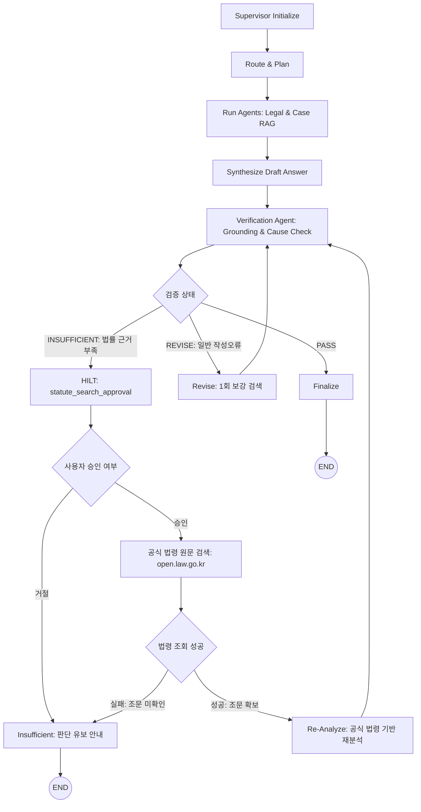

# P4.1 Verifier-Guided HILT 법령 검색 — 01. 기존 구조 분석 및 P4.1 설계 대비

## 1. 개요
본 문서는 `AI Legal Helper`의 기존 Supervisor & Verification Agent 워크플로우를 분석하고, 내부 법률 RAG 데이터베이스 부재(예: 특별법인 주택임대차보호법 조문 누락) 시 발생하던 한계를 극복하기 위해 설계된 **P4.1 Verifier-Guided HILT(Human-in-the-Loop) 법령 검색 아키텍처**를 기존 구조와 비교·분석한다.

---

## 2. 기존 워크플로우 분석 및 한계점

### 2.1 기존 LangGraph 실행 흐름
기존 시스템은 다음과 같은 단방향 또는 단순 루프 구조를 가졌다:
```
[사용자 질문] 
  → Supervisor Initialize
  → Route (민사, 형사, 임대차 등 범주 분류)
  → Plan (도구/분석 계획 수립)
  → Run Agents (전문 에이전트 병렬 검색 및 분석)
  → Synthesize (종합 답변 초안 작성)
  → Verification (법률검증 Agent의 근거 검증)
  → [PASS] -> Finalize -> END
  → [REVISE] -> Revise (ChromaDB 단순 재검색 1회) -> Verification
  → [INSUFFICIENT] -> Insufficient (근거 부족 안내) -> END
```

### 2.2 기존 구조의 치명적 결함
1. **내부 RAG 부재 시 잘못된 법률 적용(Hallucination/Misapplication)**:
   - 주택임대차보호법 등 특별법이 내부 ChromaDB에 없는 경우, LLM이 일반 민법 조항(예: 민법 제635조 1개월/6개월 규정)을 부적절하게 대입하여 답변을 생성함.
2. **Verifier의 이분법적 종료**:
   - Verifier가 `INSUFFICIENT`로 판정하더라도, "어떤 법령이 부족한지"를 사용자에게 알리지 못하고 즉시 상담이 종결되거나, 미검증 경고문만 달린 채 불완전한 상태로 마감됨.
3. **외부 공식 출처 연동 부재**:
   - 로컬 임베딩 벡터스토어 외에 법제처의 공인된 최신 국가법령정보(open.law.go.kr)를 동적으로 조회하는 인터페이스가 부재했음.

---

## 3. P4.1 Verifier-Guided HILT 목표 아키텍처



---

## 4. 기존 아키텍처 대비 P4.1 개선 비교표

| 비교 항목 | 기존 아키텍처 (P3.3) | P4.1 HILT 아키텍처 |
| :--- | :--- | :--- |
| **Verifier 결과 구조** | 단순 상태값 (`status: PASS/REVISE/INSUFFICIENT`) | 원인 코드화 (`reason_code`, `candidate_laws`, `missing_legal_issues`, `recommended_action`) |
| **법률 근거 부족 대응** | `insufficient` 노드로 직행하여 판단 유보 | 법률 부족 감지 시 즉시 HILT 노드(`statute_search_approval`)로 라우팅 |
| **인터럽트 및 재개(HILT)**| 미구현 | LangGraph 0.6+ 표준 `interrupt()` 및 `Command(resume=...)` 패턴 구현 |
| **법령 검색 도구** | 내부 ChromaDB 로컬 벡터스토어에 한정 | 법제처 국가법령정보공동활용 API (`open.law.go.kr`) 공식 연동 |
| **출처 무결성 보장** | 로컬 문서 인용만 검증 | `source_type: STATUTE`, 공식 URL, 조문 단위 파싱 및 허위 인용 원천 차단 |
| **사용자 인터랙션 UI** | 일반 채팅 인터페이스 | 승인 대기 카드 (`APPROVAL_REQUIRED`) 및 [승인/재분석], [종료] 버튼 제공 |
| **상태 지속성** | 메모리 상실 위험 | PostgreSQL DB (`ConsultationRecord`) 및 Checkpointer 일관 관리 |

---

## 5. 결론 및 기대 효과
- **법적 신뢰성 제고**: LLM 자체 지식에 의한 법령 왜곡을 원천 방지하고, 법제처 공식 원문 조문(`open.law.go.kr`)에 근거한 사실만을 답변에 반영.
- **Human-in-the-Loop 통제권 확보**: 외부 검색 및 추가 분석 시 사용자 동의를 필수화하여 개인정보 노출 및 불필요한 검색 비용을 통제.
- **Observability 완성**: 모든 인터럽트, 승인, 외부 검색 호출, 재분석 단계가 Langfuse 트레이스에 완전 투명하게 기록됨.

