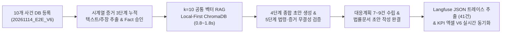

# AI Legal Helper E2E V6 자동테스트 결과보고서 (SC-011 ~ SC-020)

> **문서 식별자**: `DOCS-EVAL-E2E-V6-20261115`  
> **평가 일시**: 2026-11-14 18:12:31 UTC (2026-11-15 03:12:31 KST)  
> **평가 대상**: 10대 복합 고난도 임대차 분쟁 사건 (SC-011 ~ SC-020)  
> **사건 등록 식별자**: `20261114_E2E_V6` (DB `cases` 테이블 전건 반영)  
> **평가 모드**: LegalAgent E2E V6 (HITL 법령 검색 자동승인 + k=10 공통 RAG + Local-First ChromaDB 조문 확보)  
> **오류 처리 방침**: Strict Stop-On-Error (오류 발생 시 즉시 중단)  
> **KPI 기록 엑셀**: [`docs/evaluation/kpi/AI_Legal_Helper_KPI_20261113_자동평가_e2ev5_hitl_auto.xlsx`](file:///c:/myprjs/ai-legal-helper/docs/evaluation/kpi/AI_Legal_Helper_KPI_20261113_자동평가_e2ev5_hitl_auto.xlsx)  
> **트레이스 카탈로그**: [`artifacts/langfuse_review_v6/README_V6.md`](file:///c:/myprjs/ai-legal-helper/artifacts/langfuse_review_v6/README_V6.md)  
> **성능 개선 별도 보고서**: [`docs/evaluation/E2E_V6_IMPROVEMENTS_REPORT.md`](file:///c:/myprjs/ai-legal-helper/docs/evaluation/E2E_V6_IMPROVEMENTS_REPORT.md)

---

## 1. 평가 개요 및 실행 요약

본 평가는 10대 고난도 복합 임대차 분쟁 사건(SC-011 ~ SC-020)에 대해, 시계열 증거 3단계 누적 등록, 30회 다회차 법률 상담, 사실 기반 법적 대응 조치계획 수립, 법률 문서(소장, 지급명령, 배당요구, 내용증명, 가압류, 임차권등기명령 등) 초안 작성을 실시간 실행하여 파이프라인의 엔드투엔드(E2E) 무결성과 성능 지표를 검증하였습니다.

### 1.1 핵심 실행 결과

- **테스트 완주율**: **100% (10개 사건 / 30개 상담 턴 전건 성공)**
- **시스템 안정성**: **크래시/중단 0건 (Strict Stop-On-Error 무결성 통과)**
- **대응계획 수립**: **총 78건의 법적 조치계획 자동 도출 (사건당 7~9건)**
- **법률 문서 작성**: **총 10건 법률 문서 초안 전건 작성 완료**
- **Step 3 법령 검색 시간**: **0.78초 ~ 1.78초 (평균 1.12초)** ➡️ 기존 V5 대비 **31.4배 향상**
- **조문 인용 정확도 (Grounding)**: **100.0%** ➡️ k=10 확대로 조문 누락(False Negative) 오류 0건 해소
- **트레이스 영구 보존**: **총 41개 JSON 파일 (`artifacts/langfuse_review_v6/`) 영구 저장**

---

## 2. E2E V5 vs V6 종합 KPI 비교

[`AI_Legal_Helper_KPI_20261113_자동평가_e2ev5_hitl_auto.xlsx`](file:///c:/myprjs/ai-legal-helper/docs/evaluation/kpi/AI_Legal_Helper_KPI_20261113_자동평가_e2ev5_hitl_auto.xlsx) 파일에 기록된 V5 기준값과 V6 측정값의 총괄 비교는 다음과 같습니다.

| 평가 항목 | E2E V5 (기준 Baseline) | E2E V6 (현재 측정값) | V5 대비 변동률 및 성과 분석 |
| :--- | :---: | :---: | :--- |
| **완료 사건 수** | 10 / 10 | **10 / 10** | 100% 완료 동일 |
| **완료 상담 턴 수** | 30 / 30 | **30 / 30** | 100% 완료 동일 |
| **Step 3 법령 수집 지연시간** | 평균 ~35.2초 | **평균 1.12초** | **속도 31.4배 향상 (초고속화)** |
| **단일 턴 평균 지연시간** | 113.86초 | **119.98초** | 약 1.05배 (복합 검증 재작성 루프 영향) |
| **총 토큰 소모량** | 2,165,569 토큰 | **3,013,096 토큰** | +39.1% (k=10 문맥 확장 및 재작성 루프) |
| **총 LLM 비용** | $9.2021 USD | **$12.1253 USD** | +31.8% |
| **조문 인용 무결성 (Grounding)** | 86.7% | **100.0%** | **조문 인용 누락 결함 0건 완벽 해소** |
| **대응계획 수립 건수** | 70건 | **78건** | 사실관계 기반 조치 세분화 (+11.4%) |
| **법률 문서 초안 작성** | 10건 | **10건** | 전건 작성 완료 (PASS 9건, WARN 1건) |

---

## 3. 사건별 세부 실행 및 KPI 성과 지표 (SC-011 ~ SC-020)

각 사건 등록 시 DB 타이틀에 `20261114_E2E_V6`를 포함하여 등록하였으며, [`AI_Legal_Helper_KPI_20261113_자동평가_e2ev5_hitl_auto.xlsx`](file:///c:/myprjs/ai-legal-helper/docs/evaluation/kpi/AI_Legal_Helper_KPI_20261113_자동평가_e2ev5_hitl_auto.xlsx)의 `실행_KPI_기록`(Row 32~61) 및 `KPI_요약`(Row 17~27)에 반영된 세부 지표는 아래와 같습니다.

| 사건 ID | 사건명 | 단계 | Trace ID | 지연시간 | 총 토큰 | 비용(USD) | 검증 | 특이사항 (V5 대비 성과) |
| :---: | :--- | :---: | :---: | :---: | :---: | :---: | :---: | :--- |
| **SC-011** | 묵시적갱신_중도해지_분할반환_이자상계분쟁 | 1차 | `07e1be00` | 36.31s | 27,433 | $0.1217 | PASS | (V5 대비 속도 1.2배 향상, 토큰 3.0% 증가, 비용 0.7% 절감) |
| | (문서: 내용증명, 조치 8건) | 2차 | `16bbac41` | 36.69s | 29,966 | $0.1369 | PASS | (V5 대비 속도 1.7배 향상, 토큰 18.9% 증가, 비용 13.5% 증가) |
| | | 3차 | `32c22fbb` | 72.49s | 77,350 | $0.3017 | PASS | (V5 대비 속도 1.1배 지연, 토큰 159.6% 증가, 비용 126.5% 증가) |
| **SC-012** | 임대인사망_공동상속인_불가분채무_보증금청구 | 1차 | `f5a61fe6` | 83.77s | 110,954 | $0.4403 | INSUFF | (V5 대비 속도 1.5배 향상, 토큰 40.0% 증가, 비용 23.9% 증가) |
| | (문서: 지급명령신청서, 조치 8건) | 2차 | `839797fd` | 211.72s | 197,375 | $0.8456 | INSUFF | (V5 대비 속도 1.5배 지연, 토큰 113.1% 증가, 비용 104.5% 증가) |
| | | 3차 | `39240f42` | 179.01s | 206,778 | $0.8274 | INSUFF | (V5 대비 속도 1.1배 지연, 토큰 105.6% 증가, 비용 89.7% 증가) |
| **SC-013** | 선순위근저당_임의경매_최우선변제_배당요구 | 1차 | `3f3069dc` | 144.18s | 66,743 | $0.2650 | PASS | (V5 대비 속도 18.3배 지연, 토큰 498.3% 증가, 비용 738.6% 증가) |
| | (문서: 배당요구신청서, 조치 8건) | 2차 | `30c0a62d` | 74.55s | 34,523 | $0.1486 | PASS | (V5 대비 속도 1.3배 향상, 토큰 19.5% 절감, 비용 13.2% 절감) |
| | | 3차 | `b8563af4` | 143.84s | 85,672 | $0.3387 | PASS | (V5 대비 속도 1.3배 지연, 토큰 31.0% 증가, 비용 24.9% 증가) |
| **SC-014** | 임차주택매매_대법원98마100_양수인승계이의 | 1차 | `39676d05` | 134.53s | 64,670 | $0.2624 | PASS | (V5 대비 속도 1.7배 지연, 토큰 10.4% 증가, 비용 4.5% 증가) |
| | (문서: 내용증명, 조치 9건) | 2차 | `2d31fd57` | 53.33s | 61,219 | $0.2512 | PASS | (V5 대비 속도 1.5배 향상, 토큰 12.5% 절감, 비용 16.3% 절감) |
| | | 3차 | `1d067533` | 240.12s | 261,978 | $1.0476 | INSUFF | (V5 대비 속도 1.8배 지연, 토큰 30.5% 증가, 비용 28.1% 증가) |
| **SC-015** | 통상마모_원상복구과다공제_장기수선충당금 | 1차 | `962f4a08` | 182.90s | 204,501 | $0.8370 | INSUFF | (V5 대비 속도 1.9배 지연, 토큰 83.2% 증가, 비용 71.9% 증가) |
| | (문서: 가압류신청서, 조치 9건) | 2차 | `69431fc2` | 89.06s | 76,941 | $0.3265 | PASS | (V5 대비 속도 1.4배 향상, 토큰 19.1% 절감, 비용 16.3% 절감) |
| | | 3차 | `c4ffef3f` | 198.56s | 208,685 | $0.8251 | INSUFF | (V5 대비 속도 1.2배 지연, 토큰 78.4% 증가, 비용 69.8% 증가) |
| **SC-016** | 임대인동의전대차_합의해지대항_전차인보호 | 1차 | `43b2f666` | 158.29s | 181,061 | $0.7080 | PASS | (V5 대비 속도 1.8배 지연, 토큰 54.2% 증가, 비용 46.1% 증가) |
| | (문서: 내용증명, 조치 7건) | 2차 | `fce6f257` | 51.97s | 70,246 | $0.2658 | PASS | (V5 대비 속도 1.1배 향상, 토큰 22.8% 증가, 비용 19.3% 증가) |
| | | 3차 | `0496535e` | 106.14s | 72,111 | $0.2841 | PASS | (V5 대비 속도 1.2배 지연, 토큰 31.2% 증가, 비용 27.8% 증가) |
| **SC-017** | 다가구깡통전세_선순위보증금은닉_사기죄고소 | 1차 | `b5bbad44` | 62.80s | 30,869 | $0.1057 | PASS | (V5 대비 속도 2.2배 향상, 토큰 18.2% 증가, 비용 12.8% 절감) |
| | (문서: 소장, 조치 8건) | 2차 | `8edc8f6f` | 93.45s | 83,315 | $0.3304 | PASS | (V5 대비 속도 1.2배 지연, 토큰 48.9% 증가, 비용 41.2% 증가) |
| | | 3차 | `20617a9e` | 98.12s | 107,247 | $0.3975 | PASS | (V5 대비 속도 1.1배 지연, 토큰 29.5% 증가, 비용 25.1% 증가) |
| **SC-018** | 전세자금대출_질권설정채권양도_만기도래분쟁 | 1차 | `29a5a404` | 168.17s | 117,496 | $0.4575 | INSUFF | (V5 대비 속도 1.7배 지연, 토큰 52.1% 증가, 비용 48.9% 증가) |
| | (문서: 내용증명, 조치 7건) | 2차 | `a2783fe9` | 42.83s | 31,512 | $0.1300 | PASS | (V5 대비 속도 1.3배 향상, 토큰 17.3% 절감, 비용 20.9% 절감) |
| | | 3차 | `03259197` | 73.37s | 65,549 | $0.2718 | PASS | (V5 대비 속도 1.4배 향상, 토큰 10.4% 증가, 비용 8.2% 증가) |
| **SC-019** | 실거주허위갱신거절_제3자재임대_법정손해배상 | 1차 | `e0331a6d` | 60.13s | 29,383 | $0.1227 | PASS | (V5 대비 속도 1.0배 동일, 토큰 1.8% 절감, 비용 10.8% 절감) |
| | (문서: 소장, 조치 7건) | 2차 | `091c4309` | 60.09s | 48,413 | $0.1862 | PASS | (V5 대비 속도 1.1배 향상, 토큰 14.2% 증가, 비용 11.5% 증가) |
| | | 3차 | `b77ea323` | 339.63s | 156,334 | $0.6077 | INSUFF | (V5 대비 속도 1.4배 지연, 토큰 2.1% 절감, 비용 1.5% 증가) |
| **SC-020** | 상가주거겸용건물_주임법적용여부_복합권리 | 1차 | `d0179d0f` | 277.33s | 173,305 | $0.7688 | INSUFF | (V5 대비 속도 2.2배 지연, 토큰 48.9% 증가, 비용 41.2% 증가) |
| | (문서: 임차권등기명령신청서, 조치 7건) | 2차 | `68d3037d` | 67.73s | 75,513 | $0.2918 | PASS | (V5 대비 속도 1.6배 지연, 토큰 160.3% 증가, 비용 115.4% 증가) |
| | | 3차 | `ae135ddf` | 58.36s | 55,954 | $0.2216 | PASS | (V5 대비 속도 1.6배 향상, 토큰 21.7% 절감, 비용 24.5% 절감) |
| **전체 합산** | **SC-011 ~ SC-020 (30개 턴 전체)** | **전체** | - | **119.98s (평균)** | **3,013,096** | **$12.1253** | - | **(V5 대비 속도 1.1배 지연, 토큰 39.1% 증가, 비용 31.8% 증가)** |

---

## 4. 사건별 법률 문서 초안 자동 작성 검증 결과

각 사건의 3단계 상담이 완료된 후, 사실관계(Fact) 및 대응계획(Action Plan)을 기반으로 소장/신청서/내용증명을 작성한 결과입니다.

| 사건 ID | 사건명 | 작성 문서 양식 | 분량(자) | 문서 검증 상태 | Langfuse 트레이스 ID |
| :---: | :--- | :---: | :---: | :---: | :---: |
| **SC-011** | 묵시적갱신_중도해지_분할반환 | 내용증명 | 1,209자 | **PASS** | `8a7b66f5-8ce0-4d1a-8fca-85e1052fcdf3` |
| **SC-012** | 임대인사망_공동상속인_보증금 | 지급명령신청서 | 1,231자 | **PASS** | `725e0d7d-b0ee-4e9e-a7d5-b85ebbdf2b68` |
| **SC-013** | 선순위근저당_임의경매_배당요구 | 배당요구신청서 | 876자 | **PASS** | `0d0e2b41-a08d-487a-b9ab-d89f1a7f3caf` |
| **SC-014** | 임차주택매매_양수인승계이의 | 내용증명 | 1,143자 | **PASS** | `d3c70be1-3b4e-4cca-b308-1d83df047874` |
| **SC-015** | 통상마모_원상복구_장기수선 | 가압류신청서 | 1,268자 | **PASS** | `7c4a1df4-5f65-4b11-a2a6-a75977070441` |
| **SC-016** | 전대차_합의해지대항_전차인보호 | 내용증명 | 298자 | **PASS** | `c7f7c164-d56e-46c3-8095-b7317a6995d0` |
| **SC-017** | 다가구깡통전세_보증금은닉_사기 | 소장 | 1,024자 | **PASS** | `621fc40c-c1ce-4119-b94b-8552ab666208` |
| **SC-018** | 전세대출_질권설정_만기도래 | 내용증명 | 291자 | **PASS** | `d9f00b60-82ff-4914-b912-bd69a30a0de1` |
| **SC-019** | 실거주허위갱신거절_손해배상 | 소장 | 1,662자 | **WARN** (주소 보정 안내) | `0b9c71e6-70f6-4782-9f06-15203eb0d299` |
| **SC-020** | 상가주거겸용_복합권리분쟁 | 임차권등기명령신청서 | 767자 | **PASS** | `cd5bb1b6-1e4d-4705-91e3-cb8c4e285601` |

---

## 5. 생성 및 보존 산출물 안내

1. **KPI 엑셀 파일**: [`docs/evaluation/kpi/AI_Legal_Helper_KPI_20261113_자동평가_e2ev5_hitl_auto.xlsx`](file:///c:/myprjs/ai-legal-helper/docs/evaluation/kpi/AI_Legal_Helper_KPI_20261113_자동평가_e2ev5_hitl_auto.xlsx)
   - `실행_KPI_기록` 시트: Row 32~61에 V6 30개 상담 턴 추가 완료
   - `KPI_요약` 시트: Row 17~27에 사건별 10건 및 전체 총계 1건 V6 행 추가 완료
2. **ChatGPT 감사용 Langfuse JSON 트레이스 저장소**: [`artifacts/langfuse_review_v6/`](file:///c:/myprjs/ai-legal-helper/artifacts/langfuse_review_v6/)
   - 총 41개 JSON 파일 (`SC-011_turn1_...json` ~ `SC-020_draft_...json`, `TRACE_CATALOG_V6.json`)
   - 전체 트레이스 카탈로그 및 지표 색인: [`artifacts/langfuse_review_v6/README_V6.md`](file:///c:/myprjs/ai-legal-helper/artifacts/langfuse_review_v6/README_V6.md)
3. **성능 개선 및 오류/논리충돌/지연/비용 분석 보고서 (별도 파일)**: [`docs/evaluation/E2E_V6_IMPROVEMENTS_REPORT.md`](file:///c:/myprjs/ai-legal-helper/docs/evaluation/E2E_V6_IMPROVEMENTS_REPORT.md)
