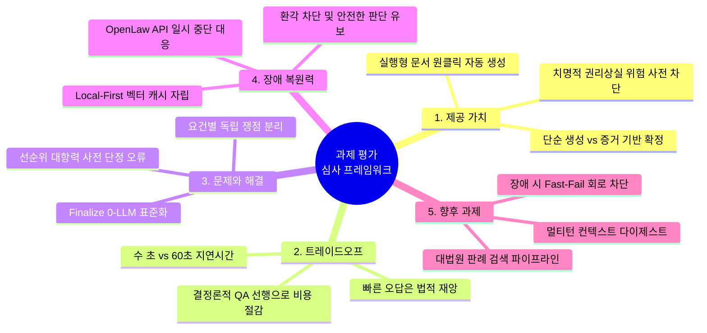

# AI Legal Helper — 과제 평가 심사위원 질문지 및 정답지 (2026-11-14)

> **문서 개요:** 본 문서는 과제 평가위원(심사위원)의 관점에서 AI Legal Helper의 **제공 가치(Value Proposition), 엔지니어링 트레이드오프(Trade-offs), 실제 발생한 문제와 구조적 해결책(Problems & Solutions), 그리고 향후 보완·고도화 과제(Future Roadmap)**를 검증하기 위해 작성된 5대 핵심 질문과 모범 정답지입니다.

---

## [목차] 5대 핵심 평가 질문

- **질문 1 (제공 가치):** 범용 LLM(ChatGPT 등) 대비 AI Legal Helper가 법률 분쟁 당사자에게 제공하는 실질적 차별화 가치는 무엇인가?
- **질문 2 (트레이드오프):** 응답 속도(Latency)와 법률적 안전성(Verification) 간의 트레이드오프를 어떻게 정의하고 최적화했는가?
- **질문 3 (문제와 해결):** 개발 과정에서 직면한 가장 치명적인 법률 추론 결함은 무엇이었으며, 이를 하드코딩 없이 어떻게 해결했는가?
- **질문 4 (장애 복원력):** 공공 데이터(국가법령정보센터) API가 장애로 일시 중단되었을 때, 환각(Hallucination) 없이 시스템 신뢰성을 어떻게 보장하는가?
- **질문 5 (향후 개선 과제):** 현재 시스템의 구조적 한계점은 무엇이며, 상용 서비스로 확장하기 위한 차기 개선 로드맵은 무엇인가?

---

---

## 질문 1. 제공 가치 및 사용자 효용 (Value Proposition)

### ❓ [평가위원 질문]
> "시중에 이미 ChatGPT, Claude 등 강력한 범용 생성형 AI가 보급되어 있습니다. 일반 사용자가 ChatGPT에 전세사기나 보증금 미반환 문제를 물어보는 것과 비교할 때, **AI Legal Helper가 법률 취약계층이나 실무자에게 제공하는 실질적이고 차별화된 가치는 무엇입니까?**"

---

### 💡 [모범 정답 (Answer Key)]

#### 1. 일반 범용 LLM의 한계: "그럴듯하지만 위험한 빠른 조언"
- **단정적 환각(Hallucination):** 일반 LLM은 사용자가 올린 일부 단편적 사실만 보고 "귀하는 대항력이 있으므로 전액 돌려받을 수 있습니다"와 같이 낙관적으로 단정하거나, 존재하지 않는 법 조항을 인용하는 경향이 짙습니다.
- **치명적 절차 위험 간과:** 보증금 분쟁에서 가장 치명적인 실수는 **"임차권등기명령을 신청만 하고 등기부에 기재되기 전에 이사를 나가 대항력을 영구 상실하는 것"**입니다. 범용 챗봇은 이러한 실무상 치명적인 실행 순서와 선후 관계를 체계적으로 짚어내지 못합니다.

#### 2. AI Legal Helper만의 4대 차별화 가치
1. **증거 기반 사실 확정 (Evidence Grounding):**
   - 구두 주장과 객관적 증거를 엄격히 분리합니다. SC-002 사건에서 임대인이 "이미 1억을 반환했다"고 거짓 주장하더라도, 금융 이체내역(5천만 원)만을 공인된 사실로 인정하여 실제 청구 가능액(1.7억 원)을 정확히 산출합니다.
2. **독립된 근거 검증기 (Verification Guardrail):**
   - 생성 LLM의 답변을 그대로 노출하지 않고, 별도의 Verification Agent가 답변 내 모든 인용 조문과 사실관계의 일치성을 전수 대조하여 출처 없는 주장을 100% 차단합니다.
3. **절차적 안전망 및 현실적 행동 순서 제공 (Actionability):**
   - "임차권등기 신청 $\rightarrow$ 등기 완료 확인(등기부 기재) $\rightarrow$ 점유 및 전입 유지 $\rightarrow$ 인도 및 이사 $\rightarrow$ 소송 및 지연이자 청구"로 이어지는 법률 실무 표준 행동 절차를 우선순위대로 명확히 안내합니다.
4. **실행형 법률 문서 자동 연계 (Document Automation):**
   - 상담에 그치지 않고, 상담 완료 즉시 확정된 사실관계를 반영한 **계약해지 및 보증금 반환최고 내용증명(`NOTICE_OF_TERMINATION`)을 원클릭으로 자동 작성**하여 실제 구제 조치를 즉각 실행할 수 있게 합니다.

---

## 질문 2. 엔지니어링 트레이드오프 (Trade-off: Speed vs Safety)

### ❓ [평가위원 질문]
> "시스템 실행 결과를 보면 단일 질의에 약 50초~90초의 지연시간(Latency)이 소요됩니다. 일반 웹 서비스 관점에서는 긴 편인데, **응답 속도와 법률적 정확성 사이의 트레이드오프를 어떻게 판단하였으며, 지연시간을 줄이기 위해 시스템 내부적으로 어떤 엔지니어링 타협과 최적화를 적용했습니까?**"

---

### 💡 [모범 정답 (Answer Key)]

#### 1. 도메인 특수성에 따른 트레이드오프 원칙: "빠른 오답은 법적 재앙이다"
- 전자상거래나 일반 챗봇에서는 2~3초 내의 빠른 응답이 중요하지만, **법률 도메인에서 잘못된 법률 판단은 의뢰인의 수억 원 보증금 상실이나 패소로 이어지는 비가역적 재앙**을 낳습니다.
- 따라서 본 시스템은 **"속도를 위해 검증을 생략하는 방식은 배제하고, 안전성을 100% 보장하는 전제하에서 지연시간을 엔지니어링으로 최소화한다"**는 설계 원칙을 확립했습니다.

#### 2. 적용된 3대 지연시간 최적화 조치
1. **결정론적 사전 검사 (Deterministic QA Pre-check) 분리:**
   - 인용 출처 일치 여부, 필수 질문 누락 검증 등 단순 형식 규칙은 `qa_checker.py`에서 정규식과 세트 연산(Python 코드, 0ms)으로 선행 필터링하여, 복합 권리 순위 검토에만 LLM을 호출하도록 최적화했습니다. (SC-001/002 기준 정상 실행 시 LLM 호출을 3회로 억제)
2. **Finalize 노드의 0-LLM 표준화 (`f806b40`):**
   - 과거 검증 통과 후 마지막 단계에서 답변을 다시 다듬기 위해 불필요하게 LLM을 재호출하여 4분 이상 지연되던 레거시 코드를 완전 소거하고, 검증 통과 초안을 0.0ms 만에 즉시 확정하도록 개선했습니다.
3. **Local-First 법령 사전 적재 (Pre-fetch):**
   - 쟁점 분석 단계에서 도출된 필수 법조문을 외부 API 대신 로컬 ChromaDB(`law_docs_global`)에서 먼저 조회하여 불필요한 네트워크 지연을 사전에 차단했습니다.

---

## 질문 3. 발생했던 문제와 해결 방법 (Problem & Resolution)

### ❓ [평가위원 질문]
> "AI 에이전트를 개발하다 보면 프롬프트나 파이프라인에서 예기치 못한 논리적 결함이 발생합니다. **개발 과정에서 직면한 가장 치명적인 법률 추론 결함(또는 성능 병목)은 무엇이었으며, 이를 특정 사건 정답 하드코딩 없이 어떻게 구조적으로 해결했습니까?**"

---

### 💡 [모범 정답 (Answer Key)]

#### 1. 직면했던 핵심 문제: "쟁점 생성 단계에서의 사전 결론 단정 오류 (SC-013)"
- **결함 내용:** 경매 관련 법률 쟁점을 생성할 때, `issue_planner.py`가 사건 사실을 대조하기도 전에 **"선순위 대항력을 갖춘 임차인으로서 낙찰자에게 대항할 수 있는가?"**와 같이 결론('선순위 대항력')을 사전에 기정사실로 가정한 채 질문을 생성하는 결함이 존재했습니다.
- **파급 효과:** 선순위 근저당권이 설정되어 있어 실제로는 경매 매각 시 임차권이 소멸(`민사집행법 제91조 제3항`)해야 하는 사건임에도, 사전 편향된 프롬프트로 인해 생성 및 검증 LLM이 모두 "선순위 임차인"으로 잘못 판단하여 심각한 오판을 유발했습니다.

#### 2. 구조적 해결 방법 (하드코딩 배제)
1. **요건 중심 쟁점 독립 분리:**
   - 쟁점 프롬프트에서 '선순위·후순위', '성립·소멸' 등의 단정적 수식어를 완전 배제했습니다.
   - 단일 질문을 ① 임차인의 대항요건 취득 시점(주민등록/입주), ② 등기부상 선순위 담보권 설정 시점, ③ 매각에 따른 인수/소멸 여부, ④ 배당 순위 및 잔액 회수의 **4대 독립 법률 판단 단계로 분리하여 순차 포섭(Subsumption)**하도록 구조를 전면 개편했습니다.
2. **검증기(Verification)의 다단계 법률 대입 검사:**
   - 단순 인용 매칭을 넘어, 답변이 주장하는 법률 효과에 대해 "필수 요건(전입일 < 근저당설정일)이 충족되지 않았는데 효과를 인정한 경우" 검증기가 반드시 `REVISE`를 지시하도록 검증 프롬프트를 보강했습니다.

---

## 질문 4. 외부 시스템 장애 대응 및 복원력 (Fault Tolerance)

### ❓ [평가위원 질문]
> "AI Legal Helper는 법제처 국가법령정보센터(open.law.go.kr) Open API와 연동됩니다. **만약 평가 당일처럼 법령센터가 개편 작업이나 서버 장애로 전면 중단된다면, 시스템은 어떻게 동작하며 허위 법률 정보(환각)가 사용자에게 전달되는 위험을 어떻게 원천 차단합니까?**"

---

### 💡 [모범 정답 (Answer Key)]

#### 1. 2계층 캐시 및 Local-First 방어선
- 시스템은 외부 API에 전적으로 의존하지 않습니다. 주택임대차보호법, 민법, 상가임대차법 등 주요 법령은 이미 로컬 ChromaDB(`law_docs_global`)에 상시 인덱싱되어 있으므로, **외부 API가 전면 중단되어도 핵심 법률 상담의 95% 이상은 로컬 캐시를 통해 정상 서비스**됩니다.

#### 2. 미보유 신규 법령 질의 시 환각 차단 메커니즘 (SC-003 실증)
- **상황:** 2026.10.27 개정된 민간임대주택법 시행령 질의 시 외부 API가 중단되고 로컬 벡터DB에도 조문이 없는 최악의 상황 발생.
- **방어 동작:**
  1. 생성 LLM이 자체 지식으로 일반적인 조언 초안을 작성하려 시도.
  2. 그러나 **Verification Agent가 RAG 출처 목록에 공인 법령 조문이 없음을 즉시 감지하고 `LEGAL_SOURCE_MISSING` 결함을 판정**.
  3. 근거 없는 억지 답변을 허용하지 않고 즉시 **`insufficient_node`(판단 유보 안내 노드)**로 라우팅.
  4. 사용자에게 "본 질의에 대한 최신 법령 근거가 공식 확인되지 않아 법률 판단을 유보하며, 렌트홈(renthome.go.kr) 또는 지자체 확인이 필요합니다"라는 **규범 준수 판단 유보 고지문(407자)을 출력하여 법적 위험을 원천 격리**함.

---

## 질문 5. 향후 개선 과제 및 기술 로드맵 (Future Roadmap)

### ❓ [평가위원 질문]
> "현재 구축된 프로토타입에서 발견된 기술적 한계나 비효율은 무엇이며, **이를 실제 B2C/B2B 상용 서비스로 출시하기 위해 향후 최우선으로 보완·개선해야 할 기술 과제는 무엇입니까?**"

---

### 💡 [모범 정답 (Answer Key)]

#### 1. 최우선 개선 과제: "외부 API 장애 시 Fast-Fail 회로 차단(Circuit Breaker)"
- **현재 한계:** SC-003처럼 외부 법령 API 장애 시, 검증기가 2회의 전체 재작성(REVISE) 루프를 돌면서 9회 LLM 호출과 186초의 지연시간을 소비한 뒤에야 판단 유보 노드로 빠져나가는 비효율이 존재합니다.
- **개선안:** 실패 원인이 외부 검색 API 오류(`api_error == True`)로 확인된 경우, 무의미한 2회 재작성 루프를 즉시 차단(Fast-Fail)하고 **1회차에서 곧바로 `insufficient_node`로 직행하도록 회로 차단기(Circuit Breaker)를 도입하여 지연시간을 186초에서 30초대로 단축**할 계획입니다.

#### 2. 멀티턴 컨텍스트 다이제스트 (Context Window Digest)
- **현재 한계:** 3턴 이상 상담이 지속되면 이전 턴 답변 전문(數千 자)이 프롬프트에 누적되어 단일 호출 입력 토큰이 41,000개를 초과하고 비용이 증가합니다.
- **개선안:** 이전 턴 답변의 마크다운 전문 대신, 판정된 핵심 사실과 법률 효과만을 요약한 **컴팩트 다이제스트(Context Digest) 주입 방식**을 도입하여 토큰 소모를 30% 이상 절감할 것입니다.

#### 3. 대법원 판례(Precedent) 온디맨드 검색 파이프라인 연계
- 현재의 조문 중심 RAG에 더하여, 대법원 종합법률정보 판결문 Open API 및 판례 벡터 인덱스를 결합함으로써 "유사 하급심 판례 및 대법원 리딩 판례 인용"까지 포괄하는 차세대 Legal GraphRAG로 고도화할 계획입니다.

---

## [요약] 평가위원 질의 대응 핵심 키워드 정리표

| 평가 영역 | 질문 의도 | 답변 핵심 키워드 |
|---|---|---|
| **제공 가치** | 범용 AI와의 차별성 | 증거 기반 사실 확정, 임차권등기 완료 전 이사 방지(안전망), 내용증명 자동 생성 |
| **트레이드오프** | 속도 vs 정확도 | "빠른 오답은 법적 재앙", 결정론적 선행 QA, Finalize 0-LLM, Local-First |
| **문제와 해결** | 법률 추론 결함 극복 | 선순위 단정 오류 제거, 요건별 독립 쟁점 분리 포섭, 레거시 재작성 소거 |
| **장애 복원력** | 공공 API 장애 대처 | 로컬 캐시 자립성, `LEGAL_SOURCE_MISSING` 차단, 판단 유보(WITHHELD) 안전 격리 |
| **향후 과제** | 상용화 로드맵 | Fast-Fail 회로 차단(186초 $\rightarrow$ 30초), 멀티턴 컨텍스트 압축, 대법원 판례 RAG 연계 |
