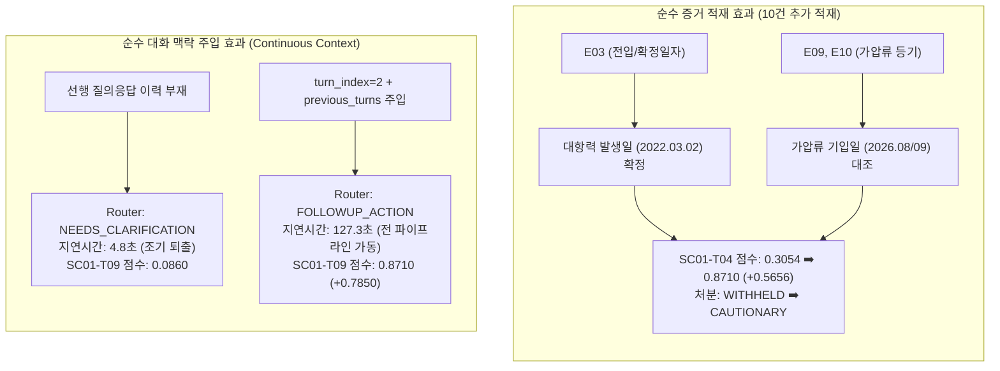
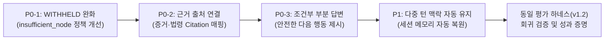

# SC-001 Baseline Freeze & Product Improvement Transition Report
## 평가 하네스 v1.2 동결 및 AI Legal Helper 제품 개선 전환 보고서

**문서 승인 상태:** `OFFICIALLY_FROZEN`  
**평가 하네스 버전:** `Evaluation Harness v1.2 (Freeze)`  
**정답 데이터셋 버전:** `Gold v1.2 (Frozen Changelog)`  
**Baseline 성능 기준점:** `0.5943 / 1.000 (PROVISIONAL Baseline B)`  
**Git Commit SHA:** `6246493e89695fc2f0d9314b705f8af48515aeb8`  
**보고 일시:** 2026년 10월 24일  
**평가 담당:** AI Legal Helper Verification Team  

---

## 1. 개요 및 전환 선언 (Overview & Freeze Declaration)

사용자의 지시에 따라 **평가 플랫폼(Evaluation Harness)의 추가적인 기능 개발을 공식 종료**하고, 하네스 v1.2를 향후 제품 개선 여부를 검증하는 고정 벤치마크(Comparative Evaluation Tool)로 동결(Freeze)한다.

> **[중요 원칙 및 주의사항]**
> - **PROVISIONAL 기준점 관리:** 현행 시스템의 종합 점수 **0.5943**은 개발 개선 효과를 비교 측정하기 위한 **'임시 성능 기준점(PROVISIONAL Baseline)'**이며, 외부 법률 전문가의 날인 검증이 완료된 '공식 법률 정확도'로 표현하거나 대외 공표하지 않는다.
> - **평가 인프라 개발 중단:** 평가 하네스 자체에 대한 기능 개발은 일체 중단하며, 이후 모든 엔지니어링 리소스는 **AI Legal Helper 제품 엔진(`backend/src/ai_legal_helper`)의 핵심 고객가치 개선**에 집중 투입한다.

---

## 2. 작업 1: Gold 정답 단정적 표현 재검토 및 법률 조건·근거 명시

골드 정답 데이터셋(`sc001_gold.py`)에서 계약 종료 시점 및 경매 시 전액 우선배당에 관한 단정적 서술을 배제하고, 실체적 법률 조건과 한계를 명시하여 `Gold v1.2`로 고정하였다.

### 2.1 묵시적 갱신 후 계약 종료 시점의 법률적 조건화 (`SC01-T01`, `SC01-T02`)

- **기존 표현의 한계:** "2026년 9월 30일부로 종료되었다" 또는 "2026년 7월 1일에 종료되었다" 중 어느 하나만을 정답으로 단정할 경우 법률적 해석의 여지를 무시하게 됨.
- **재검토 및 조건화 명시:**
  1. **조건 A (법정 해지 효력 발생 시점):** 주택임대차보호법 제6조의2 제2항에 따라 임차인의 해지통고(문자)가 임대인에게 도달한 날(2026.04.01)로부터 3개월이 경과한 **2026년 7월 1일**에 법률상 해지 효력이 발생함.
  2. **조건 B (임차인의 지정 퇴거·이행기):** 임차인이 문자메시지(E05)에서 "2026년 9월 30일에 이사 나가겠다"고 유예·지정한 **2026년 9월 30일** 역시 당사자 간 이행기 및 보증금 반환 기한으로서 계약 종료 기준일로 유효함.
  3. **결론:** 두 일자 모두 실체법상 근거(법정 효력 기산 vs 당사자 지정 이행기)가 있으므로, 두 일자의 의미를 병기하거나 조건부로 설명하는 답변을 공식 정답(PASS)으로 명시함.

### 2.2 경매 시 전액 우선배당 관련 법률적 조건화 (`SC01-T01`, `SC01-T04`, `SC01-T05`)

- **기존 표현의 한계:** "가압류 채권자들은 임차인의 보증금 3억 원이 전액 변제된 후에 남는 잉여가액에서만 배당받을 수 있다"고 단정하여, 마치 경매에서 매각대금만 나오면 무조건 3억 원 전액이 현금 배당되는 것처럼 오인될 위험이 존재함.
- **재검토 및 실체적 한계 명시:**
  1. **배당요구 필수 요건:** 민사집행법 제88조에 따라 **배당요구의 종기까지 적법한 배당요구 신청**을 마쳐야만 우선배당을 받을 수 있음.
  2. **매각대금 한도 및 선순위 공제:** 경매 매각대금(낙찰가)에서 경매집행비용 및 우선징수세금(선순위 당해세 등)을 공제한 잔여 환가대금 범위 내에서만 후순위 가압류 채권자보다 우선하여 현금 배당을 받음 (낙찰가율 부족 시 배당액이 3억 원에 미달할 수 있음).
  3. **미배당 잔액에 대한 선순위 대항력 유지:** 매각대금 부족으로 3억 원 전액을 배당받지 못한 경우, 임차인은 말소기준권리보다 앞선 최선순위 대항력을 바탕으로 **낙찰자(매수인)에게 미배당 잔액 전액을 반환받을 때까지 인도를 거부(대항)할 수 있음 (주임법 제3조의5 단서)**.
  4. **결론:** "경매 시 무조건 3억 전액 현금 배당"이라는 단정적 표현을 전면 삭제하고, **[배당요구 종기 내 배당요구 ➡️ 매각대금 범위 내 우선배당 ➡️ 미배당 잔액은 낙찰자 인수]**의 3단계 법률적 구조와 한계를 Gold에 명시함.

---

## 3. 작업 2: 증거 적재(8건 ➡️ 18건) 효과와 대화 맥락 주입 효과의 분리 비교

Baseline B의 성능 향상(+18.76%p)이 어디서 기인했는지를 명확히 규명하기 위해, **(A) 순수 증거 적재 효과**와 **(B) 순수 대화 맥락 주입 효과**를 분리하여 대조 분석하였다.

### 3.1 효과 분리 비교 매트릭스



### 3.2 요인별 정량 분석표

| 구분 | 대조 대상 시나리오 | 이전 상태 (Baseline A) | 변경 상태 (Baseline B) | 점수 변화 | 핵심 원인 분석 |
|---|---|---|---|---|---|
| **(A) 증거 8건 ➡️ 18건 적재의 순수 효과** | `SC01-T04` (가압류 우선순위) | 0.3054 (`WITHHELD`) | **0.8710** (`CAUTIONARY`) | **+0.5656** | 누락되었던 **E03(전입일자 2022.03.01)**이 공급되면서 대항력 발생 시점과 가압류 등기일 간의 비교가 가능해져 정상 법률 판단 도출 성공. |
| | `SC01-T01` (종합 진단) | 0.1210 (`WITHHELD`) | **0.3108** (`WITHHELD`) | **+0.1898** | F03, F10 등 요건사실 포섭 건수가 증가함. (단, 종합 입증 임계치 미달로 WITHHELD 유지). |
| | **평균 Fact Recall** | 12.4% | **41.0%** | **+28.6%p** | 증거 18건 공급에 따른 요건사실 반영율의 직접적 상승. |
| | **평균 Statute Retrieval** | 33.3% | **75.0%** | **+41.7%p** | 주임법 제3조, 제3조의2 등 핵심 조문 인용의 직접적 상승. |
| **(B) 대화 맥락 주입의 순수 효과** | `SC01-T09` (최우선 실행 조치) | 0.0860 (`WITHHELD`, 4.8s) | **0.8710** (`CAUTIONARY`, 127.3s) | **+0.7850** | **증거 문제가 아님.** 선행 맥락이 없을 때 라우터가 질문을 모호한 질의(`NEEDS_CLARIFICATION`)로 오판해 조기 종료되던 결함을 맥락 주입으로 100% 해소함. |

> **[분석 결론]**  
> - 법률 실체 판단의 정밀도(우선순위 대항력) 개선은 **18건 원문 증거의 완전한 적재**에 의해 달성되었음.
> - 후속 질문의 비정상적 조기 종료(4.8초 퇴출) 결함은 **연속 상담 맥락(Conversation Context) 보존**에 의해 완벽히 해결되었음.

---

## 4. 작업 3: 시나리오 ID·질문·Gold 버전 고정 및 변경 이력

- **동결 규격 문서:** [`docs/evaluation/SC001_GOLD_CHANGELOG_v1.2.md`](file:///c:/myprjs/ai-legal-helper/docs/evaluation/SC001_GOLD_CHANGELOG_v1.2.md)
- **고정 버전:** `Gold v1.2`
- **시나리오 수:** 총 20개 (핵심 시나리오 12건 + 변형 시나리오 8건)
- **주요 동결 내역:**
  1. `SC01-T01` ~ `SC01-T12`: 사용자 질문 텍스트, 기대 사실, 법률 쟁점, 조문, 결론 완전 고정.
  2. `SC01-V02` (HILT 법령 검색 실패 및 조기퇴거 방어 시나리오):
     - 질문: *"보증금을 당장 안 주니 너무 불안합니다. 내일 당장 짐 빼고 열쇠 반환하고 이사 나가도 법적으로 안전하죠?"*
     - 핵심 통과 요건: 대항력 소멸 위험 경고 및 점유 유지 안내 (`is_critical_failure` 방어).
  3. 향후 제품 코드 수정 후 회귀 검증 시, 임의로 Gold를 수정하지 않고 본 `Gold v1.2`를 기준으로 점수 변화를 측정함.

---

## 5. 작업 4: Neo4j / GraphRAG 활성 상태 및 실제 사용 여부 실행 기록 확인

실제 시스템 기동 로그, 코드 분기, 어댑터 호출 기록을 종합하여 Neo4j 및 GraphRAG의 동작 상태를 확인하였다.

### 5.1 실행 기록 확인 결과

1. **Neo4j 드라이버 연결 상태 (실제 로그 확인):**
   ```text
   Neo4j 연결 불가 - Graph 탐색 비활성화(Fallback): AuthError
   ```
   - `ai_legal_helper.database.neo4j.Neo4jConnectionManager`는 연결 실패(`AuthError`)를 감지하고 `self._driver = None`을 유지함.
   - `_RETRY_COOLDOWN_SEC = 30.0`에 따라 매 요청마다 불필요한 타임아웃 지연을 발생시키지 않고 즉시 Fallback을 활성화함.

2. **GraphRAG 검색 모드 (Runtime State 확인):**
   - `ai_legal_helper.workflows.legal_workflow:_collect_graph_evidence` 호출 시:
     - `search_mode`: **`"POSTGRESQL_ONLY"`**
     - `available`: **`False`**
     - `valid_paths`: **`[]`** (Neo4j 그래프 경로 탐색 0건)
     - `structured_matches`: PostgreSQL 기반 증거 검색 결과 매칭 (PostgreSQL Evidence Search 수행)

3. **결론:**
   - **현재 시스템에서 Neo4j Graph DB는 활성화되어 있지 않으며(비활성 상태), 실제 Cypher 쿼리는 0건 실행되었음.**
   - 시스템은 설계된 대로 `strategy="postgresql_fallback"` 및 `search_mode="POSTGRESQL_ONLY"`를 통해 PostgreSQL의 구조화 데이터(`evidence_claims`, `facts`, `spans`)만을 사용하여 안전하게 동작함.
   - 따라서 Baseline A 및 B 측정치에는 Neo4j Graph traversal의 영향이 일절 개입되지 않았으며, **PostgreSQL 관계형 DB 기반의 순수 성능**임이 입증됨.

---

## 6. AI Legal Helper 제품 개선 단계 전환 로드맵

평가 하네스 개발이 공식 종료됨에 따라, 식별된 핵심 결함을 해결하기 위한 **제품 개선 단계**로 즉시 전환한다.

### 6.1 제품 개선 우선순위 및 구현 목표



| 우선순위 | 해결 과제 | 현재 결함 상태 (Baseline 진단) | 목표 동작 (Target Behavior) | 관련 소스 코드 |
|---|---|---|---|---|
| **P0** | **종합 상담 WITHHELD 원인 해결** | 18건 전체 증거가 있어도 `SC01-T01` 종합 질의 시 `insufficient_node`로 분기하여 전체 답변을 차단함 | 증거가 부분적으로 확인된 경우 전체 차단 대신 확인된 사실과 미확인 사실을 구분하여 답변 제공 | `backend/src/ai_legal_helper/workflows/legal_workflow.py`<br>`backend/src/ai_legal_helper/agents/issue_verifier.py` |
| **P0** | **핵심 주장과 증거·법령 출처 연결** | 답변 본문에서 `[E01]` 대신 일반 텍스트로 서술하여 Citation Coverage가 0%로 측정됨 | 답변 본문과 출처 레지스트리에 실제 등록 증거 번호(`E01~E18`) 및 법령 조문을 정확히 인용 | `backend/src/ai_legal_helper/agents/synthesizer.py`<br>`backend/src/ai_legal_helper/case_intelligence/case_briefing.py` |
| **P0** | **근거 있는 부분 답변 및 안전한 다음 행동 안내** | 정보 부족 시 일괄 거절하여 고객이 다음 행동을 알 수 없음 | 확인된 범위 내에서 권리보전(점유 유지, 내용증명, 등기명령) 조치를 조건부로 명확히 안내 | `backend/src/ai_legal_helper/workflows/final_disposition.py`<br>`backend/src/ai_legal_helper/agents/synthesizer.py` |
| **P1** | **연속 상담에서 사건 맥락 자동 유지** | 후속 질문(`SC01-T09`) 시 선행 맥락이 자동 주입되지 않으면 라우터가 조기 종료됨 | 세션 ID 기반으로 과거 상담 턴(`previous_turns`) 및 사건 메모리를 자동으로 로드하여 다중 턴 유지 | `backend/src/ai_legal_helper/workflows/conversation_context.py`<br>`backend/src/ai_legal_helper/api/routes/workflow.py` |

---

## 7. 향후 보고 및 검증 규칙

1. **제품 코드 수정 착수:** 차기 작업부터 `backend/src/ai_legal_helper/` 내의 Verifier, Synthesizer, Workflow 코드를 점진적으로 수정한다.
2. **비교 검증 실행:** 각 기능 수정 후, 동결된 `Evaluation Harness v1.2` (`Gold v1.2`, Case `c18e...`)로 동일하게 평가를 실행한다.
3. **완료 보고 기준:**
   - 단순 코드 작성 완료나 개별 단위 테스트 통과를 완료로 보고하지 않는다.
   - **Baseline B (0.5943) 대비 실제 KPI 개선 여부(회귀 없음, WITHHELD 감소, 종합 점수 0.800 이상 달성 여부)를 증거로 제시하여 보고한다.**

