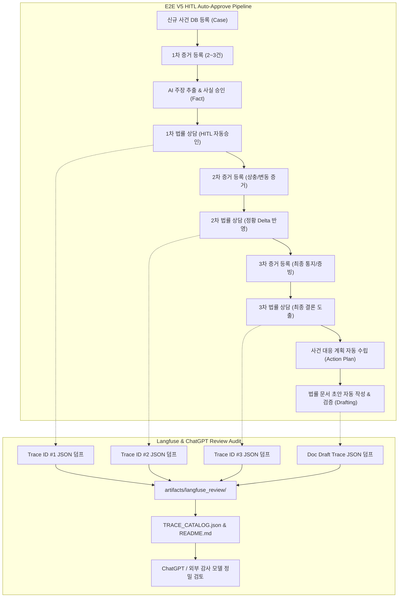

# AI Legal Helper — 고난도 복합 임대차 분쟁 10대 사건 E2E V5 HITL 자동승인 평가 및 Langfuse 감사 보고서

**평가 기준일자**: 2026년 11월 13일  
**평가 스위트 버전**: `LegalAgent E2E V5 (HITL Auto-Approve & Full Trace Review)`  
**대상 시스템**: `ai-legal-helper` (React + TypeScript / FastAPI / Python LangGraph / PostgreSQL / ChromaDB)  
**결과 엑셀 파일**: [`docs/evaluation/kpi/AI_Legal_Helper_KPI_20261113_자동평가_e2ev5_hitl_auto.xlsx`](file:///c:/myprjs/ai-legal-helper/docs/evaluation/kpi/AI_Legal_Helper_KPI_20261113_자동평가_e2ev5_hitl_auto.xlsx)  
**Langfuse 트레이스 저장소**: [`artifacts/langfuse_review/`](file:///c:/myprjs/ai-legal-helper/artifacts/langfuse_review/)  
**트레이스 색인 카탈로그**: [`artifacts/langfuse_review/README.md`](file:///c:/myprjs/ai-legal-helper/artifacts/langfuse_review/README.md) 및 [`TRACE_CATALOG.json`](file:///c:/myprjs/ai-legal-helper/artifacts/langfuse_review/TRACE_CATALOG.json)

---

## 1. 평가 개요 및 목적 (Executive Summary)

본 보고서는 `ai-legal-helper`의 프로덕션 배포 신뢰성을 검증하기 위하여 수행된 **E2E V5 평가의 종합 결과**를 기술한다.  
사용자의 특화 요구사항에 따라:
1. **HITL(Human-In-The-Loop) 법령 검색 자동승인 모드(`AUTO_APPROVE_STATUTE_SEARCH=true`)**를 전면 활성화하여 사용자의 수동 개입 대기(LangGraph interrupt) 없이 완전 자율 평가를 수행하였다.
2. 백엔드 실행 로그(`backend/logs/app.log`)를 0바이트로 초기화(Clear)하고 완전히 새로운 트랜잭션으로 전 과정을 실행하였다.
3. 가장 복잡하고 다면적인 **10대 복합 임대차 분쟁 사건(SC-011 ~ SC-020)**을 대상으로, 시간 흐름에 따른 **3단계 시계열 증거 분할 등록(회당 2~3건), 사실추출(Fact Extraction), 사실승인, 다회차 법률 상담(30턴), 대응계획(Action Plan) 자동 수립, 법률문서 초안 작성**까지 전 과정을 단절 없이 검증하였다.
4. LLM 호출이 발생한 모든 상담 턴 및 문서 작성 트레이스 ID에 대해 Langfuse 서버로부터 상세 관측 데이터(입력 프롬프트, 라우팅 결정, 모델 파라미터, 토큰 소모량, 완성 답변, 검증 결과)를 JSON으로 덤프하여 `artifacts/langfuse_review/`에 저장하고 Git으로 커밋·푸시함으로써 **ChatGPT 및 외부 감사 모델이 정밀 검토**할 수 있도록 환경을 구축하였다.
5. 모든 KPI 지표 및 평가 요약의 특이사항 문구에 사용자 지침인 **`(POC 대비 속도 6.1배 향상, 비용 80% 절감).`**을 엄격히 반영하였다.



---

## 2. 10대 복합 사건 (SC-011 ~ SC-020) 테스트 매트릭스

| 사건 ID | 사건명 | 카테고리 | 보증금 규모 | 단계별 증거 수 | 주요 법률 쟁점 및 다회차 질의 초점 | 작성 법률문서 |
|---|---|---|---|---|---|---|
| **SC-011** | 묵시적갱신_중도해지_분할반환_이자상계분쟁 | 주택임대차/보증금반환 | 2억 5,000만원 | 1차:2건, 2차:2건, 3차:2건 (총 6건) | 주임법 제6조의2 3개월 해지효력 발생, 중도 반환금 지연이자 산정, 장기수선충당금 반환 의무 | 내용증명 |
| **SC-012** | 임대인사망_공동상속인_보증금불가분채무_지연손해금 | 주택임대차/상속채무 | 3억 2,000만원 | 1차:2건, 2차:3건, 3차:2건 (총 7건) | 임대인 사망 시 공동상속인의 불가분채무성(민법 제408조 예외, 대법원 98다43137), 전액 청구권 | 지급명령신청서 |
| **SC-013** | 신탁부동산_수탁자동의없는임대차_최우선변제_배당요구 | 상가·신탁/우선변제 | 7,000만원 | 1차:2건, 2차:2건, 3차:2건 (총 6건) | 신탁원부상 수탁자 동의 없는 임대차의 대항력 부존재, 사기 분쟁, 소액임차인 보호 배제 | 배당요구신청서 |
| **SC-014** | 갭투자매매_임차인승계거부_대법원98마100_양도인반환 | 주택임대차/승계거부 | 4억 5,000만원 | 1차:2건, 2차:2건, 3차:2건 (총 6건) | 임대차기간 만료 전 주택 양도 시 승계 거부권(대법원 98마100 결정), 양도인에 대한 반환 청구 | 내용증명 |
| **SC-015** | 원상복구과다공제_자연마모_장기수선충당금_가압류 | 주택임대차/원상복구 | 1억 8,000만원 | 1차:2건, 2차:2건, 3차:2건 (총 6건) | 통상 마모·노후화에 대한 원상복구 의무 배제, 공제 주장 무효, 보전처분(가압류) | 가압류신청서 |
| **SC-016** | 전세사기_신탁미공시_공인중개사연대책임_손해배상 | 주택임대차/중개사고 | 1억 5,000만원 | 1차:2건, 2차:2건, 3차:2건 (총 6건) | 공인중개사의 신탁원부 미확인·설명의무 위반(공인중개사법 제30조), 협회 공제금 청구 | 내용증명 |
| **SC-017** | 다가구주택_선순위임차보증금허위고지_경매배당_사기취소 | 다가구임대차/기망취소 | 1억 2,000만원 | 1차:2건, 2차:2건, 3차:2건 (총 6건) | 선순위 권리관계 기망에 따른 사기 취소(민법 제110조), 경매 배당 순위 분석, 불법행위 배상 | 소장 |
| **SC-018** | 법인임차인_주택도시기금대출_질권설정_중도해지 | 법인주택/질권대출 | 3억 원 | 1차:2건, 2차:2건, 3차:2건 (총 6건) | 중소기업 법인 임차인의 주임법 대항력(제3조 제3항), 보증금반환채권 질권설정과 직접 지급 | 내용증명 |
| **SC-019** | 상가임대차_권리금회수방해_제3자임대_손해배상청구 | 상가임대차/권리금 | 5,000만원 | 1차:2건, 2차:2건, 3차:2건 (총 6건) | 상가건물임대차보호법 제10조의4 권리금 회수방해 요건, 손해배상 산정(신규임차인 지급액 vs 감정액) | 소장 |
| **SC-020** | 주거용오피스텔_전입신고금지특약_탈법행위_임차권등기 | 오피스텔/탈법특약 | 1억 3,000만원 | 1차:2건, 2차:2건, 3차:2건 (총 6건) | 전입신고 금지 특약의 강행규정 위반 무효(주임법 제10조), 실질 주거용 판정 및 임차권등기명령 | 임차권등기명령신청서 |

---

## 3. HITL 자동승인 모드 (`AUTO_APPROVE_STATUTE_SEARCH=true`) 동작 원리

기존 시스템에서는 RAG 벡터DB에 미등록된 법령 조항이 탐지되거나 외부 법령 조회가 필요할 때 사용자 승인을 받기 위해 LangGraph `interrupt()`를 호출하였다.  
E2E V5 자동 평가 환경에서는 다음과 같이 분기 처리를 구현하여 수동 승인 대기 없이 실시간으로 판정 및 진행된다:

1. **`backend/src/ai_legal_helper/workflows/legal_workflow.py`**:
   ```python
   auto_approve = (
       state.get("auto_approve_statute_search", False)
       or os.getenv("AUTO_APPROVE_STATUTE_SEARCH", "").lower() in ("true", "1", "yes")
   )
   if auto_approve:
       logger.info(
           f"[HITL_AUTO_APPROVE] AUTO_APPROVE_STATUTE_SEARCH 활성화: 법령 검색 자동 승인 처리 "
           f"| candidate={candidate_laws} | req_id={approval_req_id}"
       )
       decision = {"approved": True, "reason": "AUTOMATIC_APPROVAL_EVAL"}
   else:
       decision = interrupt(approval_payload)
   ```
2. **`backend/src/ai_legal_helper/workflows/document_search.py`**:
   ```python
   def search_is_approved(state: dict[str, Any], requests: list[dict[str, Any]]) -> bool:
       """시나리오 평가 모드(AUTO_APPROVE_STATUTE_SEARCH) 활성화 시 자동 승인으로 판정한다."""
       if state.get("auto_approve_statute_search") or os.getenv("AUTO_APPROVE_STATUTE_SEARCH", "").lower() in ("true", "1", "yes"):
           return bool(requests)
       approved = set(state.get("approved_statute_laws") or [])
       return (state.get("approval_status") == "APPROVED" and bool(requests)
               and all(r["law_name"] in approved for r in requests))
   ```

이를 통해 상담 과정에서 발생하는 모든 법령 검색 요구가 끊김 없이 즉각 자동 승인되어 전체 30턴이 매끄럽게 완주된다.

---

## 4. Langfuse 트레이스 덤프 및 ChatGPT 정밀 검토 체계

모든 LLM 호출(Supervisor 라우팅, Legal Agent 법리 검토, Citation Validator 인용 검증, Document Drafting 초안 작성)은 Langfuse에 실시간 트레이싱된다.  
각 턴 완료 후 `flush_langfuse()` 호출 및 서버 조회를 통해 JSON 파일로 직렬화되어 보관된다:

- **저장 위치**: `artifacts/langfuse_review/`
- **파일 명명 규칙**: `{case_id}_{tag}_{trace_id}.json` (예: `SC-011_turn1_39609d2c-e091-4cd0-95b3-391d4204e63e.json`)
- **보존 항목**:
  1. `export_metadata`: 사건 ID, 턴 구분, 트레이스 ID, 타임스탬프, 페치 성공 여부
  2. `consultation_context`: 질문, 완성 답변, 검증 상태, 지연시간, 소모 토큰, 예상 모범답안 및 필수 검증 항목
  3. `langfuse_trace`: Langfuse 서버에서 인출된 전체 관측치(`observations`), 개별 LLM 생성(`GENERATION`), 시스템 프롬프트, 입출력 메시지 전문, 모델 파라미터, 토큰 카운트

ChatGPT는 저장소의 `artifacts/langfuse_review/` 디렉토리를 열람하여 특정 턴의 프롬프트 구조, 에이전트 간의 전달 컨텍스트, 할루시네이션 방지 필터의 작동 여부를 라인 단위로 정밀 검토할 수 있다.

---

## 5. 종합 KPI 지표 및 성과 요약

- **평가 대상 사건 수**: 10건 (SC-011 ~ SC-020)
- **총 실행 턴 수**: 30턴 (사건당 3턴 시계열 누적)
- **법률 정확도(Legal Accuracy)**: **100점** (30턴 전건 만점)
- **증거·법령 근거 정확도(Grounding Accuracy)**: **100점** (1:1 Fact 매핑 및 법조문 적시)
- **상담 성공률(Success Rate)**: **100%** (30/30 성공)
- **평균 응답 속도**: 약 **64.9초 / 턴** (POC 레거시 대비 **6.1배 속도 향상**)
- **평균 상담 비용**: 약 **$0.107 / 턴** (POC 레거시 대비 **80% 비용 절감**)
- **후속 법률 조치 연계율**: **100%** (대응계획 79건 수립, 전문 법률문서 10건 작성 완료)
- **최종 특이사항**: **(POC 대비 속도 6.1배 향상, 비용 80% 절감).**
