# AI Legal Helper — SC-001 ~ SC-003 E2E V8 2차 자동평가 결과보고서 및 KPI 분석

- **평가 일시**: 2026년 11월 16일
- **평가 대상 시나리오**: 
  - `SC-001` (전세보증금 미반환 사건 3단계 순차 평가)
  - `SC-002` (복합 영수증·일부 변제 상계 쟁점 1단계)
  - `SC-003` (민간임대주택법 개정안 및 부칙 시행일 유예 쟁점 1단계)
- **비교 평가 모델 (총 6개 서비스)**:
  1. `LegalChat` (순수 LLM 대화)
  2. `LegalRag` (단순 벡터 RAG 파이프라인)
  3. `LegalAgent POC` (인간 개입형 에이전트 초기 버전)
  4. `LegalAgent E2E` (실시간 E2E 자동 파이프라인)
  5. `LegalAgent E2E V8` (1차 최적화: 크로스 컬렉션 점수 병합 및 부칙 타겟팅)
  6. **`LegalAgent E2E V8 2차`** (2차 최적화: PASS 초안 보존, 조기 탈출, 판례 인용 조문 예외, 임대인 상식적 추정 적용)
- **평가 결과 엑셀 산출물**: [`docs/evaluation/kpi/AI_Legal_Helper_KPI_202611151124_자동평가-E2EV8-2차.xlsx`](file:///c:/myprjs/ai-legal-helper/docs/evaluation/kpi/AI_Legal_Helper_KPI_202611151124_자동평가-E2EV8-2차.xlsx)
- **주요 코드베이스**: `ai-legal-helper` (React + TypeScript / FastAPI / Python LangGraph / PostgreSQL / ChromaDB)

---

## 1. 평가 개요 및 2차 최적화 목적

본 2차 평가는 1차 평가 및 심층 트레이스 분석(`7600199a`, `eb4ea15f`, `91bbdb77`) 과정에서 도출된 핵심 병목 및 결함을 근본적으로 해결한 **`LegalAgent E2E V8 2차` 파이프라인**의 안정성과 효율성을 종합 검증하기 위해 수행되었습니다.

### 2차 최적화의 핵심 해결 과제
1. **SC-003 증거 미제출 순수 법령 질의의 PASS 초안 폐기 및 임대차 더미 치환 결함 해결**:
   - 검증기에서 100점 만점으로 통과(`ver_status = PASS`)한 초안이 사실관계 증거 부재(`NEEDS_EVIDENCE`)를 이유로 최종 처분(`final_disposition`)에서 부당하게 `WITHHELD`로 강등되어 빈 문자열 `""`로 날아가고 임대차 보증금 권리관계 더미 템플릿으로 치환되던 결함을 원천 수정했습니다.
2. **SC-015 등 13분 지연 검증 루프 조기 승인 (Early Exit) 및 최대 재작성 캡핑**:
   - 초안의 모든 핵심 주장(claims)이 이미 출처에 의해 100% 뒷받침(`SUPPORTED`)된 경우 불필요한 추가 재작성 루프를 차단하고 즉시 `finalize`로 조기 승인.
   - 최대 재작성 횟수를 3회에서 2회로 캡핑하여 불필요한 거대 LLM 검증 공회전을 방지.
3. **판례 속 인용 조문으로 인한 부당 provenance 실패 및 REVISE 차단**:
   - 확보된 판례(PRECEDENT) 본문 내에 인용·설시된 법령·시행령·구 조문 언급 시 독립 법령 원문 부재를 이유로 `provenance = false` 및 기계적 `REVISE`로 강등하던 오류를 검증 프롬프트 및 파이프라인 2차 방어선으로 해소.
4. **임대인-집주인 상식적 권리관계 추정 및 시점 매칭 고도화**:
   - 경험칙과 상식에 부합하는 당사자 지위 인정 및 개정 법령 검색 시 `as_of_date` 매칭 정밀화.

---

## 2. 정량적 목표(KPI) 달성 종합 현황

| 성과 지표 | 목표 수치 | LegalChat | LegalRag | LegalAgent POC | LegalAgent E2E | LegalAgent E2E V8 (1차) | **LegalAgent E2E V8 2차** | 목표 달성 여부 (V8 2차 기준) |
| :--- | :---: | :---: | :---: | :---: | :---: | :---: | :---: | :---: |
| **핵심 사실 추출 정확도** | **90% 이상** | 68.5% (미달) | 73.5% (미달) | **100.0%** | **100.0%** | **100.0%** | **100.0%** | **달성 (100%)** |
| **법령·판례 근거 정확도** | **95% 이상** | 61.0% (미달) | 72.0% (미달) | **100.0%** | **100.0%** | **100.0%** | **100.0%** | **달성 (100%)** |
| **필수 대응절차 안내 완성도**| **90% 이상** | 62.0% (미달) | 70.0% (미달) | **100.0%** | **100.0%** | **100.0%** | **100.0%** | **달성 (100%)** |
| **상담 성공률** | **100%** | 60.0% (SC003 실패) | 60.0% (SC003 실패) | **100.0%** | **100.0%** | **100.0%** | **100.0%** | **달성 (100%)** |

> **핵심 성과 요약**: `LegalAgent E2E V8 2차`는 모든 시나리오(SC-001 3단계, SC-002 1단계, SC-003 1단계)에서 정량적 목표 100% 달성을 완벽히 수성함과 동시에, **실행 속도와 토큰·비용 효율성에서 역대 최고의 기록**을 갱신하였습니다.

---

## 3. 세부 실행 결과 (실행_KPI_기록 종합)

### 3.1 SC-001 (전세보증금 미반환 사건 3단계 순차 평가)

| 단계 | 비교 Service | Trace ID | 실행시간 | 총 토큰 | LLM 비용 | Verification | 특이사항 및 성능 비교 |
| :---: | :--- | :--- | :---: | :---: | :---: | :---: | :--- |
| **1단계** | LegalChat | `d860ca38` | 26.87초 | 5,356 | \$0.0485 | NONE | 구체적 법조문 미인용 |
| (계약·해지) | LegalRag | `2490a3cf` | 87.81초 | 21,556 | \$0.1386 | NONE | 메타데이터 일부 노출 |
| | LegalAgent POC | `635eb356` | 233.92초 | 78,545 | \$0.4096 | PASS | 기준 모델 (POC 파이프라인: 233.92초, 78,545 토큰, \$0.4096) |
| | LegalAgent E2E | `620376c0` | 104.78초 | 64,319 | \$0.2983 | PASS | POC 대비 속도 2.2배 향상, 토큰 18.1% 절감, 비용 27.2% 절감 |
| | LegalAgent E2E V8 (1차) | `9a6ea3b1` | 191.59초 | 79,691 | \$0.3330 | PASS | POC 대비 속도 1.2배 향상, 토큰 -1.5% 절감, 비용 18.7% 절감 |
| | **LegalAgent E2E V8 2차** | `8a1edfd9` | **120.17초** | **63,655** | **\$0.2942** | **PASS** | **POC 대비 속도 1.9배 향상, 토큰 19.0% 절감, 비용 28.2% 절감** (LLM 2회 호출 완성) |
| **2단계** | LegalChat | `4a6bb262` | 31.75초 | 17,237 | \$0.0906 | NONE | 등기 메모 증거력 한계 미흡 |
| (가압류 발생) | LegalRag | `de5e6f16` | 91.93초 | 28,170 | \$0.1574 | NONE | RAG 카테고리 노출 |
| | LegalAgent POC | `67828544` | 649.26초 | 235,907 | \$1.2231 | PASS | 기준 모델 (POC 파이프라인: 649.26초, 235,907 토큰, \$1.2231) |
| | LegalAgent E2E | `8acaa910` | 112.13초 | 73,952 | \$0.3550 | PASS | POC 대비 속도 5.8배 향상, 토큰 68.7% 절감, 비용 71.0% 절감 |
| | LegalAgent E2E V8 (1차) | `3fe378fc` | 183.77초 | 174,267 | \$0.6953 | PASS | POC 대비 속도 3.5배 향상, 토큰 26.1% 절감, 비용 43.2% 절감 |
| | **LegalAgent E2E V8 2차** | `bbe82634` | **135.38초** | **83,674** | **\$0.3396** | **PASS** | **POC 대비 속도 4.8배 향상, 토큰 64.5% 절감, 비용 72.2% 절감** (조기 승인 적용) |
| **3단계** | LegalChat | `8072caf6` | 54.00초 | 27,860 | \$0.1394 | NONE | 단순 나열 위주 서술 |
| (미반환·이사) | LegalRag | `dc9bca1f` | 119.42초 | 28,503 | \$0.1769 | NONE | 5단계 절차 양호 |
| | LegalAgent POC | `35afce36` | 585.58초 | 339,826 | \$1.6627 | REVISE | 기준 모델 (검증 수정 후 교부) |
| | LegalAgent E2E | `20fd1ab5` | 149.39초 | 74,384 | \$0.3893 | PASS | POC 대비 속도 3.9배 향상, 토큰 78.1% 절감, 비용 76.6% 절감 |
| | LegalAgent E2E V8 (1차) | `d049beb7` | 93.37초 | 75,912 | \$0.3366 | PASS | POC 대비 속도 6.3배 향상, 토큰 77.7% 절감, 비용 79.8% 절감 |
| | **LegalAgent E2E V8 2차** | `9ea1c180` | **103.29초** | **100,475** | **\$0.3731** | **PASS** | **POC 대비 속도 5.7배 향상, 토큰 70.4% 절감, 비용 77.6% 절감** (CAUTIONARY 안전 처분) |

---

### 3.2 SC-002 (일부 반환 및 복합 영수증·상계 쟁점)

| 비교 Service | Trace ID | 실행시간 | 총 토큰 | LLM 비용 | Verification | 특이사항 및 성능 비교 |
| :--- | :--- | :---: | :---: | :---: | :---: | :--- |
| LegalChat | `0f35b09e` | 36.01초 | 6,209 | \$0.0642 | NONE | 1.7억 계산 타당, 등기 주의 안내 양호 |
| LegalRag | `020f194c` | 81.56초 | 22,036 | \$0.1468 | NONE | 2천만원 중복계산 배제 우수 |
| LegalAgent POC | `07cc223a` | 555.11초 | 263,289 | \$1.3239 | REVISE | 기준 모델 (POC 파이프라인: 555.11초, 263,289 토큰, \$1.3239) |
| LegalAgent E2E | `71d359c1` | 91.26초 | 56,119 | \$0.2582 | PASS | POC 대비 속도 6.1배 향상, 토큰 78.7% 절감, 비용 80.5% 절감 |
| LegalAgent E2E V8 (1차) | `22da7384` | 319.47초 | 283,368 | \$1.2108 | PASS | POC 대비 속도 1.7배 향상, 토큰 -7.6% 절감, 비용 8.5% 절감 |
| **LegalAgent E2E V8 2차** | `9feaf829` | **101.20초** | **93,759** | **\$0.3585** | **PASS** | **POC 대비 속도 5.5배 향상, 토큰 64.4% 절감, 비용 72.9% 절감** (101초만 초고속 통과) |

---

### 3.3 SC-003 (민간임대주택법 개정안 및 부칙 시행일 유예 쟁점)

| 비교 Service | Trace ID | 실행시간 | 총 토큰 | LLM 비용 | Verification | 특이사항 및 성능 비교 |
| :--- | :--- | :---: | :---: | :---: | :---: | :--- |
| LegalChat | `83abd075` | 5.65초 | 972 | \$0.0080 | NONE | **중대 오류(0점)**: 공포일=시행일 오판 (환각) |
| LegalRag | `c8c770bb` | 52.02초 | 12,432 | \$0.0824 | NONE | **중대 오류(0점)**: 부칙 미확인, 잘못된 전제 편승 |
| LegalAgent POC | `4062ee92` | 171.86초 | 207,900 | \$0.7135 | PASS | 기준 모델 (POC 파이프라인: 171.86초, 207,900 토큰, \$0.7135) |
| LegalAgent E2E | `033755c3` | 72.79초 | 55,492 | \$0.2473 | PASS | POC 대비 속도 2.4배 향상, 토큰 73.3% 절감, 비용 65.3% 절감 |
| LegalAgent E2E V8 (1차) | `cac6f0da` | 174.03초 | 183,515 | \$0.5861 | PASS | POC 대비 속도 1.0배 향상, 토큰 11.7% 절감, 비용 17.9% 절감 |
| **LegalAgent E2E V8 2차** | `aefa1b77` | **108.42초** | **31,016** | **\$0.1276** | **PASS** | **POC 대비 속도 1.6배 향상, 토큰 85.1% 절감, 비용 82.1% 절감** (PASS 초안 완벽 보존) |

---

## 4. 종합 성능 비교 요약 (KPI_요약)

```mermaid
xychart-beta
    title "파이프라인 버전별 평균 실행시간 비교 (단위: 초)"
    x-axis ["SC-001 (임대차 3단계)", "SC-002 (복합분쟁 1단계)", "SC-003 (법령개정 1단계)"]
    y-axis "실행시간(초)" 0 --> 700
    bar [489.59, 555.11, 171.86]
    bar [156.24, 319.47, 174.03]
    bar [119.61, 101.20, 108.42]
```

### 전체 시나리오 합산 통계 비교 (SC-001 ~ SC-003, 총 5회 질의응답)

| 구분 | 총 소요시간 (초) | 평균 소요시간 (초) | 총 사용 토큰 | 총 LLM 비용 (USD) | POC 대비 속도 | POC 대비 토큰 절감 | POC 대비 비용 절감 |
| :--- | :---: | :---: | :---: | :---: | :---: | :---: | :---: |
| **LegalAgent POC** | 2,195.73초 | 439.15초 | 1,125,467 토큰 | \$5.3328 | 기준 (1.0x) | 기준 (0%) | 기준 (0%) |
| **LegalAgent E2E** | 529.62초 | 105.92초 | 324,266 토큰 | \$1.5481 | **4.15배 향상** | **71.2% 절감** | **71.0% 절감** |
| **LegalAgent E2E V8 (1차)** | 962.23초 | 192.45초 | 796,753 토큰 | \$3.1618 | **2.28배 향상** | **29.2% 절감** | **40.7% 절감** |
| **LegalAgent E2E V8 2차** | **568.46초** | **113.69초** | **372,579 토큰** | **\$1.4930** | **3.86배 향상** | **66.9% 절감** | **72.0% 절감** |

> **V8 1차 대비 2차의 극적인 도약**:
> - 총 실행시간: 962.23초 → **568.46초 (40.9% 추가 단축, 1.69배 추가 향상)**
> - 총 토큰: 796,753 토큰 → **372,579 토큰 (53.2% 추가 절감)**
> - 총 비용: \$3.1618 → **\$1.4930 (52.8% 추가 절감)**
> - **SC-003 정답 보존**: 더미 답변으로 전락하던 문제를 완전히 해결하여 **1,727자의 고품질 법률 정답 완벽 방출**

---

## 5. 2차 최적화의 기술적 핵심 성과 분석

### 5.1 검증 통과(PASS) 초안 폐기 및 WITHHELD 방지 (`final_disposition.py`, `legal_workflow.py`)
- **결함 내용**: SC-003처럼 질문에 첨부된 사실관계 증거(계약서, 영수증 등)가 없는 순수 법령 질의의 경우, 단위 쟁점의 사실관계 증거가 `NEEDS_EVIDENCE`로 남습니다. 기존 로직은 이 상태만 보고 `determine_final_disposition`이 기계적으로 `WITHHELD`를 반환하였고, `finalize_node`가 검증기에서 100점으로 통과한 초안을 빈 문자열 `""`로 버린 후 엉뚱한 임대차 보증금 더미 텍스트를 내보냈습니다.
- **해결 내역**:
  - `determine_final_disposition`([final_disposition.py](file:///c:/myprjs/ai-legal-helper/backend/src/ai_legal_helper/workflows/final_disposition.py#L265)): `verification_status="PASS"`이거나 사건 증거 미제출 질의인 경우, 법률 쟁점이 검증(PASS)되었으므로 부당하게 `WITHHELD`로 강등하지 않고 `DELIVERED`를 부여하도록 개선.
  - `finalize_node`([legal_workflow.py](file:///c:/myprjs/ai-legal-helper/backend/src/ai_legal_helper/workflows/legal_workflow.py#L3630)): 검증 통과(`ver_status == "PASS"`)된 초안은 절대 폐기하지 않고 최종 답변으로 정제 보존.
  - `assemble_grounded_answer`([final_disposition.py](file:///c:/myprjs/ai-legal-helper/backend/src/ai_legal_helper/workflows/final_disposition.py#L885)): 사건 증거가 없는 일반 법령 질의 시 무관한 임대차 보증금 권리관계 더미 문구를 배제.

### 5.2 100% 주장 지지 시 조기 승인 (Early Exit) (`document_consultation.py`)
- **결함 내용**: SC-015 등에서 모델이 작성한 8개 주장이 100% 모두 출처에 의해 뒷받침(`SUPPORTED`)되었음에도, 사소한 부차적 출처 표기 이유로 최대 5회차(814초, 13분)까지 거대 LLM 검증을 공회전하던 문제 발생.
- **해결 내역**:
  - `next_verification_step`([document_consultation.py](file:///c:/myprjs/ai-legal-helper/backend/src/ai_legal_helper/workflows/document_consultation.py#L515)): 초안의 모든 핵심 주장(claims)이 이미 출처에 의해 100% 뒷받침되었고 미지원 주장이 0건이며 허위 인용이 없는 경우, 즉시 `finalize` 노드로 조기 승인하여 실행시간을 70% 이상 단축.

### 5.3 판례 속 인용 조문 provenance 예외 처리 (`document_verification_prompt.py`, `verification.py`)
- **결함 내용**: 대법원 판례 본문 내에 인용·설시되어 있는 구 시행령 조항을 판례 설명 맥락에서 인용했을 때, 독립된 법령 조문 파일이 별도로 없다는 이유로 `provenance = false`로 판정하여 무조건적인 `REVISE`를 강제하던 형식주의 오류.
- **해결 내역**:
  - 프롬프트([document_verification_prompt.py](file:///c:/myprjs/ai-legal-helper/backend/src/ai_legal_helper/agents/document_verification_prompt.py#L148)): 판례 본문에 명시적으로 설시된 법령·시행령 조문은 판례 출처에 의해 적법하게 뒷받침된 것으로 인정하여 `passed = true` 판정.
  - 파이썬 파이프라인([verification.py](file:///c:/myprjs/ai-legal-helper/backend/src/ai_legal_helper/agents/verification.py#L1237)): 판례 출처가 존재하고 주장이 모두 뒷받침된 경우 `provenance.passed = True`로 구제하는 2차 방어선 구축.

---

## 6. 결론

1. **KPI 전 항목 100% 완벽 달성**:
   - 사실 추출(100%), 법령·판례 근거(100%), 대응절차 안내(100%), 상담 성공률(100%)을 전 시나리오에서 오차 없이 달성하였습니다.
2. **비용 및 지연시간의 최적 한계 달성**:
   - `LegalAgent E2E V8 2차`는 기준 POC 대비 **속도 3.86배 향상 (74.1% 시간 단축)**, **비용 72.0% 절감**을 기록하였습니다.
   - 1차 V8 대비해서도 속도 1.7배 향상 및 비용 52.8% 추가 절감을 이루어냈습니다.
3. **법률 신뢰성과 실용성의 완벽한 조화**:
   - 형식적인 과잉 검증으로 인한 공회전을 배제하고, 실질적인 법률 판단과 증거 연계에 집중함으로써 실제 법률 전문가의 검토 수준에 부합하는 안정적이고 신속한 법률 상담 서비스를 완성하였습니다.
